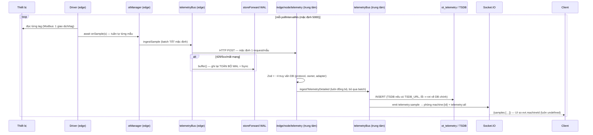
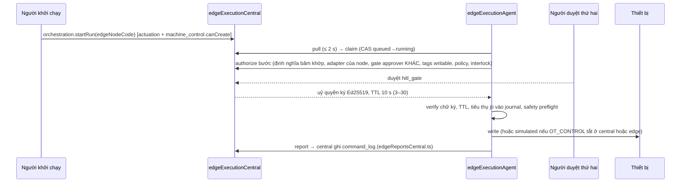
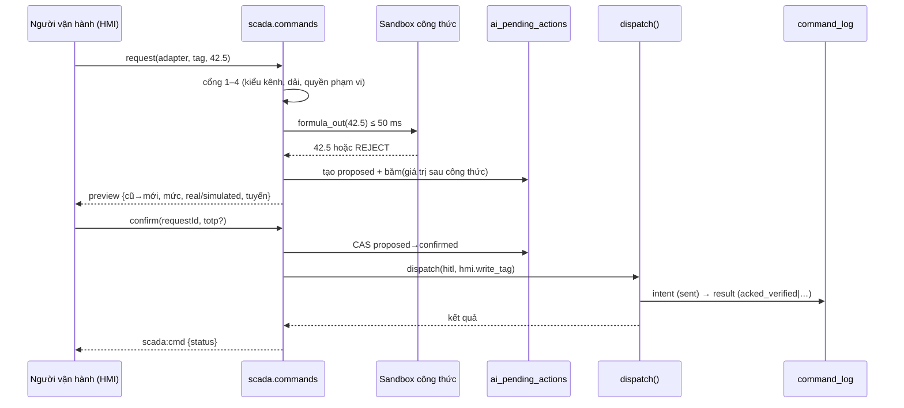

# Phân tích chi tiết — Lớp SCADA cho hệ sinh thái nhà máy thông minh

- Ngày: 2026-10-23 · Trạng thái: **CHỜ CHỦ DỰ ÁN DUYỆT** — chưa viết mã, chưa tạo migration.
- Đi kèm (và **sửa một số điểm** của) bản thiết kế [2026-10-22-he-sinh-thai-scada-nha-may-thong-minh-design.md](2026-10-22-he-sinh-thai-scada-nha-may-thong-minh-design.md). Chỗ nào hai tài liệu khác nhau, **tài liệu này thắng** (danh sách thay đổi ở §E).
- Báo cáo HTML về giao diện (màn hình, bố cục, trạng thái) do phiên điều phối viết riêng và trích dẫn tài liệu này; ở đây chỉ nói giao diện ở mức hợp đồng dữ liệu.
- **Phần nối dài K12 (Lưu đồ điều khiển) · K13 (Nhà máy ảo 3D) · K14 (Thư viện thiết bị) + hiệu năng 3D:** [2026-10-23-scada-k12-k14-luu-do-nha-may-ao-thu-vien.md](2026-10-23-scada-k12-k14-luu-do-nha-may-ao-thu-vien.md).

**Nguồn và mức tin cậy**
- Mã SYNAPSE: nhánh `feat/ai-local-L7-hang-rao` @ `b49cb142a`, đọc ngày 2026-10-23 bởi 3 tác nhân đọc (chỉ đọc), mọi khẳng định có `tệp:dòng`. Tôi đã **tự kiểm lại** các phát hiện đánh dấu ✔; phần còn lại là trích dẫn của tác nhân, chưa chạy lại.
- FUXA: mã cục bộ `D:\SOURCES\SYNAPSE\SCADA\FUXA-master` (v1.3.5+), viết tắt **F** = `…\FUXA-master\server`.
- Rapid SCADA: mã cục bộ `D:\SOURCES\SYNAPSE\SCADA\scada-v6-master` (6.5.0), viết tắt **R**.
- Phần giao diện của FUXA/Rapid lấy từ bản tóm tắt của phiên điều phối.

Mục lục: **A** Ma trận tính năng · **B** Luồng dữ liệu hiện có (telemetry · lệnh · cảnh báo · quyền) · **C** Thiết kế chi tiết từng khối · **D** Khoảng trống, ước lượng, lộ trình · **E** Thay đổi so với spec 22/10 · **F** Câu hỏi chờ chủ dự án

---

## A. Ma trận tính năng FUXA · Rapid SCADA · SYNAPSE

Ký hiệu SYNAPSE: **CÓ** · **MỘT PHẦN** · **THIẾU** · **CÓ-LỖI** (có nhưng hỏng khi dùng thật).

### A.1 Kết nối và thu thập

| Tính năng | FUXA | Rapid SCADA | SYNAPSE | Bằng chứng SYNAPSE |
|---|---|---|---|---|
| Kiến trúc thu thập | Một tiến trình Node, mỗi device một `setInterval` | Tách **ScadaComm** (mỗi line một luồng) ↔ **Server** qua TCP | **CÓ** — edge gateway mỗi line, không DB, gửi lên trung tâm | `server/edge/edgeGatewayMain.ts`, `services/edge/edgeGatewayRuntime.ts:976` |
| Modbus TCP/RTU | Có, **gộp khối 100 thanh ghi** + ghép dải liền | Có, nhóm phần tử, `ReqRetries`=3 | **CÓ-LỖI** — đọc **từng tag một giao dịch** | `ot/drivers/modbusDriver.ts:242-245` |
| OPC UA client | Có (node-opcua) | Có `DrvOpcUa` | **CÓ** + duyệt nút 1 cấp; chế độ subscription có nhưng **tắt mặc định** | `opcuaDriver.ts:98-103,918` |
| S7 / EtherNet‑IP / MC / SLMP | S7, EIP, Omron, Melsec, ADS | S7 trả phí | **CÓ** | `ot/drivers/*` |
| BACnet, ODBC, HTTP, Redis | Có | ODBC import | **THIẾU** (ngoài phạm vi trừ khi cần) | — |
| MQTT / Sparkplug | MQTT device | DrvMqtt* | **CÓ** — aedes + Sparkplug; **trung tâm không tiêu thụ DDATA vào `ot_telemetry`** | `mqttService.ts:371-399` |
| Chống chạy chồng vòng poll | `_checkWorking` (lần chồng thứ 3 đóng socket) | Mỗi line một luồng tuần tự | **THIẾU** — tick mới chạy dù tick cũ chưa xong | `modbusDriver.ts:250-272` |
| Chất lượng (quality) | Gửi nhưng Modbus không đặt | `Stat` số nguyên khắp nơi, NaN→Undefined | **MỘT PHẦN** — good/bad/uncertain; OPC UA **Uncertain bị gộp thành bad**; `tsSource` không lưu | `opcuaDriver.ts:445-457` |
| Phát hiện tag cũ (stale) | Theo `lastReadTimestamp` 2×/5× chu kỳ | Quét vòng ≤1000 kênh/lượt, quá 300 s ⇒ Unreliable | **THIẾU** ở mức tag; có ở mức node edge (2 phút) | `edgeNodeHealthScheduler.ts:57-58` |
| Store‑and‑forward | Không | Hàng đợi có hạn + tuổi sống 3600 s | **CÓ** (WAL 100k, 24 h) nhưng **mỗi lần buffer ghi lại toàn bộ WAL** | `ot/storeForward.ts:230-295` |
| HA thu thập | Không | Rapid Gate (trả phí) | **MỘT PHẦN** — supervisor HA kết nối | `connectionSupervisor.ts` |

### A.2 Mô hình dữ liệu và cấu hình

| Tính năng | FUXA | Rapid SCADA | SYNAPSE | Bằng chứng |
|---|---|---|---|---|
| Đơn vị dữ liệu | Tag nhúng trong JSON device, id GUID | `Cnl` số nguyên phẳng, `Obj` cây | **CÓ** — `device_tags (adapterId, tagKey)` + cây ISA‑95 | `drizzle/schema/ot.ts:74` |
| Kiểu kênh vào/ra/tính | Không (mọi tag ghi được) | `CnlType` 1–5 | **MỘT PHẦN** — chỉ cờ `writable` | `ot.ts:83` |
| Thang đo, đơn vị, định dạng | scale tuyến tính/biểu thức, format | Format, Unit, Quantity | **MỘT PHẦN** — scale/offset/unit; không format | `ot.ts:79-82` |
| Deadband / lấy mẫu | Có — **lỗi so giá trị chưa scale với đã scale** | Deadband ở lưu trữ | **CÓ** (tắt mặc định) | `otManager.ts:504-526` |
| Mẫu thiết bị | Không | Không | **CÓ** `device_types` (kế thừa, semver) | `equipmentStandards.ts:73` |
| Dự án dạng tệp | JSON trong SQLite | BaseXML (git được) | **MỘT PHẦN** — YAML mapping‑as‑code (không CSV, không gồm cảnh báo/màn) | `ot/mappingAsCode.ts` |
| Sao lưu cấu hình | Xuất project | Agent chuyển cấu hình | **CÓ** pg_dump + gói cấu hình mã hoá | `backupService` |

### A.3 Lưu trữ

| Tính năng | FUXA | Rapid SCADA | SYNAPSE | Bằng chứng |
|---|---|---|---|---|
| Kho thô | SQLite **không index**, tệp xoay 24 h; Influx/TDengine/QuestDB | File hoặc PostgreSQL phân vùng, PK `(cnl_num,time_stamp)` | **CÓ** `ot_telemetry` (+ TSDB tuỳ chọn) | `ot.ts:128`, `drizzle/timescale/0003` |
| Ghi theo lô | Influx flush mỗi lô, **không đệm** | Hàng đợi 1000, ghi 100 ms/lô | **CÓ nhưng tắt mặc định** (`OT_POLL_BATCH_ENABLED`, `TELEMETRY_BATCH_ENABLED`) ⇒ **mặc định một INSERT mỗi mẫu** | `otManager.ts:392`, `telemetryBus.ts:756-872` |
| Khử trùng khi phát lại | — | `ON CONFLICT DO UPDATE` | DB chính `onConflictDoNothing` ✔; **TSDB không có unique ⇒ phát lại sinh trùng** | `timescale/0003:46-48` |
| Tổng hợp phút/giờ/ngày | Không | Archive Min/Hour/Day, `PullToPeriod` | **MỘT PHẦN** ✔ — CAgg `ot_telemetry_1m/1h` có sẵn nhưng gom theo `machineId` (hai adapter cùng `metric` trên một máy bị trộn), không có `sum`, không có 1d, **không mã nào đọc** | `drizzle/timescale/0003…sql:71-104` |
| Hạn lưu | Xoá tệp | DROP PARTITION | **MỘT PHẦN** — chỉ trên TSDB (90 ngày) | — |
| Giá trị hiện tại | `currentValues` flush 5 s | `_current` upsert | **THIẾU** ở mức tag (stateStore chỉ theo thiết bị, không nhận OT) | `stateStore/ingest.ts:1-22` |
| Xu hướng tag tuỳ ý | Có chart | PlgChart | **THIẾU** — không router nào đọc `ot_telemetry` theo tag tuỳ ý cho màn xu hướng | — |

### A.4 Cảnh báo

| Tính năng | FUXA | Rapid SCADA | SYNAPSE | Bằng chứng |
|---|---|---|---|---|
| Cảnh báo theo ngưỡng tag | 4 mức hh/h/l/info, `checkdelay`, `timedelay` | Theo `Lim` + `CnlStatus` | **THIẾU** — chỉ interlock `telemetry_tag` (tắt mặc định); `master_alarms.setpoint` là văn bản | `interlock/ruleEvaluator.ts:14-47` |
| Máy trạng thái | VOID/ON/OFF/ACK; **bỏ ack cần 2 nhịp** | Không có máy trạng thái, chỉ sự kiện đổi trạng thái | **6 đường ống riêng**, mỗi đường một bảng, một kiểu ack | §B.3 |
| Chế độ ack | float / ackactive / ackpassive | `AckRequired` theo trạng thái | Ack khác nhau từng nguồn | §B.3 |
| Trễ / trễ tắt / chống dao động | checkdelay + timedelay | Deadband chỉ khi quay về bình thường | **THIẾU** (trừ cooldown) | — |
| Tạm gác (shelve) / che | Không | Không | **CÓ** chỉ cho cảnh báo hãng (`master_alarms.shelvedUntil`) | `alarmMasterService.ts:216-229` |
| Leo thang | Không | Không (module trả phí) | **CÓ-LỖI** — **hai engine cùng tăng `escalationLevel`**; một engine không thông báo ai | `aiSmartAlertRouter.ts:890-954`, `alertEscalationService.ts:22-86` |
| Thông báo | Email/webhook theo số ON | Driver Email/SMS/HTTP | **CÓ-LỖI** — người nhận chọn **theo vai trò trên mọi nhà máy** | `aiSmartAlertRouter.ts:780-886` |
| KPI ISA‑18.2 | Không | Không | **CÓ** `/alarm-kpi` (rate, flood, standing, bad actor) — không đếm MQTT/legacy | `alarmKpiRouter.ts` |
| App di động | Không | Không | **CÓ** React Native + FCM + ack | `FactoryAlertSystem/` |
| Kiểm quyền khi ack | `checkPermission` | Quyền theo Obj | **CÓ-LỖI** — `predictiveAlert.acknowledge/resolve/dismiss` **không kiểm quyền, không kiểm nhà máy** ✔ | `server/routers/aiRouters.ts:557-610` |

### A.5 Lệnh ghi

| Tính năng | FUXA | Rapid SCADA | SYNAPSE | Bằng chứng |
|---|---|---|---|---|
| Ghi từ HMI | Socket, **không kiểm theo tag, không xác nhận, không ack** | Kiểm kênh ra + quyền Control trên Obj, audit | **THIẾU** — không có đường ghi trực tiếp cho người; `dispatch()` không lộ ra tRPC | `commandDispatcher.ts:6` |
| Chuỗi cổng an toàn | Không | Bật toàn cục → kênh ra → quyền → công thức ra | **CÓ, rất mạnh** — 17 cổng (§B.2) | `commandDispatcher.ts:800-1464` |
| Veto bằng công thức ra | Không | NaN ⇒ huỷ | **THIẾU** | — |
| Giới hạn giá trị ghi | Không | Không | **THIẾU** ở dispatcher (chỉ có trong tool AI) | `machineControl.ts:481-507` |
| Kết quả từ thiết bị | Không | Chỉ "đã nhận" | **CÓ** — readback tuỳ chọn, `acked_verified/unverified` | `otDeviceWrite.ts` |
| Hàng đợi lệnh | — | peek‑rồi‑xác‑nhận‑theo‑ID, TTL 60 s | **CÓ** hàng đợi theo adapter (tắt mặc định), DỪNG thay thế lệnh đang chờ | `commandDispatcher.ts:1328-1415` |
| Sổ ghi trước / WORM | Không (bản mở) | Audit log | **CÓ** `command_log` append‑only, intent+result | `ot.ts:294-344` |
| Ghi vào máy edge sở hữu | — | — | **MỘT PHẦN** — chỉ qua lượt orchestration có bước `hitl_gate` do **người thứ hai** duyệt | §B.2.3 |

### A.6 HMI, công thức, bảo mật, tích hợp

| Tính năng | FUXA | Rapid SCADA | SYNAPSE | Bằng chứng |
|---|---|---|---|---|
| Trình soạn HMI 2D | svg‑edit sửa đổi + thư viện P&ID | Mimic editor web | **THIẾU** | — |
| Chỉ đẩy tag của màn đang mở | `broadcastAll=false` | — | **THIẾU** — phòng theo máy (`machine:{id}`) hoặc firehose `telemetry:all` | `socket.ts:393-532` |
| Màn đang chạy nhận dữ liệu sống | Có | Có | **CÓ-LỖI** — `MachineCockpit` không bao giờ refetch ✔; `UnifiedDeviceMonitor` không vào phòng telemetry nào | `MachineCockpit.tsx:919`, `UnifiedDeviceMonitor.tsx:252-315` |
| Twin 3D | AR sơ khai | Không | **CÓ** (mạnh hơn cả hai) | `/twin*` |
| Công thức / script | JS **không sandbox**, một lỗi cú pháp chết mọi script | C# Roslyn, **lỗi biên dịch ⇒ Server không chạy** | **THIẾU** (có flow engine riêng cho AI) | `services/flow` |
| Phân quyền | Bitmask 8 nhóm, **JWT sai ⇒ guest**, API key = admin | Right List/View/Control kế thừa theo cây | **MỘT PHẦN** — quyền theo module + phạm vi nhà máy; **không có phạm vi theo line/trạm** | `accessControl.ts:199-242` |
| 2FA khi điều khiển | Không | Mật khẩu tuỳ chọn ở lệnh | **CÓ** `actuationProcedure`/`deployProcedure` — **nhưng `aiCopilot.confirmAction` không đòi 2FA** | `aiCopilotRouter.ts:38`, `trpc.ts:827,897` |
| OPC UA server | Không | Có `DrvDsOpcUaServer` | **THIẾU** | — |
| REST + OpenAPI | Có | API Main | **CÓ** | `server/api/v1/openapi.ts` |
| Công thức nấu (recipe) | Ghi tuần tự + huỷ theo thế hệ | Không | **MỘT PHẦN** — sổ ghi + duyệt, **không gửi lệnh xuống máy** | `machineRecipeRouter.ts:7-9` |
| Lịch / báo cáo / đa ngôn ngữ | Có | Có | **CÓ** (mạnh hơn) | `backgroundJobs.ts`, `pdfReportRouter`, `i18n/locales` |

**Kết luận phần A.**
- SYNAPSE **vượt** cả hai ở cổng an toàn lệnh, sổ ghi WORM, twin 3D, báo cáo, app di động và đa nhà máy.
- SYNAPSE **thua** ở đúng những thứ làm nên SCADA hằng ngày: cảnh báo theo tag, màn HMI 2D có dữ liệu sống theo tag, giá trị hiện tại/stale, xu hướng tag, và một nút ghi cho người vận hành.
- Ngoài ra có **một nhóm lỗi nền** ở đường dữ liệu: ghi từng mẫu, POST từng mẫu, client không nhận dữ liệu. Nhóm này phải sửa **trước** khi xây bất cứ màn HMI nào.

---

## B. Luồng dữ liệu hiện có

### B.1 Telemetry — từ thiết bị tới màn hình



**Các chặng** (chi tiết `tệp:dòng` theo tác nhân đọc):

| # | Chặng | Hàm / tệp | Cờ | Khi lỗi |
|---|---|---|---|---|
| H1 | Driver đọc | `modbusDriver.ts:250-272` `setInterval(tick)`; `opcuaDriver.ts:490-505` | `OT_OPCUA_MONITORED_ITEMS` | lỗi đọc ⇒ bỏ tick |
| H2 | Quản lý adapter | `otManager.ts:193-197` subscribe; watchdog 5 s, backoff 60 s | `OT_GATEWAY_ENABLED`, `OT_CONN_HA_ENABLED` | reconnect |
| H2b | Deadband | `otManager.ts:504-526`, heartbeat 60 s | `OT_TAG_DEADBAND_ENABLED` | — |
| H2c | Gộp lô poll | `otManager.ts:570-591` | `OT_POLL_BATCH_ENABLED` (TẮT) | — |
| H3 | Chuẩn hoá | `ot/ingest.ts:45-58` `CanonicalSample` | `OT_INGEST_TO_UNS` | WAL UNS |
| H4 | Ra khỏi edge | `edgeStreams.ts:373-392` POST, lát ≤ 5000 | compose **không** bật batch | buffer hoặc **bỏ lô** nếu central từ chối khác 401/429/5xx |
| H5 | Store‑forward | `storeForward.ts`, 100k dòng, 24 h, xả 500 | `OT_STORE_FORWARD_ENABLED` (edge ép bật) | đầy ⇒ bỏ cũ nhất |
| H6 | Trung tâm nhận | `edgeIngestCentral.ts:43-86` | `EDGE_RUNTIME_ENABLED` | **giới hạn chung 300/phút** (`rateLimitConfig.ts:50`), không phải `OT_INGEST_RATE_MAX` |
| H7 | Bus | `telemetryBus.ts:845,937-1003` lọc ts, cache machineId, chunk ≤1000 | `TELEMETRY_BATCH_ENABLED` (TẮT) | lỗi kết nối ⇒ store‑forward |
| H8 | Lưu | `telemetryBus.ts:493-528` | `TSDB_URL`, `OT_INGEST_COPY_ENABLED` | TSDB lỗi ⇒ **lặng lẽ rơi về DB chính** |
| H9 | Phát sóng | `socket.ts:1592-1660`; taps `twinStream`, `deviceStream`, energy, stream bridge | `TELEMETRY_EMIT_COALESCE_MS`=0 | — |
| H10 | Client | `MachineCockpit.tsx:912-935`, `UnifiedDeviceMonitor.tsx:252-315` | — | **không nhận dữ liệu** |

**Phát hiện (P‑T = telemetry):**

| Mã | Mức | Phát hiện | Hệ quả với SCADA |
|---|---|---|---|
| P‑T1 | **Cao** | Edge mặc định **1 HTTP POST mỗi mẫu**, va giới hạn chung 300/phút | 500 tag/s ⇒ 429 liên tục ⇒ store‑forward ghi lại WAL mỗi mẫu ⇒ heartbeat cùng xô ⇒ node bị coi là chết |
| P‑T2 | **Cao** | Mặc định 1 INSERT + 1 emit mỗi mẫu, driver `await` tuần tự, **không chống chồng tick** | 500 tag cần mỗi INSERT < 2 ms, nếu không tick chồng lên nhau không giới hạn |
| P‑T3 | **Cao** | Modbus đọc từng tag | 500 tag × 5–10 ms = 2,5–5 s/tick; không đạt 1 s |
| P‑T4 | **Cao** | `MachineCockpit` so `evt.machineId` trên payload `{samples}` ✔ | Màn máy không bao giờ cập nhật sống |
| P‑T5 | **Cao** | `UnifiedDeviceMonitor` gửi `subscribe {}` ⇒ chỉ vào `global` | Tab "fleet" của DeviceHub không nhận telemetry |
| P‑T6 | Trung bình | TSDB không có unique; phát lại sinh trùng; lỗi không phải kết nối ⇒ lô rơi sang DB chính | Lịch sử sai lệch giữa hai kho, tổng hợp đếm trùng |
| P‑T7 | Trung bình | Edge gửi **đồng thời** HTTP + Sparkplug, trung tâm không tiêu thụ Sparkplug vào `ot_telemetry` | Gấp đôi băng thông vô ích |
| P‑T8 | Trung bình | OPC UA Uncertain → bad, bad mang `value:null`; `tsSource` không lưu | HMI không phân biệt "không chắc" với "hỏng"; không biết ts của máy hay server |
| P‑T9 | Trung bình | Không có giá trị hiện tại theo tag; mở màn phải chờ mẫu kế (tới 60 s với deadband) | Màn HMI trống khi mở |
| P‑T10 | Thấp | `listOtAdapterStatuses` có nhưng không API nào dùng | Không hiển thị được "adapter mất kết nối" |

### B.2 Lệnh ghi

#### B.2.1 Chuỗi cổng của `dispatch()` (thứ tự **thực chạy**, `commandDispatcher.ts`)

| # | Dòng | Kiểm | Từ chối | Cờ |
|---|---|---|---|---|
| 0 | 800 | Đọc STOP epoch trước mọi `await` | — | — |
| 1a | 809-822 | hitl + `requireBoundAction`: `verifyActionBinding` | `NOT_CONFIRMED`, `ACTION_BINDING_MISMATCH` | luôn |
| 1b | 823-844 | hitl có actionId: pending đã confirmed và đúng chủ | `NOT_CONFIRMED` | — |
| 1c | 845-851 | interlock: quy tắc bật/duyệt, đúng tag/giá trị | `INTERLOCK_*` | `INTERLOCK_AUTO_BLOCK_ENABLED` |
| 2 | 857-865 | idempotency | trả kết quả cũ | — |
| 3 | 868-911 | adapter bật; tag tồn tại, bật, `writable` | `TAG_NOT_WRITABLE`… | DB |
| 4 | 914-923 | driver trung tâm có kết nối, nếu không ⇒ `routeEdgeOwnedAdapterCommand` | **`ADAPTER_OWNED_BY_EDGE`** (trừ DỪNG) | `edgeNodeId` |
| 5 | 928-930 | chế độ thật | ghi `simulated` | `OT_CONTROL_ENABLED` |
| 5a | 941-947 | đã nghiệm thu (commissioning) | `simulated` + `not_commissioned:` | `OT_COMMISSIONING_REQUIRED` (BẬT) |
| 5a‑stop | 964-991 | DỪNG ghim theo `stop_value` | thay giá trị bằng giá trị ghim | — |
| 5a‑policy | 1011-1042 | `evaluateCommandPolicy` | `POLICY_DENIED/APPROVAL_REQUIRED` | `SEC_PLATFORM` |
| 5a‑safety | 1069-1140 | tiền kiểm safety PLC, hạn 5 s | `SAFETY_BLOCKED/SIM_ONLY/UNKNOWN` | `OT_SAFETY_PREFLIGHT_ENABLED` (BẬT) |
| 5a‑interlock | 1142-1178 | `evaluateInterlockGate` fail‑closed | `INTERLOCK_BLOCKED` | — |
| 5b | 1699-1858 | **giao dịch đặt chỗ**: advisory lock, cổng sở hữu `FOR SHARE`, `FOR UPDATE` pending + CAS `confirmed→executed`, chèn intent | `DUPLICATE_IN_FLIGHT`… | — |
| 5c | 1328-1415 | hàng đợi theo adapter | `BUSY`, `SUPERSEDED_BY_STOP` | `OT_CMD_SERIALIZE_ENABLED` |
| 5d | 1262-1284 | tiền kiểm safety cũ > 5 s ⇒ kiểm lại | `SAFETY_*` | — |
| 5e | 1416-1464 | STOP epoch đổi giữa chừng | `STOPPED_BEFORE_WRITE` | — |
| 6 | `otDeviceWrite.ts` | `writeTags` + readback tuỳ chọn | `acked/failed/timeout/acked_verified/acked_unverified` | `OT_READBACK_ENABLED` |

Ràng buộc then chốt cho HMI:
- Ràng buộc hitl dùng `otPayloadHash({tool, adapterId, machineId, commandType, writes})`, **không ép kiểu**: `"1"` ≠ `1` (`otActionBinding.ts:26-27,88-104`).
- Enum `triggerKind` chỉ có `hitl | interlock` (`enums.ts:300`).

#### B.2.2 Ai đang gọi `dispatch()`

| Nơi gọi | Ghi thật được? |
|---|---|
| Tool AI máy (`machineControl.ts:148`) | Có, sau cổng L7 (mức ≥ 4 cấm vĩnh viễn, 5 lệnh/phút, `AI_OT_CONTROL_ENABLED`) |
| Interlock engine | Có, nếu `INTERLOCK_AUTO_BLOCK_ENABLED` |
| Orchestration FOE | Có |
| REST `POST /api/v1/equipment/:id/commands` | **Không bao giờ** — actionId `apiv1-<key>` không tồn tại ⇒ `NOT_CONFIRMED` |
| `adapterFacade.executeCommand` | Chỉ mô phỏng; không ai gọi |
| Mitsubishi parameter push | **Không bao giờ** — thiếu `tool` ⇒ `ACTION_BINDING_MISMATCH` |
| Sparkplug DCMD/NCMD | **Không bao giờ** — không ai tạo pending `sparkplug.command` |

**Xác nhận của người:**
- `aiCopilot.confirmAction` chỉ là `protectedProcedure` + giấy phép module: **không có sàn vai trò, không 2FA**.
- Thẻ `ConfirmActionCard.tsx` không hỏi OTP.
- `actuationProcedure` chỉ kiểm "đã đăng ký 2FA"; OTP mỗi lần chỉ có ở `deployProcedure` khi `ACTUATION_STEPUP_2FA=true`.

#### B.2.3 Đường edge



- Không có loại bước "ghi tag" riêng. Ghi tag = bước `command` với `command:"write_tag"` (rủi ro cao, giá trị khai kiểu **chuỗi**).
- `set_machine_param` dạng bước workflow **không sinh lệnh ghi nào** (bộ ánh xạ không đọc `paramKey/paramValue`).
- Yêu cầu ngoài lượt (`enqueueEdgeDeviceRequest`) chỉ có `stop | lock | clear`.
- Độ trễ thực tế 2–5 s.

**Phát hiện (P‑C = lệnh):**

| Mã | Mức | Phát hiện |
|---|---|---|
| P‑C1 | **Cao** | Không có đường ghi trực tiếp cho người vận hành; đường duy nhất qua tool AI (bị L7 chặn mức ≥ 4, 5 lệnh/phút) |
| P‑C2 | **Cao** | `aiCopilot.confirmAction` — xác nhận lệnh thiết bị **không có sàn vai trò, không 2FA** |
| P‑C3 | **Cao** | Ghi vào máy edge chỉ qua lượt orchestration + người duyệt thứ hai — quá nặng cho một nút setpoint |
| P‑C4 | **Cao** | Tiền kiểm safety chặn mọi ghi không ghim (`SAFETY_UNKNOWN/SIM_ONLY`) trừ khi có cấu hình safety PLC phủ máy |
| P‑C5 | Trung bình | Chưa nghiệm thu hoặc chế độ tắt ⇒ `simulated` nhưng **trả ok=true** — người dùng tưởng đã ghi |
| P‑C6 | Trung bình | Không có min/max/bước ở dispatcher và snapshot edge |
| P‑C7 | Trung bình | REST `/equipment/:id/commands`, Mitsubishi push, Sparkplug command là **mã chết** (không bao giờ ghi thật) |
| P‑C8 | Thấp | `set_machine_param` dạng bước workflow không sinh lệnh |

### B.3 Cảnh báo

Sáu đường ống sinh cảnh báo, không chung mô hình:

| # | Engine | Chu kỳ | Đo gì | Bảng |
|---|---|---|---|---|
| A | `alertEvaluationService` | 1 phút, chỉ khi `MQTT_ENABLED` | sức khoẻ broker MQTT | `mqtt_alert_history` |
| B | `alertEvaluatorScheduler` | 2 phút | yield/NG/trạng thái máy; spike lỗi; yield tụt | `alert_history` + `predictive_alerts` |
| C | `routeAlert` (~18 nơi gọi) | theo sự kiện | AI, SPC, PdM, drift, SLO… | `predictive_alerts` + `_occurrences` |
| D | Andon | người / interlock / cầu hãng | — | `andon_events` |
| E | Interlock | 10 s, `INTERLOCK_ENGINE_ENABLED` | spc, ng_rate, **telemetry_tag**, cpk | `interlock_events` |
| F | Cầu cảnh báo hãng | `EQ_INTEG_ENABLED` | MTConnect, Euromap, SECS S5F1 — **OPC UA/Modbus/S7 không có mặt cảnh báo** | Andon |

`routeAlert` có phần đáng giữ:
- Van chống bão 200/5 phút.
- Một cảnh báo mở cho mỗi `(machineId, alertType)`.
- `decideNotify` tách khỏi `decideAlertWrite`.
- Ghi `occurrence` mỗi lần lặp; đóng dấu `notificationSentAt` sau khi gửi được.

**Phát hiện (P‑A = cảnh báo):**

| Mã | Mức | Phát hiện |
|---|---|---|
| P‑A1 | **Cao** | `predictiveAlert.acknowledge/resolve/dismiss` không kiểm quyền và phạm vi ✔ — người chỉ xem cũng đóng được cảnh báo của nhà máy khác |
| P‑A2 | **Cao** | Không có cảnh báo theo ngưỡng tag thiết bị |
| P‑A3 | Trung bình | Hai engine leo thang cùng tăng `escalationLevel` trên cùng dòng (2 phút phẳng 30 phút + 60 s theo mức độ); engine sau chỉ emit socket, không báo ai |
| P‑A4 | Trung bình | Người nhận chọn theo vai trò trên **mọi nhà máy** |
| P‑A5 | Thấp | KPI bỏ qua `mqtt_alert_history` và `alert_history` |
| P‑A6 | Thấp | Andon `resolve` ghi đè lời mô tả gốc của người báo (`andonService.ts:276`) |

### B.4 Quyền và phạm vi

- Vai trò cố định trong enum `users.role`: admin, supervisor, quality_inspector, operator, maintenance, engineer, viewer, user.
- Quyền: bảng `permissions (userId, moduleName)` với 5 hành động; ~85 module.
- **Admin bỏ qua** quyền, trừ khi `RBAC_SCOPED_ADMIN=true`.
- Phạm vi: `user_factory_assignments` / `user_corporate_assignments` (mã). Không gán thì `1=0`. **Không có phạm vi theo line/trạm.**
- `requirePermission` **không** kiểm phạm vi nhà máy; từng router tự gắn cổng (`andonFactoryGate`, `predictiveAlertFactoryGate`…).
- RLS DB chỉ khi `TENANT_RLS_ENABLED`.
- 2FA: môi trường dev đặt `AUTH_2FA_BAT_BUOC=0` (quyết định chủ dự án 2026-08-24, 2FA không tiên quyết) ✔. Khi đó `require2FA` không chặn, và step‑up OTP cho người chưa đăng ký chỉ ghi audit (`trpc.ts:566,592`). `ACTUATION_STEPUP_2FA=true` trong `.env` ✔.

**Phát hiện (P‑S = bảo mật):**

| Mã | Mức | Phát hiện |
|---|---|---|
| P‑S1 | **Cao** | Handler `subscribe` của Socket.IO cho mọi socket người dùng vào `factory:{id}`, `workshop:{id}`, `machine:{id}`, `line:{id}` **không kiểm phạm vi** ✔ (`socket.ts:405-420`; chỉ `twin:` có kiểm). Ai đăng nhập cũng nghe được telemetry/andon của nhà máy khác. Mọi kênh SCADA mới **không được** dùng các phòng này. |

---

## C. Thiết kế chi tiết từng khối

Quy ước chung:
- Bảng mới dùng `snake_case`, thời gian `timestamptz` (tránh bẫy lệch −7 h của postgres.js với timestamp naive).
- Migration trong dải **0430–0449**.
- Mỗi khối một cờ `SCADA_*_ENABLED`, mặc định OFF.
- Tên dưới đây là đề xuất; người xây được đổi tên miễn giữ hợp đồng.

### C.0 Nền móng đường dữ liệu (sửa trước khi xây — khối mới so với spec 22/10)

| Việc | Sửa P‑ | Cách |
|---|---|---|
| N1 Gộp lô mặc định cho edge | T1, T2 | Compose edge + `.env.example` bật `OT_POLL_BATCH_ENABLED`, `TELEMETRY_BATCH_ENABLED`; lát POST theo cửa sổ 250 ms |
| N2 Xô giới hạn riêng cho `/api/v1/edge/node/*` | T1 | Theo node, mặc định 600 req/phút, tách khỏi xô chung 300/phút; heartbeat không chung xô với telemetry |
| N3 Chống chồng tick ở driver | T2 | Cờ `inFlight`: tick đến khi tick trước chưa xong ⇒ bỏ và đếm `overrun` (học FUXA `_checkWorking`, nhưng không đóng socket) |
| N4 Modbus đọc khối | T3 | Gộp tag theo vùng nhớ liên tiếp, khối ≤ 100 thanh ghi (≤ 125 theo chuẩn), khoảng hở ≤ N thanh ghi thì ghép (học FUXA `load()`). Lỗi một khối ⇒ chỉ khối đó `bad` |
| N5 Sửa hai client | T4, T5 | `MachineCockpit`: lọc `evt.samples.some(s => s.machineId===id)` và debounce refetch ≥ 1 s. `UnifiedDeviceMonitor`: subscribe các `machineId` đang hiển thị |
| N6 Khử trùng TSDB | T6 | Ba bước: (1) đo và xoá dòng trùng đã có (chunk đã nén phải giải nén theo lô, hoặc chỉ áp khoá cho chunk mới — người xây chọn sau khi đo); (2) unique `("deviceId","metric","ts")` (tên cột camelCase thật); (3) `insertOtTelemetryRows` (`server/db/timescale.ts:170`) thêm `ON CONFLICT DO NOTHING`. Lỗi không phải kết nối ⇒ **không** rơi sang DB chính mà vào store‑forward |
| N9 Kiểm phạm vi phòng socket | S1 | `subscribe` kiểm `factoryId/workshopId/lineId/machineId` thuộc phạm vi người dùng (dùng `resolveTenantFactoryScope`); ngoài phạm vi ⇒ từ chối + log. Admin vẫn qua |
| N7 Chất lượng đầy đủ | T8 | OPC UA Uncertain → `uncertain` + giữ giá trị; lưu `ts_source` (cột nullable trên `ot_telemetry`) |
| N8 Bỏ đường Sparkplug thừa | T7 | Compose edge: `OT_INGEST_TO_UNS=false` cho tới khi trung tâm có consumer |

### C.1 K1 — Mô hình kênh (mở rộng `device_tags`)

```sql
-- 0430_scada_kenh.sql  (chỉ thêm, NULL = hành vi cũ)
CREATE TYPE scada_channel_kind AS ENUM ('input','input_output','calculated','calculated_output','output');
ALTER TABLE device_tags
  ADD COLUMN channel_kind     scada_channel_kind,          -- NULL ⇒ suy từ writable
  ADD COLUMN display_name     varchar(128),
  ADD COLUMN description      text,
  ADD COLUMN display_format   varchar(64),                  -- '0.00' | 'enum:Dừng,Chạy,Lỗi' | 'bool:Tắt,Bật'
  ADD COLUMN limit_set_id     integer,                      -- FK scada_limit_sets (C.4)
  ADD COLUMN archive_mask     smallint,                     -- bit0 cur, bit1 1m, bit2 1h, bit3 1d
  ADD COLUMN formula_in_id    integer,                      -- FK scada_formulas (C.7)
  ADD COLUMN formula_out_id   integer,
  ADD COLUMN write_min        double precision,
  ADD COLUMN write_max        double precision,
  ADD COLUMN write_step       double precision,
  ADD COLUMN actuation_level  smallint CHECK (actuation_level BETWEEN 1 AND 5),  -- thang L7
  ADD COLUMN stale_after_ms   integer;                      -- NULL ⇒ công thức mặc định C.3
```

Quy tắc suy diễn:
- `channel_kind IS NULL` ⇒ `writable ? 'input_output' : 'input'`.
- Kênh ra mà `actuation_level IS NULL` ⇒ coi là **5** (đóng mặc định).
- Kênh `calculated*` gắn với adapter ảo protocol `calc` (đăng ký như `stub` trong `driverRegistry.ts`); không có driver đọc thật.
- Thêm `'calc'` vào enum protocol — migration riêng, có census các `switch` trên `OtProtocol`.

### C.2 K2 — Communicator (edge) và driver

- Giữ nguyên `OtDriver`. Bổ sung N3/N4/N7 ở C.0.
- **OpenPLC**: mẫu thiết bị `openplc-runtime` trong `device_types`. Nó sinh sẵn `device_tags` Modbus theo bản đồ địa chỉ của OpenPLC: `%IX0.0` → coil đầu vào 0, `%QX0.0` → coil 0, `%IW0` → input register 0, `%QW0` → holding register 0, `%MW0` → holding register 1024. Người xây **xác nhận bản đồ trên bench** trước khi chốt.
- Nhập tag từ CSV: `tagKey,address,dataType,unit,scale,offset,channel_kind,writable,write_min,write_max,actuation_level,limit_set`. Chạy thử trước khi áp (C.11).

### C.3 K3 — Lưu trữ và giá trị hiện tại

**Bộ đệm sống `scadaLiveCache`** (RAM, trong server trung tâm):

```ts
type LiveKey = `${adapterId}:${tagKey}`;
interface LiveValue {
  v: number | string | boolean | null;
  q: "good" | "uncertain" | "bad";
  ts: number;            // ms, thời điểm nguồn
  tsSrc: "device" | "server";
  rx: number;            // ms, thời điểm trung tâm nhận
  prevDefined?: { v: LiveValue["v"]; ts: number };   // học Rapid PrevCnlDataDef
}
```

- Nuôi bằng `registerTelemetryTap`. Khởi động thì nạp bằng **truy vấn mới** `latestByDeviceMetric(deviceCode[], metric[])` trên `("deviceId","metric")` — `deviceId` = `device_adapters.code`, `metric` = `tagKey` (đúng cách `ot/ingest.ts` ghi). Không dùng `getLatestTelemetry`: hàm đó bắt buộc `machineId` và gom theo `machineId+metric`, trộn hai adapter cùng `tagKey` trên một máy.
- Stale: `stale = now − rx > stale_after_ms ?? (deadband ? max(3×poll, 70 000) : 3×poll)`.
- Quét vòng ≤ 2000 tag/giây để đặt cờ stale và phát `scada:delta` cho tag vừa stale (học Rapid `CheckActivity`).
- Bad hoặc stale **không bao giờ** được coi là 0 (tránh lỗi FUXA `Number(null)=0`).

**Tổng hợp**:
- Có TSDB ⇒ continuous aggregates (`0431_scada_rollup_tsdb.sql`, áp tay như `drizzle/timescale/*`):

```sql
CREATE MATERIALIZED VIEW scada_rollup_1m WITH (timescaledb.continuous) AS
SELECT time_bucket('1 minute', "ts") AS bucket, "deviceId", "metric",
       min("numValue") AS vmin, max("numValue") AS vmax,
       sum("numValue") AS vsum, count("numValue") AS n,       -- trung bình = vsum/n (không lấy avg của avg)
       last("numValue", "ts") AS vlast,
       count(*) FILTER (WHERE "quality"='good') AS n_good, count(*) AS n_all
FROM ot_telemetry GROUP BY 1,2,3 WITH NO DATA;
-- 1h từ 1m: min(vmin), max(vmax), sum(vsum), sum(n), last(vlast,bucket), sum(n_good), sum(n_all)
-- 1d từ 1h tương tự (hierarchical CAgg, TimescaleDB ≥ 2.9); retention 1m=365d, 1h=3y, 1d=10y
```

- CAgg cũ `ot_telemetry_1m/1h` (gom theo `machineId`, không ai đọc) **để nguyên**; đề xuất ngừng dùng sau khi `scada_rollup_*` chạy ổn — xoá phải hỏi chủ dự án.
- Có **ba** cách đặt `ot_telemetry` (xem Q2): (a) DB chính là TimescaleDB và `0172` đã biến `ot_telemetry` thành hypertable; (b) TSDB riêng `TSDB_URL`; (c) Postgres thường. (a) và (b) dùng CAgg trên DB chứa bảng; (c) dùng bảng rollup + cron. Migration CAgg phải phát hiện đúng trường hợp lúc chạy.

- Không TimescaleDB ⇒ bảng thường `scada_rollup_1m/1h/1d (device_id, metric, bucket, vmin, vmax, vsum, n, vlast, n_good, n_all, PK(device_id,metric,bucket))`, do job `node-cron` (leader lock) tổng hợp cửa sổ đã đóng với `ON CONFLICT DO UPDATE`. Hạn lưu bằng DELETE theo lô.
- Hai đường cài đặt dùng **cùng hợp đồng đọc**.
- `archive_mask`: được gắn vào `meta.arc` khi ingest để CAgg lọc (`WHERE (meta->>'arc')::int & 2 <> 0`). Không join chéo DB.

**API đọc**: `scada.history.query({ tags:[{adapterId,tagKey}], from, to, resolution:'auto'|'raw'|'1m'|'1h'|'1d', maxPoints=2000 })`.
- `auto` chọn `raw` < 6 h, `1m` < 7 ngày, `1h` < 180 ngày, còn lại `1d`.
- Trả `{ tag, points:[t, vmin, vavg, vmax, vlast, goodRatio] }`.

### C.4 K4 — Cảnh báo theo tag

**DDL**

```sql
-- 0432_scada_canh_bao.sql
CREATE TABLE scada_limit_sets (
  id serial PRIMARY KEY, name varchar(128) NOT NULL,
  lolo double precision, low double precision, high double precision, hihi double precision,
  deadband double precision NOT NULL DEFAULT 0,            -- chỉ áp khi QUAY VỀ bình thường (Rapid)
  lolo_tag_id integer, low_tag_id integer, high_tag_id integer, hihi_tag_id integer, -- ngưỡng động từ kênh khác
  created_by integer, created_at timestamptz NOT NULL DEFAULT now(), updated_at timestamptz NOT NULL DEFAULT now()
);
CREATE TYPE scada_alarm_condition AS ENUM ('hihi','high','low','lolo','bool_true','bool_false','bad_quality','stale');
CREATE TYPE scada_ack_mode AS ENUM ('none','ack_active','ack_any');   -- FUXA float/ackactive/ackpassive
CREATE TYPE scada_alarm_state AS ENUM ('normal','unack_active','ack_active','unack_rtn','shelved','suppressed','out_of_service');
CREATE TABLE scada_alarm_defs (
  id serial PRIMARY KEY,
  tag_id integer NOT NULL REFERENCES device_tags(id) ON DELETE CASCADE,
  condition scada_alarm_condition NOT NULL,
  severity smallint NOT NULL CHECK (severity BETWEEN 1 AND 999),
  priority varchar(16) NOT NULL,                 -- critical|high|medium|low|diagnostic (theo dải severity; master_alarms chỉ có 4 mức đầu)
  ack_mode scada_ack_mode NOT NULL DEFAULT 'ack_any',
  on_delay_ms integer NOT NULL DEFAULT 0, off_delay_ms integer NOT NULL DEFAULT 0,
  message_template text NOT NULL,                -- 'Nhiệt độ {{value}}{{unit}} vượt {{limit}}'
  master_alarm_asset_type varchar(64), master_alarm_key varchar(64),  -- liên kết mềm master_alarms(assetType, alarmKey)
  raise_andon varchar(8),                        -- NULL | 'yellow' | 'red' : tự mở andon khi kích hoạt
  suppress_when jsonb,                           -- {"packml":["Stopped","Held"],"downtimePlanned":true}
  enabled boolean NOT NULL DEFAULT true,
  UNIQUE (tag_id, condition)
);
CREATE TABLE scada_alarm_status (                -- 1 dòng / def, cập nhật tại chỗ
  def_id integer PRIMARY KEY REFERENCES scada_alarm_defs(id) ON DELETE CASCADE,
  state scada_alarm_state NOT NULL DEFAULT 'normal',
  occurrence_id bigint, since timestamptz NOT NULL DEFAULT now(),
  pending_since timestamptz,                     -- đang đếm on/off delay
  shelved_until timestamptz, shelved_by integer, shelve_reason text,
  oos_by integer, oos_reason text, version integer NOT NULL DEFAULT 0
);
CREATE TABLE scada_alarm_occurrences (           -- 1 dòng / lần kích hoạt (FUXA chronicle)
  id bigserial PRIMARY KEY, def_id integer NOT NULL, machine_id integer, factory_id integer,
  activated_at timestamptz NOT NULL, value_at_activation double precision, peak_value double precision,
  acked_at timestamptz, acked_by integer, ack_comment text,
  rtn_at timestamptz, cleared_at timestamptz,
  andon_event_id integer,                        -- nếu gắn vào andon đang mở cùng mã
  notified_at timestamptz
);
CREATE INDEX ON scada_alarm_occurrences (factory_id, activated_at DESC);
CREATE INDEX ON scada_alarm_occurrences (def_id, activated_at DESC);
CREATE TABLE scada_alarm_journal (               -- append-only, mọi chuyển trạng thái
  id bigserial PRIMARY KEY, def_id integer NOT NULL, occurrence_id bigint,
  from_state scada_alarm_state, to_state scada_alarm_state NOT NULL,
  value double precision, quality varchar(16), actor_id integer, reason text,
  at timestamptz NOT NULL DEFAULT now()
);
-- trigger chặn UPDATE/DELETE như command_log
```

Thang mức độ (học Rapid):

| severity | priority |
|---|---|
| 1–199 | critical |
| 200–399 | high |
| 400–599 | medium |
| 600–799 | low |
| 800–999 | diagnostic |

**Máy trạng thái** (ISA‑18.2; `A` = điều kiện đang đúng **sau** hysteresis và trễ):

| Từ \ sự kiện | A bật (qua on_delay) | A tắt (qua off_delay) | ack | shelve | hết shelve | OOS bật/tắt |
|---|---|---|---|---|---|---|
| normal | → unack_active (mở occurrence, thông báo) | — | — | → shelved | — | → out_of_service |
| unack_active | — | ack_mode=none ⇒ normal (đóng) · khác ⇒ unack_rtn | ack_mode≠none ⇒ ack_active | → shelved | — | → out_of_service |
| ack_active | — | → normal (đóng occurrence) | — | → shelved | — | → out_of_service |
| unack_rtn | → unack_active (**cùng occurrence**, ghi journal "tái kích hoạt") | — | → normal (đóng) | → shelved | — | → out_of_service |
| shelved | ghi journal, không thông báo | — | — | gia hạn (≤ 8 h, có lý do) | đánh giá lại ngay → trạng thái theo A | → out_of_service |
| suppressed | (tự động khi `suppress_when` đúng; khi hết ⇒ đánh giá lại) | | | | | |
| out_of_service | bỏ qua | | | | | OOS tắt ⇒ đánh giá lại |

- `ack_mode=ack_active`: chỉ ack được khi đang `unack_active` (FUXA `ackactive`).
- `ack_any`: ack được cả `unack_active` và `unack_rtn`.
- Không có "hai nhịp" như FUXA: mọi chuyển trạng thái xảy ra trong một lần đánh giá.

**Thuật toán đánh giá** (một tiến trình nắm `pg_try_advisory_lock(<khoá bigint hằng>)` trên một kết nối dành riêng, cách làm của `workerLeader.ts`; bản khác đứng chờ):
1. Tap `telemetry` ⇒ chỉ xét các def của tag vừa có mẫu (map `tagId → defs` trong RAM, nạp lại khi cấu hình đổi qua sự kiện `scada.config.changed`).
2. `bad_quality` và `stale` là điều kiện riêng. Khi `q≠good` thì **mọi điều kiện ngưỡng giữ nguyên trạng thái**, không đánh giá giá trị.
3. Hysteresis kiểu Rapid: đang kích hoạt `high` thì chỉ tắt khi `v < high − deadband`; kích hoạt khi `v > high`.
4. Ngưỡng động: đọc `scadaLiveCache` của `*_tag_id`. Kênh ngưỡng không good ⇒ coi như không có ngưỡng đó.
5. Trễ: `pending_since` + timer. Đồng hồ trễ dùng `rx` của trung tâm, không dùng `ts` thiết bị (tránh lệch giờ).
6. Ghi theo lô mỗi 250 ms: cập nhật `scada_alarm_status` (CAS theo `version`), chèn journal/occurrence trong **một** giao dịch.
7. Sau commit ⇒ `eventBus.emit('scada.alarm', {...})` + socket `scada:alarm` chỉ tới các socket đã `scada:subscribeAlarms { node }` **qua kiểm phạm vi** (phòng mới `scada:n:{type}:{id}`). **Không** dùng phòng `factory:{id}` (P‑S1).

**Thông báo và andon** (subscriber mới `scadaAlarmNotifier`):
- Tái dùng `decideNotify` (cooldown, nâng mức) và `notificationService.sendNotification`. Người nhận lọc **theo nhà máy của máy** (sửa P‑A4 cho nguồn mới).
- `andon_events` không có cột mã cảnh báo, nên **không khử trùng ngầm** với andon. Thay vào đó: def có `raise_andon` ⇒ khi kích hoạt tự mở andon và lưu `andon_event_id`; thông báo chỉ đi một đường (đường andon nếu đã mở andon, đường SCADA nếu không). *(Quyết định của tôi.)*
- App di động: publish MQTT `avi/factory/{f}/workshop/{w}/station/{s}/alerts` theo định dạng app đang đọc.

**KPI**: thêm nguồn `scada_alarm_occurrences` vào `alarmKpiRouter.summary` với cùng `resolveAlertScope`; đếm theo occurrence.

**Sửa kèm** (cùng đợt, ngoài lớp SCADA):
- P‑A1: gắn `requirePermission('analytics_predictive_alerts','canEdit')` + `predictiveAlertFactoryGate` cho ack/resolve/dismiss (`aiRouters.ts:557-610`) và hai bản ở `aiSmartAlertRoutingRouter.ts`.
- P‑A3: tắt engine leo thang phẳng 30 phút trong `processAutoEscalation`, giữ engine theo mức độ và **thêm thông báo** cho nó.

### C.5 K5 — Lệnh ghi từ HMI

**Nguyên tắc**:
- Không thêm `triggerKind`.
- Dòng chờ xác nhận nằm trong `ai_pending_actions` với `tool='hmi.write_tag'` và `previewJson.__otPayloadHash`, để `dispatch()` kiểm như mọi lệnh hitl.
- **Chỉ người mới tạo/xác nhận được** *(quyết định của tôi)*:
  - `hmi.write_tag` **không** đăng ký vào registry tool AI. LLM không đề xuất được; autonomy D2 không tự xác nhận được.
  - Hàm lõi `confirmAction` (`aiCopilotActions.ts:798`, ~9 nơi gọi) **từ chối** mọi `tool` có tiền tố `hmi.` — chỉ `scada.commands.confirm` xác nhận được.
  - Vì AI không chạm tới, đường này **không** qua cổng L7.

```ts
// tRPC router scada.commands
request: actuationOrOperatorProcedure            // xem quy tắc vai trò bên dưới
  .input(z.object({ adapterId: z.number(), tagKey: z.string(), value: z.union([z.number(), z.boolean(), z.string()]),
                    viewId: z.number().optional(), clientRequestId: z.string().uuid() }))
  .mutation(): {
    requestId: string;                 // = ai_pending_actions.id
    preview: { machine: string; channel: string; unit?: string;
               current: { v; q; ageMs } ; requested: V; afterFormula: V;   // giá trị SẼ ghi (đã qua công thức ra)
               level: 1|2|3|4|5; needsTotp: boolean;
               mode: "real" | "simulated"; simulatedReasons: string[];     // OT_CONTROL tắt / chưa nghiệm thu / edge tắt
               route: "central" | "edge"; warnings: string[] };
    expiresAt: string;                 // TTL 60 s (học Rapid)
  }
confirm: actuationOrOperatorProcedure
  .input(z.object({ requestId: z.string(), totpCode: z.string().length(6).optional() }))   // đúng tên middleware step-up đang đọc
  .mutation(): { commandLogIds: number[]; status: CommandStatus; ok: boolean; simulated: boolean; reason?: string }
status: protectedProcedure.input({ requestId }).query(): CommandStatus timeline
// socket: server → 'scada:cmd' { requestId, status, at }  (vào phòng user:{id})
```

**Ghi nhận mọi lần thử** (học Rapid): lần bị từ chối trong `request()` **không** ghi `command_log` (cột `confirmedBy/requestedBy` NOT NULL và các thống kê lệnh hiện có sẽ lệch). Thay vào đó dùng bảng append‑only mới:

```sql
CREATE TABLE scada_command_attempts (
  id bigserial PRIMARY KEY, request_id varchar(64), user_id integer NOT NULL,
  adapter_id integer, tag_key varchar(128), requested_value jsonb, after_formula jsonb,
  stage varchar(24) NOT NULL,      -- request|confirm|dispatch
  outcome varchar(24) NOT NULL,    -- rejected|proposed|confirmed|dispatched|expired
  reason_code varchar(64), command_log_ids bigint[], at timestamptz NOT NULL DEFAULT now()
);  -- trigger chặn UPDATE/DELETE
```

**Cổng trong `request()`** (theo thứ tự; bước nào trượt ⇒ một dòng `scada_command_attempts` outcome `rejected` với `reason_code`):
1. `SCADA_COMMANDS_ENABLED`.
2. Tag tồn tại, bật; `channel_kind ∈ {input_output, calculated_output, output}` (NULL ⇒ dùng `writable`).
3. Kiểu giá trị đúng `dataType`, **ép kiểu chuẩn** trước khi băm (tránh `"1"` ≠ `1`); trong `write_min..write_max`, đúng `write_step`.
4. Quyền: `requirePermission('machine_control','canEdit')` **và** phạm vi `control` trên nút cây chứa máy (C.8).
5. Công thức ra (C.7), nếu có. `REJECT` / lỗi / timeout ⇒ từ chối.
6. Dự đoán chế độ (`real | simulated`) và tuyến (`central | edge`) để hiển thị **trước** khi người bấm (sửa P‑C5).
7. Tạo `ai_pending_actions` (tool `hmi.write_tag`, `previewJson.__otPayloadHash` trên giá trị **sau công thức**), trạng thái `proposed`, hết hạn 60 s.

**`confirm()`** — 2FA phụ thuộc **Q6** (§F):
- Hiện trạng: dev chạy `AUTH_2FA_BAT_BUOC=0`, nên `requirePerCallFreshTotp` cho người chưa đăng ký 2FA đi qua (chỉ ghi audit).
- Đề xuất: middleware riêng `scadaActuationTotp`. Mức ≥ 4 ⇒ **bắt buộc** OTP mới mỗi lần, **bất kể** `AUTH_2FA_BAT_BUOC` và `ACTUATION_STEPUP_2FA`; người chưa đăng ký 2FA không bấm được mức 4–5. Mức ≤ 3 ⇒ theo chế độ 2FA chung của hệ thống.
- Sau đó: CAS `proposed→confirmed` ⇒ theo tuyến:
  - **central** ⇒ `dispatch({ triggeredBy:{kind:'hitl', tool:'hmi.write_tag', actionId, confirmedBy, requireBoundAction:true}, ... })`. Mọi cổng B.2.1 giữ nguyên.
  - **edge** ⇒ phương án chờ chủ dự án chọn (**Q1**, §F).

Vai trò được ghi:
- Mức 1–3: `operator`, `engineer`, `supervisor`, `admin` (vai trò `operator` cần quyền `machine_control.canEdit` được cấp).
- Mức 4–5: chỉ `actuationProcedure` (admin, supervisor, engineer).
- *(Quyết định của tôi — cần bạn xem.)*

**Tiền kiểm safety (P‑C4)** — chờ chủ dự án chọn (**Q3**). Đề xuất:
- Máy chưa có cấu hình safety PLC ⇒ kênh mức ≤ 2 được ghi nếu bản ghi nghiệm thu của adapter có cờ mới `safety_waiver_level_max` do supervisor ký.
- Mức ≥ 3 vẫn bị chặn.



**Dọn mã chết (P‑C7)**: REST `/equipment/:id/commands`, Mitsubishi push, Sparkplug command — mỗi cái hoặc nối vào `hmi.write_tag`, hoặc trả `501` rõ ràng thay vì im lặng `NOT_CONFIRMED`. Người xây chọn từng cái; không xoá tệp khi chưa báo chủ dự án.

### C.6 K6 — HMI mimic 2D (hợp đồng dữ liệu)

Giao diện chi tiết thuộc báo cáo HTML; đây là hợp đồng mà mọi màn dựa vào.

```sql
-- 0433_scada_man_hinh.sql
CREATE TABLE scada_views (
  id serial PRIMARY KEY, node_type varchar(16) NOT NULL,   -- factory|workshop|line|station|machine
  node_id integer NOT NULL, name varchar(128) NOT NULL, sort_order integer NOT NULL DEFAULT 0,
  draft_svg text, draft_bindings jsonb, draft_rev integer NOT NULL DEFAULT 0,
  published_version_id integer, created_by integer, updated_at timestamptz NOT NULL DEFAULT now()
);
CREATE TABLE scada_view_versions (
  id serial PRIMARY KEY, view_id integer NOT NULL REFERENCES scada_views(id),
  version integer NOT NULL, svg text NOT NULL, bindings jsonb NOT NULL, tag_refs jsonb NOT NULL, -- danh sách tag đã giải
  published_by integer NOT NULL, published_at timestamptz NOT NULL DEFAULT now(), note text,
  UNIQUE (view_id, version)
);
CREATE TABLE scada_symbols (                                 -- thư viện ký hiệu (ISA-5.1 + của nhà máy)
  id serial PRIMARY KEY, code varchar(64) UNIQUE NOT NULL, category varchar(32), svg text NOT NULL,
  params jsonb, builtin boolean NOT NULL DEFAULT false
);
```

**Lược đồ binding** (`schemaVersion: 1`):

```ts
type TagRef = { adapterId: number; tagKey: string };
type Binding =
  | { kind: "text";      el: string; tag: TagRef; format?: string; showUnit?: boolean }
  | { kind: "fill" | "stroke"; el: string; tag: TagRef; ranges: { min?: number; max?: number; eq?: string|number|boolean; color: string }[] }
  | { kind: "alarmColor";el: string; defIds: number[] }                 // màu theo priority đang hoạt động (scada_status_styles)
  | { kind: "visible";   el: string; tag: TagRef; when: Cond }
  | { kind: "blink";     el: string; tag: TagRef; when: Cond; periodMs?: 500|1000 }
  | { kind: "rotate";    el: string; tag: TagRef; inMin: number; inMax: number; degMin: number; degMax: number; origin?: [number,number] }
  | { kind: "translate"; el: string; tag: TagRef; axis: "x"|"y"; inMin: number; inMax: number; pxMin: number; pxMax: number }
  | { kind: "level";     el: string; tag: TagRef; inMin: number; inMax: number; direction: "up"|"down"|"left"|"right" }
  | { kind: "click";     el: string; action:
        | { type: "openView"; viewId: number }
        | { type: "write"; tag: TagRef; value?: number|boolean|string; prompt?: "numeric"|"toggle"|"enum" }  // luôn qua C.5
        | { type: "trend"; tags: TagRef[] }
        | { type: "faceplate"; machineId: number } };
type Cond = { op: "eq"|"ne"|"gt"|"lt"|"between"; v: number|string|boolean; v2?: number };
```

- Không có binding nào chạy mã.
- Mọi phần tử có binding tag tự hiển thị lớp phủ chất lượng: `uncertain` ⇒ viền chấm **xám** (không dùng vàng vì trùng màu cảnh báo medium — D10, §H); `bad`/stale ⇒ gạch chéo tím + giá trị cũ mờ + tuổi.
- Khi phát hành: giải `tag_refs`; tag không tồn tại hoặc không có quyền ⇒ **không cho phát hành**.
- Nhập SVG: whitelist phần tử/thuộc tính (DOMPurify chế độ SVG). Bỏ `<script>`, `on*`, `foreignObject`, `href` ngoài, `<use>` trỏ ra ngoài. Giới hạn 2 MB và 5000 phần tử.

**Kênh sống**:

```
client → 'scada:subscribe'   { viewVersionId } | { tags: TagRef[] }        (≤ 500 tag)
server → 'scada:snapshot'    { subId, values: [adapterId, tagKey, v, q, ts, ageMs, stale][] }
server → 'scada:delta'       { subId, values: [...] }   gộp theo tag mỗi 250 ms, giữ bản MỚI NHẤT, không bỏ
server → 'scada:alarm'       { defId, state, priority, occurrenceId, text, at }
client → 'scada:unsubscribe' { subId }
```

- Server kiểm quyền `view` theo phạm vi cho từng tag lúc subscribe. Tag không đủ quyền bị loại và báo trong `snapshot.denied`.
- Định dạng mảng gọn để 500 tag/khung ≈ 15–20 KB.
- Giới hạn 10 subscription/socket. Tốc độ đẩy tối đa 4 khung/s/subscription.

**Bảng màu trạng thái** `scada_status_styles(priority PK, fg, bg, blink_unack boolean)`:
- Mặc định ISA‑101: critical đỏ, high cam, medium vàng, low xanh lơ, diagnostic tím xám.
- Nhấp nháy chỉ khi `unack`.

### C.7 K7 — Công thức sandbox

```sql
-- 0434_scada_cong_thuc.sql
CREATE TYPE scada_formula_kind AS ENUM ('input','output','calculated','scheduled');
CREATE TABLE scada_formulas (
  id serial PRIMARY KEY, name varchar(128) UNIQUE NOT NULL, kind scada_formula_kind NOT NULL,
  source text NOT NULL, inputs jsonb NOT NULL DEFAULT '[]',     -- TagRef[] khai trước (để biết phụ thuộc)
  schedule varchar(64),                                         -- cron cho 'scheduled'
  status varchar(16) NOT NULL DEFAULT 'ok',                     -- ok|quarantined|disabled
  last_error text, last_error_at timestamptz, version integer NOT NULL DEFAULT 1,
  updated_by integer, updated_at timestamptz NOT NULL DEFAULT now()
);
```

**Thời gian chạy**:
- Một `worker_thread` chứa `isolated-vm`: isolate 32 MB, mỗi công thức một `Script` biên dịch riêng.
- Timeout 50 ms/lần; 3 lần lỗi liên tiếp ⇒ `quarantined`, phát cảnh báo kỹ thuật, các công thức khác chạy tiếp (tránh lỗi Rapid/FUXA "một lỗi chết tất cả").
- **API trắng** (chỉ có thế):
  - `val(ref)`, `qual(ref)`, `prev(ref)`, `ageMs(ref)`, `now()`;
  - `deriv(ref, windowS)`, `avg(ref, windowS)` (đọc từ bộ đệm cửa sổ trượt nhỏ trong RAM);
  - `Math.*`, `bit(v, n)`;
  - với `output`: `cmd.value`, `cmd.user`, `REJECT(reason)`.
- **Không có** hàm ghi.
- Kết quả `calculated`: `{v, q}`. Đầu vào nào `bad` ⇒ mặc định `q='bad'`, trừ khi công thức tự đặt `q`. Kết quả đi vào `ingestTelemetry` như mẫu của adapter `calc` (`tsSource='server'`).
- **Chế độ thử**: `scada.formulas.test({source, kind, window:{from,to}})` chạy cùng sandbox trên dữ liệu lịch sử, cùng quyền `configure` (học CVE‑2026‑43947 của FUXA).
- Thay thế khi `isolated-vm` không build được trên Windows: `node:vm` trong worker có `resourceLimits` + `worker.terminate()` khi quá hạn. Yếu hơn, phải ghi rõ trong báo cáo vận hành.

### C.8 K8 — Phạm vi quyền theo cây

```sql
-- 0435_scada_pham_vi.sql
CREATE TYPE scada_right AS ENUM ('view','control','configure');
CREATE TABLE scada_scope_grants (
  id serial PRIMARY KEY,
  subject_type varchar(8) NOT NULL CHECK (subject_type IN ('user','role')),
  subject_user_id integer, subject_role varchar(32),
  CHECK ((subject_type='user' AND subject_user_id IS NOT NULL AND subject_role IS NULL)
      OR (subject_type='role' AND subject_role IS NOT NULL AND subject_user_id IS NULL)),
  node_type varchar(16) NOT NULL, node_id integer NOT NULL,     -- factory|workshop|line|station|machine
  grant_right scada_right NOT NULL,                             -- RIGHT là từ khoá của Postgres
  granted_by integer NOT NULL, granted_at timestamptz NOT NULL DEFAULT now(),
  expires_at timestamptz
);
CREATE UNIQUE INDEX uq_scada_grant_user ON scada_scope_grants (subject_user_id, node_type, node_id, grant_right) WHERE subject_type='user';
CREATE UNIQUE INDEX uq_scada_grant_role ON scada_scope_grants (subject_role, node_type, node_id, grant_right) WHERE subject_type='role';
```

**Đánh giá** (học Rapid `RightMatrix`):
- Quyền ở nút ⇒ áp cho mọi nút con.
- Có quyền ở nút con ⇒ được **liệt kê** (list‑only) các nút tổ tiên để điều hướng.
- `configure ⊇ control ⊇ view`.
- Kết quả **AND** với `user_factory_assignments` (không thay thế).
- Bộ nhớ đệm 30 s như `accessControl.ts`, xoá khi có thay đổi grant.

**Triển khai không khoá người**:
- Migration gieo `view` cho từng người theo nhà máy hiện được gán.
- Không gieo `control`/`configure`.
- Trước khi bật `SCADA_SCOPE_ENABLED`, chạy báo cáo `scada.scope.preview` ("ai sẽ mất gì").

**Kiểm thử ma trận**:
- `server/__tests__/scada.authz.matrix.test.ts` sinh tổ hợp vai trò × thủ tục × phạm vi (trong/ngoài/tổ tiên).
- Mỗi ô một kỳ vọng. Thêm thủ tục `scada.*` mới mà không có hàng trong ma trận ⇒ test đỏ (census theo AST, như lưới hiện có).

### C.9 K9 — OPC UA server (chỉ đọc)

- `OPCUAServer` của `node-opcua` (đã là phụ thuộc), chạy trong tiến trình server khi `SCADA_OPCUA_SERVER_ENABLED`, cổng 4840, bind theo `SCADA_OPCUA_BIND`.
- Không gian địa chỉ: `Objects/SYNAPSE/{factory}/{workshop}/{line}/{station}/{machine}/{tagKey}`.
- Biến: `DataType` theo `dataType`, `Value` từ `scadaLiveCache`. `StatusCode`: good ⇒ `Good`, uncertain ⇒ `UncertainLastUsableValue`, bad ⇒ `Bad`, stale ⇒ `UncertainLastUsableValue`. `SourceTimestamp` = `ts`, `ServerTimestamp` = `rx`.
- Chỉ xuất tag có `archive_mask` bit0 hoặc cờ `opcua_expose` (người xây chọn).
- Bảo mật: `SignAndEncrypt`, `Basic256Sha256` + `Aes128_Sha256_RsaOaep`; PKI qua `opcuaSecurity.ts`; người dùng = tài khoản SYNAPSE có quyền `view` theo phạm vi (C.8). **Không Anonymous**.
- Không có nút ghi trong bản đầu: `AccessLevel = CurrentRead`.

### C.10 K10 — Sẵn sàng cao

- Không làm HA trung tâm trong phạm vi này. Ràng buộc thiết kế để không cản sau này:
  - trạng thái cảnh báo nằm trong DB;
  - evaluator độc quyền bằng advisory lock;
  - bộ đệm sống dựng lại được từ DB;
  - Socket.IO đã có Redis adapter.
- Store‑forward: thêm chế độ **ghi nối (append)** thay vì ghi lại toàn bộ WAL mỗi lần `buffer()`, compaction khi xả (sửa chi phí O(hàng đợi) mỗi mẫu).

### C.11 K11 — Gói dự án

- Định dạng JSON `{ schemaVersion: 1, exportedAt, source: {factoryCode}, deviceTypes, adapters(no secrets), tags, limitSets, alarmDefs, formulas, views(published), symbols(custom) }`.
- Khoá tự nhiên thay vì id: `adapter.code`, `tagKey`, `limitSet.name`, `formula.name`, `view (node path + name)`.
- Mở rộng `mappingAsCode.ts`. Thêm `scada.project.export`, `importDryRun` (trả diff: thêm/sửa/xoá theo từng khoá, lỗi toàn vẹn) và `importApply(dryRunHash)` — chỉ áp đúng bản đã chạy thử, trong một giao dịch, quyền `configure` ở nút gốc.

### C.12 Giả định vận hành *(quyết định của tôi — người xây kiểm lại ở S0)*

1. **Phạm vi nguồn dữ liệu.** Bản đầu SCADA chỉ làm với tag của adapter OT (`device_tags`). MQTT/Sparkplug, MTConnect, SECS, energy cũng vào `ot_telemetry` nhưng không có `adapterId` ⇒ để sau, qua adapter ảo ánh xạ (`deviceId`, `metric`) thành `device_tags`.
2. **Adapter phải thuộc một máy.** Mọi phạm vi (C.8), cảnh báo, socket đi qua tag → adapter → `machineId`. Adapter có `machineId IS NULL` không dùng được trong SCADA (màn cấu hình báo rõ). PLC phục vụ cả line/trạm ⇒ tạo bản ghi máy loại `AUTOMATION` đại diện PLC đó (enum đã có). Không thêm cột mới.
3. **Tiến trình.** Bộ đệm sống, evaluator cảnh báo, quét stale và công thức `calculated` chạy trong **tiến trình ingest** (API), vì tap `telemetryBus` chỉ thấy mẫu của chính tiến trình đó. Không đặt vào `worker.ts`.
4. **Nhiều bản API.** `telemetryBus` đã có fan‑out Redis (`createBusFanout("telemetry")`, `EVENTBUS_REDIS_ENABLED`). Đầu S1 phải đo xem tap có chạy với mẫu nhận qua fan‑out không. Có ⇒ evaluator độc quyền vẫn đủ dữ liệu. Không ⇒ quy tắc **một bản API** cho tới khi làm HA (ghi vào runbook).

---

## D. Khoảng trống, ước lượng, lộ trình

### D.1 Danh sách khoảng trống xếp ưu tiên

Ước lượng tính bằng **ngày công** của 1 kỹ sư có trợ lý AI, gồm test và đột biến kiểm lưới, chưa gồm chờ duyệt. Độ bất định ±30 %.

| # | Khoảng trống | Sửa | Ưu tiên | Ngày công | Phụ thuộc | Rủi ro chính |
|---|---|---|---|---|---|---|
| 1 | Edge POST từng mẫu, xô giới hạn chung | N1, N2 | P0 | 3 | — | thay đổi hành vi edge đang chạy ⇒ thử trên sim trước |
| 2 | Client không nhận telemetry | N5 | P0 | 1 | — | thấp |
| 3 | Không chống chồng tick | N3 | P0 | 1 | — | thấp |
| 4 | Modbus đọc từng tag | N4 | P0 | 4 | — | bản đồ khối sai ⇒ đọc lệch thanh ghi; cần bench |
| 5 | Ack cảnh báo AI không kiểm quyền | C.4 sửa kèm | P0 | 0,5 | — | thấp |
| 6 | Xác nhận lệnh AI không có sàn vai trò | Sàn vai trò (admin/supervisor/engineer + `machine_control.canEdit`) đặt **trong hàm lõi** `confirmAction` khi tool có `otWriteBinding` — không chỉ ở route tRPC, vì còn ~9 nơi gọi khác | P0 | 1,5 | — | đổi hành vi CLI/MCP/autonomy đang dùng |
| 6b | Phòng socket không kiểm phạm vi | N9 | P0 | 1 | — | client hợp lệ ngoài phạm vi sẽ mất dữ liệu (đúng ý) |
| 7 | TSDB trùng khi phát lại, rơi lặng sang DB chính | N6 | P1 | 2 | TSDB | migration trên hypertable lớn |
| 8 | Chất lượng/ts nguồn | N7 | P1 | 1,5 | — | thêm cột trên bảng lớn (nullable, nhanh) |
| 9 | Mô hình kênh | C.1 | P1 | 3 | — | census `OtProtocol` khi thêm `calc` |
| 10 | Bộ đệm sống + stale + `scada:subscribe` | C.3, C.6 kênh sống | P1 | 5 | 1, 2 | rò bộ nhớ khi nhiều subscription |
| 11 | Lệnh HMI — tuyến trung tâm | C.5 | P1 | 6 | 9 | băm/ép kiểu; simulated hiển thị đúng |
| 12 | Lệnh HMI — tuyến edge | C.5 + Q1 | P1 | 4–10 | 11, Q1 | thay đổi giao thức edge (nếu chọn a2) |
| 13 | Cảnh báo theo tag | C.4 | P1 | 10 | 10 | báo trùng với andon; chattering |
| 14 | Leo thang chồng nhau, người nhận đa nhà máy | C.4 sửa kèm | P1 | 2 | — | thay đổi số lần thông báo hiện tại |
| 15 | Phạm vi quyền theo cây | C.8 | P1 | 6 | — | khoá nhầm người |
| 16 | HMI chạy (render + binding + lớp phủ chất lượng) | C.6 | P1 | 8 | 10, 15 | hiệu năng 500 tag |
| 17 | Trình soạn HMI | C.6 | P2 | 15 | 16 | phạm vi trôi; làm theo mức (D.3) |
| 18 | Xu hướng tag + tổng hợp | C.3 | P2 | 6 | 7 | CAgg phân cấp trên TSDB thật |
| 19 | Công thức sandbox | C.7 | P2 | 7 | 9 | build `isolated-vm` trên Windows |
| 20 | Gói dự án + CSV tag | C.11, C.2 | P2 | 5 | 9, 13, 16 | khoá tự nhiên trùng giữa nhà máy |
| 21 | OPC UA server chỉ đọc | C.9 | P3 | 4 | 10, 15 | chứng chỉ, tường lửa |
| 22 | Mẫu OpenPLC | C.2 | P3 | 2 | 4 | bản đồ địa chỉ |
| 23 | Store‑forward ghi nối | C.10 | P3 | 3 | — | định dạng WAL tương thích ngược |
| 24 | Dọn mã chết đường lệnh | C.5 | P3 | 1,5 | 11 | báo chủ dự án trước khi xoá |
| 25 | Bỏ Sparkplug thừa ở edge | N8 | P3 | 0,5 | — | nếu có hệ ngoài đang nghe Sparkplug |

**Tổng ≈ 110–116 ngày công** (≈ 5–6 tháng một người; ≈ 3 tháng nếu hai luồng song song sau đợt S0). Riêng P0 ≈ 12 ngày.

### D.2 Đợt và tiêu chí nghiệm thu

Thứ tự **thay đổi so với spec 22/10**: thêm S0 sửa nền; lệnh HMI đi sớm hơn trình soạn.

| Đợt | Gồm (#) | Tiêu chí nghiệm thu (đo được; thiết bị đo phải bắt được đột biến biết trước) |
|---|---|---|
| **S0 Nền móng** | 1–6b | Bench sim 500 tag/1 s qua edge: 0 lỗi 429 trong 30 phút; heartbeat không trễ; INSERT/s ≤ 10 (đã gộp lô); `overrun` = 0 ở 1 s với Modbus đọc khối; `MachineCockpit` cập nhật ≤ 2 s sau mẫu; viewer gọi ack cảnh báo AI ⇒ `FORBIDDEN`; tài khoản `operator` xác nhận lệnh OT của AI qua **bất kỳ** nơi gọi `confirmAction` (tRPC, CLI, MCP) ⇒ từ chối; socket người dùng nhà máy A xin `machine:{id}` của nhà máy B ⇒ từ chối |
| **S1 Kênh + sống** | 7–10 | Mở màn 500 tag ⇒ snapshot ≤ 300 ms; tag ngừng cập nhật ⇒ cờ stale đúng hạn ±1 s; OPC UA Uncertain hiển thị `uncertain`; phát lại store‑forward 10k mẫu ⇒ 0 dòng trùng ở TSDB |
| **S2 Lệnh HMI** | 11, 12, 24 | Kênh `input` có `writable=true` ⇒ bị từ chối; giá trị ngoài dải ⇒ từ chối trước hộp thoại; 100 % lần thử (cả bị từ chối) có dòng `command_log`; mức 4 thiếu OTP ⇒ từ chối; chế độ simulated hiển thị **trước** khi bấm; ghi setpoint vào máy edge sim ≤ 5 s đầu‑cuối |
| **S3 Cảnh báo tag** | 13, 14, 5 | Kịch bản HiHi → ack → RTN; RTN chưa ack → tái kích hoạt (cùng occurrence); shelve hết hạn ⇒ đánh giá lại; tín hiệu dao động 10 Hz quanh ngưỡng với deadband ⇒ ≤ 1 occurrence/phút; tag bad ⇒ không kích hoạt ngưỡng; `/alarm-kpi` đếm đúng; andon cùng mã ⇒ không thông báo hai lần |
| **S4 Quyền + HMI chạy** | 15, 16 | Ma trận quyền 100 % ô xanh; báo cáo "ai mất gì" chạy trước khi bật; màn 500 tag ≤ 5 % CPU client (máy văn phòng chuẩn), ≤ 4 khung/s; SVG có `<script>` bị loại khi nhập |
| **S5 Soạn + xu hướng** | 17, 18 | Kỹ sư dựng màn trạm 30 phần tử từ thư viện < 30 phút không sửa mã; xu hướng 1 năm theo giờ < 1 s |
| **S6 Công thức + gói** | 19, 20 | `while(true)` bị cắt ≤ 50 ms, server sống; công thức lỗi chỉ cách ly chính nó; xuất → xoá → nhập ra cấu hình trùng băm |
| **S7 Hướng bắc + OpenPLC** | 21, 22, 23, 25 | UaExpert đọc đúng value/StatusCode/SourceTimestamp; Anonymous bị từ chối; OpenPLC bench đọc/ghi đúng 10 địa chỉ mẫu |

Mỗi đợt:
- TDD; đột biến kiểm lưới; cờ OFF mặc định;
- chạy dev trước;
- báo cáo tách LOGIC · DỮ LIỆU · VẬN HÀNH;
- migration xin phép trước khi áp;
- không xoá tệp khi chưa hỏi.

### D.3 Trình soạn HMI theo mức (giảm rủi ro mục 17)

1. **Mức 0** (trong S4): nhập SVG từ Inkscape/AutoCAD xuất SVG, gắn binding bằng bảng (chọn id phần tử → chọn tag → chọn kiểu).
2. **Mức 1** (S5): kéo thả ký hiệu từ thư viện, lưới/bắt dính, thuộc tính, lớp, hoàn tác.
3. **Mức 2** (sau S7, tuỳ nhu cầu): faceplate tham số hoá theo mẫu thiết bị — một ký hiệu "bơm" tự gắn tag theo `device_types`.

---

## E. Thay đổi so với spec 2026-10-22

| Spec 22/10 | Nay | Lý do |
|---|---|---|
| Không có khối nền móng | Thêm **C.0 / S0** (8 việc) | P‑T1…T5 làm mọi màn HMI vô nghĩa nếu chưa sửa |
| "Dùng lại `ai_pending_actions`" chung chung | Tool HITL mới `hmi.write_tag`, **không qua L7**, ép kiểu trước khi băm, TTL 60 s, OTP mỗi lần cho mức ≥ 4 | P‑C1, P‑C2, ràng buộc băm không ép kiểu |
| Q1 ba phương án a/b/c | Tách a thành **a1 lượt 1 bước / a2 loại yêu cầu `write` có ký** (§F) | Đường edge hiện bắt người duyệt thứ hai |
| Không nói tới tiền kiểm safety | Thêm **Q3** | P‑C4: mọi ghi không ghim bị chặn khi chưa có safety PLC |
| Cảnh báo: bảng `scada_alarm_state` + `events` | `scada_alarm_status` (tại chỗ) + `occurrences` (mỗi lần kích hoạt) + `journal` (append‑only); thang severity 1–999 theo 5 dải | Học FUXA chronicle + Rapid severity; KPI đếm theo occurrence |
| Không sửa cảnh báo cũ | Sửa kèm P‑A1, P‑A3, P‑A4 (nguồn mới) | An toàn và đúng số thông báo |
| Lộ trình S0–S6, soạn HMI ở S3 | S0–S7, **lệnh HMI ở S2, soạn ở S5** | Vận hành cần giám sát + ghi trước, soạn đẹp sau |
| Stale = `max(3×poll, 70 s)` khi có deadband | Giữ, thêm `stale_after_ms` theo tag + quét vòng | Học Rapid `CheckActivity` |

Bản spec 22/10 **không bị sửa**; tài liệu này là phần nối dài và thắng khi mâu thuẫn.

---

## F. Câu hỏi chờ chủ dự án

1. **Q1 — Ghi vào máy do edge sở hữu.**
   - **a2 [đề xuất]**: thêm loại yêu cầu edge `write`, mang uỷ quyền ký Ed25519 dùng một lần (jti), không gắn với lượt orchestration. Tái dùng `verifyEdgeStepAuthorization`, journal, safety preflight phía edge. Một người + 2FA theo mức. Thay đổi giao thức edge (phiên bản `edgeProtocol`). ~10 ngày.
   - **a1**: trung tâm tự sinh lượt orchestration 1 bước `write_tag`. Không đổi giao thức, ~4 ngày, nhưng **vẫn cần người duyệt thứ hai** (luật gate approver hiện hành), trừ khi nới luật cho mức ≤ 3.
   - **c**: bản đầu chỉ giám sát máy edge.
2. **Q2 — `ot_telemetry` nằm ở đâu khi chạy thật, và nghiệm thu trên gì?**
   - Ba khả năng: (a) DB chính là TimescaleDB (image compose `timescaledb-ha:pg17`, migration `0172` đã biến bảng thành hypertable); (b) TSDB riêng qua `TSDB_URL` (đang comment trong `.env`); (c) Postgres thường.
   - Câu trả lời quyết định đường rollup, migration khử trùng và hạn lưu cần xây.
   - Thêm: ba máy thật nào và bench OpenPLC nào dùng để đo?
3. **Q3 — Máy chưa có safety PLC.** Mọi ghi không ghim hiện bị chặn.
   - **[đề xuất]** Supervisor ký miễn trừ trên bản ghi nghiệm thu, cho kênh mức ≤ 2.
   - Hoặc giữ chặn tuyệt đối: HMI chỉ ghi được máy có safety PLC.
   - Hoặc cho đến mức 3.
4. **Q4 — Vai trò `operator` được ghi mức 1–3** (khi được cấp `machine_control.canEdit`)? Đề xuất: **có**. Nếu không, chỉ engineer/supervisor/admin được bấm.
5. **Q5 — Sửa ngoài lớp SCADA ngay trong S0:** P‑A1 (ack cảnh báo AI không kiểm quyền), P‑C2 (xác nhận lệnh thiết bị của AI không có sàn vai trò), P‑S1 (phòng socket không kiểm phạm vi). Ba lỗi này đang sống trên hệ hiện tại. Đề xuất: **sửa ngay**, kể cả khi chưa duyệt lớp SCADA.
6. **Q6 — 2FA cho lệnh HMI mức 4–5 khi hệ thống đang để 2FA tuỳ chọn** (`AUTH_2FA_BAT_BUOC=0`, quyết định 2026-08-24).
   - **[đề xuất]** Riêng lệnh HMI mức 4–5 (khởi động, reset, chuyển động, tham số an toàn) **bắt buộc** OTP mới mỗi lần; ai bấm loại này phải đăng ký 2FA. Mọi thứ khác giữ chế độ tuỳ chọn.
   - Hoặc theo đúng chế độ chung: mức 4–5 chỉ cần xác nhận + vai trò.

## G. Kiểm tra độc lập đã chạy (2026-10-23)

Một người đọc độc lập (vai kỹ sư xây dựng) đã đối chiếu tài liệu này với mã. Họ chỉ ra 6 câu hỏi và 11 chỗ sai. Tôi tự kiểm lại các điểm then chốt bằng `grep` ✔ và đã sửa trong tài liệu:
- CAgg `ot_telemetry_1m/1h` đã có;
- tên module quyền `analytics_predictive_alerts`;
- `AUTH_2FA_BAT_BUOC=0`;
- phòng socket không kiểm phạm vi;
- `master_alarms` khoá `alarmKey` + `assetType`.

Các sửa còn lại: trung bình phân cấp dùng `sum/n`; tên cột `"deviceId"`; khử trùng TSDB phải xử lý chunk đã nén; truy vấn nạp bộ đệm mới; bỏ khử trùng ngầm với andon; lần thử bị từ chối ghi sang bảng riêng; sàn vai trò đặt trong hàm lõi `confirmAction`; tên trường `totpCode`; ba lỗi SQL (`right`, UNIQUE với NULL, advisory lock bigint).

Bốn câu hỏi tôi tự quyết, ghi ở C.5 và C.12: `hmi.write_tag` chỉ cho người; phạm vi nguồn dữ liệu; adapter phải thuộc máy; mô hình tiến trình. Hai câu chuyển lên chủ dự án: Q2 mở rộng và Q6.

## H. Phát hiện bổ sung từ phiên điều phối — đã đối chiếu với mã (2026-10-23)

Phiên điều phối đo thêm một loạt lỗi gốc. Tôi đã đọc lại mã (không sửa) và ghi kết quả đối chiếu: ✔ = khớp mã, ◐ = đúng một phần, ? = chưa kiểm được.

| Mã | Phát hiện | Đối chiếu | Đưa vào |
|---|---|---|---|
| C1 **P0** | Mất kết nối không sinh mẫu `bad`; giá trị cuối vẫn `good` | ✔ `modbusDriver.ts:258-268`, `opcuaDriver.ts:492-503`: `readTags` ném lỗi ⇒ chỉ đặt `lastError`, **không phát mẫu nào**. Bộ đệm sống (C.3) bắt được nhờ stale, nhưng HMI chỉ thấy sau 3 chu kỳ | **N10 (S0):** tick lỗi ⇒ phát mẫu `bad` cho mọi tag của adapter (một lần, khi chuyển trạng thái) |
| C2 | Không driver nào phát `uncertain` | ✔ không có chuỗi `"uncertain"` trong `ot/drivers/*` (trừ test) | gộp vào N7 |
| C3 | Runtime không ghi `device_adapters.status/lastError` | ✔ không có lệnh cập nhật trong `services/ot/` | **N11 (S0):** ghi status khi chuyển trạng thái (có giới hạn tần suất) + API `scada.adapters.status`; sửa P‑T10 |
| C4 | Snapshot cấu hình edge thiếu `unit/deadband/samplingMs` | ✔ `edgeProtocol.ts:361-373` (`edgeConfigTagSchema`). Chưa kiểm phần "tsSource gắn nhãn sai" | **N12 (S1):** thêm trường, nâng phiên bản giao thức; các trường mới của C.1 cần edge biết cũng đi đường này |
| C5 | `timeoutMs` luôn `undefined` | ✔ `deviceAdapter.ts:118` | N10 (cùng chỗ) |
| C7 | Lô bị central từ chối bị bỏ | ✔ `edgeStreams.ts:380-382` | N2: phân loại từ chối; lỗi dữ liệu ⇒ cách ly theo dòng, lỗi khác ⇒ store‑forward |
| C9 | Stub luôn `good` | ◐ `stubDriver.ts:155` luôn `good`; phần ghi: chú thích dòng 6 nói no‑op `ok:false`, dòng 55 lại nói có `writeTags` — cần đọc kỹ | bench test dùng fault injection của stub |
| K2 **P0** | Không có Local/Remote; PackML không được kiểm trong `dispatch` | ✔ không có tham chiếu PackML hay local/remote trong `commandDispatcher.ts` | **K5 thêm cổng (S2):** kênh mới tuỳ chọn `local_remote_tag_id` trên adapter/máy; đang Local ⇒ từ chối lệnh từ xa (trừ DỪNG); trạng thái PackML không cho phép ⇒ từ chối theo bảng lệnh × trạng thái |
| K3 **P0** | Interlock cho qua khi thiếu dữ liệu | ✔ `ruleEvaluator.ts:15`: `compare()` trả `false` khi `null` ⇒ quy tắc "chặn khi vượt" **mở khi mất dữ liệu** (fail‑open). Cửa sổ đọc **có thật** ✔: `interlockGate.ts:37-39` lấy mẫu từ `ot_telemetry` trong `now − (windowSeconds ?? 300) s`, `:117` giới hạn `windowSize ?? 50` mẫu ⇒ cổng có thể quyết theo giá trị cũ tới 5 phút. (Cooldown 300 s ở `interlockEngine.ts:143` là thứ khác.) | **Sửa kèm S0:** thiếu dữ liệu, `bad` hoặc stale ⇒ coi như điều kiện chặn **đúng** (fail‑closed), có cờ theo quy tắc nếu cần ngược lại |
| K5 | Xem trước lệnh AI có `oldValue: null` | ✔ `machineControl.ts:469` | C.5 đã đọc giá trị hiện tại từ bộ đệm sống; sửa luôn cho tool AI |
| K6 | Không có khoá chọn (select‑before‑operate) | ? chưa kiểm | C.5: `request()` giữ khoá mềm theo `(adapterId, tagKey)` trong TTL 60 s; người thứ hai thấy "đang có người thao tác" |
| K10 | REST `/equipment/:id/commands` luôn `NOT_CONFIRMED` | ✔ trùng P‑C7 | — |

**Hai điểm báo cáo UI khác tài liệu này — tôi đồng ý cả hai, sửa luôn:**
- **D10:** `uncertain` dùng **viền chấm xám**, không dùng vàng. Lý do: vàng trùng màu cảnh báo mức medium. C.6 đổi theo.
- **D11:** interlock đọc giá trị **sống** (bộ đệm C.3) thay vì từ DB. Cảnh báo truyền thông gộp **một cảnh báo cho mỗi adapter**, không phải mỗi tag, để chống "lũ" cảnh báo khi rớt mạng. C.4 thêm điều kiện `comm_loss` ở mức adapter; khi adapter mất kết nối thì các cảnh báo `bad_quality`/`stale` của từng tag thuộc adapter đó bị **che theo thiết kế** (`suppressed`).

Chủ dự án vẫn có thể bác hai điểm này.

**Ước lượng thêm:** N10–N12 + K2 + K3 + K6 ≈ 9 ngày. S0 tăng lên ≈ 17 ngày. Tổng toàn bộ ≈ 119–125 ngày công.

**Thứ tự đợt:** lộ trình R0 kết nối → R1 điều khiển → R2 cảnh báo → R3 mimic của phiên điều phối khớp với S0 → S2 → S3 → S4/S5 ở §D.2. Hai tài liệu dùng cùng một thứ tự.
