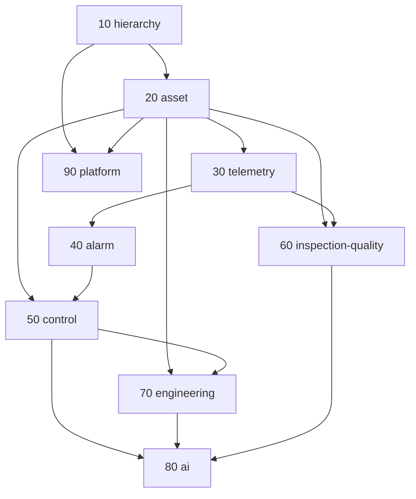

# SYNAPSE TechDocs — trục tham chiếu gốc của hệ sinh thái

> Tài liệu này là **sườn** để tinh gọn và phát triển hệ sinh thái. Mọi thay đổi mã (DB, backend, frontend) từ nay phải chỉ ra nó thực hiện mục nào của TechDocs; mục nào chưa có thì viết TechDocs trước, sửa mã sau.
>
> Nguồn gốc: báo cáo đánh giá + thiết kế đã trình chủ dự án ngày 2026-11-03 (`docs/superpowers/specs/2026-11-03-he-sinh-thai-tinh-gon-thiet-ke-lai.html`). Báo cáo là *tại sao*; TechDocs là *cái gì và như thế nào*.

## Cách đọc

Mỗi module là một tệp, bóc theo thứ tự **Dữ liệu → Backend → Frontend**, và trong mỗi tầng theo thứ tự **Hiện trạng đo được → Mục tiêu → Di trú → Nghiệm thu**. Quy ước chung (đặt tên, kiểu thời gian, quyền, mẫu đặc tả màn hình, tiêu chí nghiệm thu) nằm ở `01-QUY-UOC.md` và không lặp lại trong từng module.

Ký hiệu trạng thái từng mục:

| Ký hiệu | Nghĩa |
|---|---|
| `[đo]` | Số liệu đo trực tiếp trên mã/DB, có nguồn (tệp:dòng, câu SQL) |
| `[suy luận]` | Kết luận rút ra, chưa đo trực tiếp |
| `[cần kiểm]` | Phải đo thêm trước khi thực thi |
| `[QĐ-x]` | Quyết định chủ dự án đã duyệt (Q1–Q10 của báo cáo 2026-11-03, D1–D11 SCADA, QĐ twin…) |
| `[chờ duyệt]` | Đề xuất trong TechDocs chưa được duyệt |

## Năm mục tiêu của hệ sinh thái (bộ lọc cho mọi module)

| # | Mục tiêu | Module chịu trách nhiệm chính |
|---|---|---|
| M1 | Quản lý toàn diện nhà máy | 10 hierarchy · 20 asset · 90 platform |
| M2 | Giám sát thời gian thực | 30 telemetry · 40 alarm · 50 control |
| M3 | Lập trình và mô phỏng | 70 engineering · 50 control |
| M4 | Thu thập dữ liệu và phân tích chất lượng | 60 inspection-quality · 30 telemetry |
| M5 | AI hỗ trợ lập trình, phân tích, hành động điều khiển | 80 ai · 50 control · 70 engineering |

## Danh mục module

Thứ tự số là thứ tự phụ thuộc dữ liệu (module sau tham chiếu module trước), cũng là thứ tự viết và thực thi.

| Tệp | Module | Phạm vi một câu | Trạng thái TechDocs |
|---|---|---|---|
| `01-QUY-UOC.md` | Quy ước chung | Đặt tên, kiểu dữ liệu, tenant, quyền, mẫu đặc tả, nghiệm thu | ✅ v1 2026-11-03 |
| `10-hierarchy.md` | Phân cấp ISA-95 và phạm vi | enterprise → site → area → line (→ cell); phạm vi người xem; tenant | ✅ v1.1 **ĐÃ DUYỆT** 2026-11-03 |
| `20-asset.md` | Tài sản, lớp mẫu, kết nối, tag | asset / asset_class / connection / tag / tag_template; vòng đời; onboarding | ✅ v1.1 **ĐÃ DUYỆT** 2026-11-03 |
| `30-telemetry.md` | Chuỗi thời gian và ingest | signal_sample, WAL store-forward, UNS/Sparkplug, LiveStore + kênh 1a, chất lượng + tuổi dữ liệu | ✅ v1.1 **ĐÃ DUYỆT** 2026-11-03 |
| `40-alarm.md` | Cảnh báo ISA-18.2 | alarm_definition / alarm_event / alarm_journal, một cửa raiseEvent, engine trên LiveStore, andon, notification_rule + leo thang, KPI | ✅ v1.1 **ĐÃ DUYỆT** 2026-11-03 |
| `50-control.md` | Điều khiển một cửa | giữ chuỗi cổng dispatch() + DỪNG đã nghiệm thu; command_request/command/command_attempt; 2FA theo mức một middleware; interlock/safety/commissioning; CommandConfirmDialog + NutDungMay portal | ✅ v1.1 **ĐÃ DUYỆT** 2026-11-03 |
| `60-inspection-quality.md` | Kiểm tra, chất lượng, sản phẩm | hợp đồng ingest V3 một đường; inspection/inspection_capture/inspection_item; một thư viện KPI + SPC; quality gate; cây dạy 4 cấp nối theo id; threshold approval SoD | ✅ v1.1 **ĐÃ DUYỆT** 2026-11-03 |
| `70-engineering.md` | Lập trình và mô phỏng | program_* có FK; lưu đồ = SFC mở rộng (K12); sim-gate hành vi (OIP walker); nhà máy ảo K13; nạp qua 50; recipe một mô hình; FOE + AI flow; Twin Studio tạo | ✅ v1.1 **ĐÃ DUYỆT** 2026-11-03 |
| `80-ai.md` | Thợ Cả | một cổng ai.gateway; một runtime agent (Đợt 12); ai_session/ai_action; KB một kho + HNSW mã; ai.vision.*; luồng AI; 6 màn + extension cùng hợp đồng | ✅ v1.1 **ĐÃ DUYỆT** 2026-11-03 |
| `90-platform.md` | Nền tảng và ứng dụng | avi_app + RLS FORCE site_id; setting một bảng; audit_trail WORM; credential; job registry + worker tách; OEE một công thức; ia.ts + AppFrame + token sáng ISA-101 + ESLint; Home theo vai, Phòng vận hành, MES, Reporting, Bảo trì, Quản trị; twin xem giữ | ✅ v1.1 **ĐÃ DUYỆT** 2026-11-03 |

## Mối quan hệ giữa các module

Luật phụ thuộc: module chỉ được import kiểu/hàm từ module **số nhỏ hơn** hoặc từ `90-platform` (cắt ngang). Vi phạm luật này là lỗi kiến trúc, census phải bắt.

## Quyết định toàn hệ (tổng hợp từ §2.1/§7 của 10–90, đều ĐÃ DUYỆT 2026-11-03)

| Chủ đề | Quyết định | Module |
|---|---|---|
| Cây tổ chức | enterprise → site → area → line → (cell) → asset; `site.origin real/sim/qa`; `line.kind`; `user_scope`; trạm = bí danh máy, bỏ | 10 |
| Tenant | **một khoá `site_id`**; app chạy `avi_app`; **RLS FORCE `app.site_ids`** đặt ở middleware; hypertable nén giữ phạm vi ở lớp app + census; ngoài phạm vi ≡ NOT_FOUND; admin không bypass quyền | 10, 90 |
| Thiết bị | `asset` (+ `kind`) thay machines/robots/gateway/workstations; `asset_class` + `tag_template` (vai trò tag, 31 role); `tag` một bảng với `role`, `energy_direction`, `actuation_level {1,3,4,5}`; `connection_status` mặc định ghi; api key băm (14 ngày chuyển); robot/AGV **tạm dừng, không gỡ** | 20, 50 |
| Tín hiệu | `signal_sample(ts, tag_id)` + `quality/reason/ts_source`; CAGG 1m/1h/1d; retention 90 d real / 7 d sim; **LiveStore** mọi tag, một ngưỡng cũ; **C1 mặc định bật**; kênh đẩy = **hợp đồng 1a của scada-master** (sau khi 1a lên main + 2 cờ); UNS v2 duy nhất; simulator dev 36 máy; một WAL `DurableBuffer` | 30 |
| Cảnh báo | 16 hệ → **một `raiseEvent()`**; `alarm_definition/alarm_event/alarm_journal` (WORM); ưu tiên 1–4; ISA‑18.2 (ack/shelve/suppress/OOS); engine trên LiveStore, **tag stale không sinh cảnh báo ngưỡng**; một `notification_rule` + thang leo thang; kiểm soát lũ EEMUA 191; xoá dữ liệu lũ; `/canh-bao` một màn; app di động = adapter chỉ đọc | 40 |
| Điều khiển | **giữ nguyên chuỗi 16 cổng `dispatch()` + DỪNG HMI** (nghiệm thu bench); `command_request` một khuôn cho HMI/AI/luồng/nạp chương trình, TTL 60 s, 2FA theo mức một middleware; interlock/safety ở 50, phát sự kiện vào 40; DỪNG dự phòng trung tâm = ngoại lệ có WORM; Zmotion FFI tắt; lõi chỉ đổi **sau A2(o)**; một `CommandConfirmDialog`; `NutDungMay` trên portal, không gì che | 50 |
| Kiểm tra | hợp đồng **`InspectionV3` một đường** (v1.x = adapter, 2 chu kỳ); tenant từ khoá máy; `inspection/inspection_capture/inspection_item` có FK; **một thư viện KPI + một SPC**, client không tính KPI; NG phải có mã lỗi; giới hạn chỉ qua `threshold_approval` SoD; cây dạy 4 cấp nối theo id; xoá 13 236 kết quả seed; retention 12 tháng bật; MQTT không ingest; 60 giữ dữ liệu/KPI, 80 giữ màn AI thị giác | 60 |
| Kỹ thuật | `program_*` có FK; **lưu đồ = SFC mở rộng (K12)**; **sim‑gate = hành vi (OIP walker)**, MATIEC là oracle; nạp chỉ qua 50, đích v1 = OpenPLC mở; **nhà máy ảo K13** tách twin; bộ máy luồng 5 → 2 (FOE + AI flow); recipe một mô hình; simulator/sim‑factory = thiết bị ngoài `origin=sim`; xoá `simulation_runs`; một Studio + một `GraphCanvas`; Twin Studio giữ QĐ‑18/19/21 | 70 |
| Thợ Cả | **một cổng `ai.gateway`** (0 lối né, gỡ Ollama); **một runtime agent (Đợt 12)**, gỡ GĐ3b; `ai_session/_turn` + `ai_agent_run`; `ai_action` chỉ tool không chạm thiết bị (tool thiết bị → 50); KB một kho + HNSW chỉ mục mã; registry A (ML) / B (LLM); `ai.vision.*`; luồng AI giữ, bật sau 70‑E5; 6 màn, một `ChatPanel`/`ActionCard`/`ChonModel`; extension cùng hợp đồng; cổng ngoài giữ tắt; `vram_events` 30 d | 80 |
| Nền | `setting`/`setting_def` một bảng, `.env` ≤ 120; `audit_trail` WORM mọi mutation; `credential` một bảng; job registry + `job_run` + **3 tiến trình api/worker/edge**; **OEE một công thức** theo `shift_instance`; Reporting một engine; `ia.ts` + `AppFrame` + token **sáng ISA‑101** + Be Vietnam Pro + 3 luật ESLint; Home theo vai + Phòng vận hành + Nhà máy L1; twin 3 màn giữ; phiên 12 h/7 d; license cưỡng chế RAM; thương mại hoá → `frozen/` | 90 |

## Chỉ số mục tiêu toàn hệ

| Chỉ số | Hiện trạng `[đo 2026-11-03]` | Mục tiêu | Nguồn |
|---|---|---|---|
| Bảng DB | 469 (174 enum; 359 không FK; 395 naive) | ≈ 200 (enum ≤ 30; FK đủ; tz 100 %) | 10–90 §2.3 |
| Route client | 235 (≈ 46 redirect; 223 trang / 170k LOC) | 42 màn + redirect một chu kỳ | 90 §4.3 |
| Router tRPC | 263 | ≈ 120 (một namespace/module) | 10–90 §3.2 |
| Hệ cảnh báo / bảng | 16 / 39 | 1 / 7 | 40 |
| Cửa lệnh thiết bị | 13 (3 né cổng) | 1 (+ DỪNG dự phòng WORM) | 50 |
| Đường ingest | telemetry 7 + inspection 2 hợp đồng/9 lối | 2 (nội bộ/ngoài) + 1 (V3) | 30, 60 |
| Công thức yield / OEE / Cpk | 1+6+11 / 6+5 / 4 | 1 / 1 / 1 | 60, 90 |
| Bộ máy luồng | 5 | 2 | 70 |
| Lối gọi model né cổng / thế hệ agent / bảng phiên AI | ≈ 20 / 3 / 6+1 | 0 / 1 / 2 | 80 |
| Lớp màu thô / `text-[` / `t()` mặc định vi | 2 978 / 1 644 / 6 227 | 0 / 0 / 0 (ESLint ratchet) | 90 |
| Lớp định tuyến / kiểu header / UI chat / thẻ duyệt | 7 / 8–10 / 10 / 13 | 1 / 1 / 1 / 1 | 90, 80 |
| `.env` khoá / cờ `=== "true"` | 326 / 181 | ≤ 120 / cờ an toàn | 90 |
| Dữ liệu rác cần xoá (duyệt) | notifications 56k, escalations 7,8k, predictive 2,6k, mqtt_alert_history 3,2k, status_logs 96k, seed inspections 13k, simulation_runs 81k, PdM >90 d 1,8 GB, vram_events >30 d, ot_telemetry sim 65 GB | 0 (sim sinh lại qua pipeline) | 30, 40, 60, 70, 80 |

## Lộ trình tổng hợp (thứ tự thi công cho dieu‑phoi)

Nguyên tắc: *an toàn → nền → vỏ → gộp → dọn* (báo cáo §11); mỗi đợt = một bước Di trú của một module + tiêu chí nghiệm thu của bước đó; **không chen trước A2(o)** (SCADA) và cửa sổ GPU A/B (do‑model); mọi SQL qua dieu‑phoi duyệt, `--test-only` trước; xoá dữ liệu báo chủ dự án trước. Dải migration đã cấp: 10 `0460–0469` · 20 `0470–0489` · 30 `0490–0509` · 40 `0510–0529` · 50 `0530–0549` · 60 `0550–0569` · 70 `0570–0589` · 80 `0590–0609` · 90 `0610–0649`.

| Pha | Bước (module‑bước) | Điều kiện | Song song được |
|---|---|---|---|
| **0 · An toàn & vệ sinh** (≈ 1 tuần, không GPU) | 90‑P0 (avi_app, admin hết bypass, CSP/origin, license cache, cookies.txt, retention/backup bật, docs ra app) · 50‑C0 (gỡ 4 cửa chết, AiChatFrame ẩn, NutDungMay portal, robot "tạm dừng") · 40‑AL0 (tắt lũ, sửa import bulletin, xoá dữ liệu lũ) · 30‑T0 (UNS_BRIDGE tắt, sim 36 máy, timescale DDL một nguồn) · 70‑E0 (dừng fidelity, xoá simulation_runs, gỡ sim‑live‑daemon, Zmotion đóng băng) · 80‑F0 (vram retention, router/trang chết, cờ trùng) · 60‑Q0 (router/LOC chết, 6 công thức lệch về canonical) | không chạm `services/scada|ot|edge` | 4 phiên: scada‑master (A2), tho‑ca‑agent (80‑F0), luong‑ui (90‑P0 client + 50‑C0 UI), kiem‑dinh (census + đột biến) |
| **1 · Nền dữ liệu** | 10‑H1…H7 → 20‑A1…A3 → 30‑T1…T3 (+T5/T6) → 40‑AL1…AL3 (song song 2 tuần) → 90‑P1 (setting, audit_trail, credential, job registry, worker) → 60‑Q1…Q3 → 50‑C1…C2 (**sau A2(o)**) | 20‑A3 trước 30‑T2/40‑AL4/50‑C1/60‑Q2 | 10/20 trước; 30/40/90‑P1 song song sau A3 |
| **2 · Vỏ & hệ thiết kế** | 90‑P3 (`ia.ts`, `AppFrame` sau `VITE_SHELL_V2`, token sáng, PageHeader, ESLint ratchet, DataTable, export) · 40‑AL5 (`/canh-bao`) · 30‑T7 (`/ket-noi`) · 10/20 màn `/tai-san` | spec mượt L2/L3 vào vùng Giám sát; **chỉ sáng** tới hết SCADA pha 1 | luong‑ui + scada‑ui |
| **3 · Gộp theo vùng** | Giám sát (30‑T4 sau 1a, 40‑AL4, 50‑C3/C4) → Sản xuất & Chất lượng (60‑Q4/Q5, 90‑P4 MES/OEE) → Dữ liệu chủ (20‑A4…A7) → Kỹ thuật (70‑E1…E4) → Thợ Cả (80‑F1…F5, sau cửa sổ GPU B) → Phân tích & Quản trị (90‑P4) | 1a lên main + 2 cờ; A2(o); GPU B | 2 phiên theo vùng |
| **4 · Dọn & đóng băng** | 90‑P2 (cửa sổ bảo trì tz/enum/FK) · 90‑P5 (`frozen/`, redirect, i18n, VITE 17→1, `/api/external` → v1) · 20‑A8 · 30‑T8 · 40‑AL6/AL7 · 50‑C5 · 60‑Q6 · 70‑E5 · 80‑F6 | mọi view tương thích đã hết chu kỳ | dieu‑phoi |

Nghiệm thu mỗi pha = tổng các N của bước trong pha + cổng gộp (census đủ + `check:tests` + bench OpenPLC khi chạm 50). Số đo ghi vào Nhật ký module.

## Sổ việc chỉ chủ dự án làm (ngoài phạm vi phiên kỹ thuật)

- Gỡ `cookies.txt` + thu hồi phiên (90‑P0); đặt `OT_CONTROL_ENABLED=false` ở `.env` cây chính (D9, đã báo); bật 2 cờ socket khi 1a lên main (30‑T4); quyết định bật `AI_NGOAI_ENABLED`, `AI_OT_CONTROL_ENABLED`, `AI_FLOW_ENABLED` khi tới bước tương ứng.
- Duyệt từng lần **xoá dữ liệu** theo bảng "Dữ liệu rác" (báo trước, có số đếm trước/sau, chạy bằng owner `aoi` qua dieu‑phoi).
- Sửa worktree `avi-aoi-hmi-web` (sparse checkout lệch), dọn ≈ 8,7 GB untracked, quyết định nhánh `s7-parked`; `.wslconfig` page cache (máy hết bộ nhớ ảo).
- Trả lời `[cần kiểm]` còn mở khi tới bước: 60‑Q4 máy thật gửi hợp đồng nào; K12–K14 Q7/Q8 (ánh xạ I/O PLC thật, phần mềm hãng sẵn có) khi tới 70‑E2.

## Kế hoạch thi công (thư mục `ke-hoach/`)

| Tệp | Nội dung | Trạng thái |
|---|---|---|
| `ke-hoach/2026-11-03-pha0-an-toan-ve-sinh.md` | Gói việc pha 0 cho dieu-phoi: 4 nhánh, ~40 việc theo module (90-P0, 50-C0, 40-AL0, 30-T0, 70-E0, 80-F0, 60-Q0), thứ tự 7 ngày, 5 lần xoá dữ liệu cần duyệt, số đo trước/sau | chủ dự án chốt (a) 2026-11-03 |
| `ke-hoach/2026-11-03-mockup-5-man-brief.md` | Brief mockup 5 màn (Home theo vai, Phòng vận hành, Máy L3, Cảnh báo, Tài sản) + vỏ + `token.css` cho luong-ui/scada-ui, song song pha 0 | chủ dự án chốt (b) 2026-11-03; **mockup ĐÃ DUYỆT 2026-11-04** (main ac0e63289) |
| `ke-hoach/2026-11-06-pha1-nen-du-lieu.md` | Gói việc pha 1 (nền dữ liệu): lô 1A hierarchy → 1B asset (lối găng) → 1C telemetry ∥ 1D alarm ∥ 1E platform ∥ 1F inspection; 1G sau A2(o); dải mig theo module; chỉ thêm song song, không đổi tên bảng | soạn 2026-11-06, mở khi pha 0 gộp main |
| `ke-hoach/2026-11-08-tho-ca-ke-hoach-cai-tien.md` | Kế hoạch cải tiến hoàn chỉnh Thợ Cả (AI local): đối chiếu 3 tài liệu chủ dự án (KH Qwen3.6 · UX Forge · canvas 9 màn) với hiện trạng 08/11; 7 layer L0–L6; lô A pilot GĐ2 (đang chạy) → B tri thức dự án → C đo lường chuẩn → D runtime → E bề mặt → F an toàn dữ liệu → G tự cải thiện (LoRA chờ); 12 chỉ số | DỰ THẢO 2026-11-08 chờ chủ dự án |

## Quy trình dùng TechDocs

1. **Viết trước, sửa sau.** Module chưa có TechDocs thì viết (hoặc bổ sung mục) rồi mới mở nhánh.
2. **Một đợt = một mục Di trú.** Mỗi đợt thực thi lấy đúng một bước trong mục "Di trú" của module, kèm tiêu chí nghiệm thu của mục đó.
3. **Số đo vào/ra.** Mỗi đợt ghi số đo trước và sau (route, router, bảng, LOC, lớp màu thô…) vào mục "Nhật ký" cuối tệp module.
4. **Thay đổi TechDocs là thay đổi hợp đồng.** Sửa cột, procedure, route đã duyệt phải ghi vào "Nhật ký" với lý do; chủ dự án duyệt lại nếu đổi hành vi người dùng thấy.
5. **Ràng buộc đã duyệt không được vi phạm.** 23 ràng buộc ở Phụ lục C của báo cáo 2026-11-03 được chép vào `01-QUY-UOC.md` §9.

## Nhật ký chỉ mục

| Ngày | Việc |
|---|---|
| 2026-11-03 | Lập chỉ mục, quy ước, module 10 hierarchy v1 (phiên chu-du-an-HST) |
| 2026-11-03 | Module 10 duyệt v1.1; module 20 asset duyệt v1.1 (từ vựng role tag §2.4) |
| 2026-11-03 | Module 30 telemetry duyệt v1.1 (nhận hợp đồng 1a của scada-master; sim 36 máy/7 d); module 40 alarm duyệt v1.1 (16 hệ → 1; 39 bảng → 7); module 50 control duyệt v1.1 (13 cửa → 1; C0 ngay, lõi sau A2(o)); module 60 inspection-quality duyệt v1.1 (126 bảng → ≤ 55; 2 hợp đồng ingest → 1); module 70 engineering duyệt v1.1 (5 bộ máy luồng → 2; sim-gate hành vi; nhận K12/K13); module 80 ai duyệt v1.1 (≈20 lối né cổng → 1; 3 thế hệ agent → 1; 94 bảng → ≤ 45); module 90 platform duyệt v1.1 — **bộ TechDocs 01 + 10–90 hoàn chỉnh, tất cả ĐÃ DUYỆT** |
| 2026-11-03 | Thêm Quyết định toàn hệ, Chỉ số mục tiêu, Lộ trình tổng hợp 5 pha (dải mig 0460–0649), Sổ việc chủ dự án |
| 2026-11-03 | Chủ dự án chốt: (a) pha 0 trước, (b) mockup 5 màn song song. Viết gói việc pha 0 + brief mockup () |
