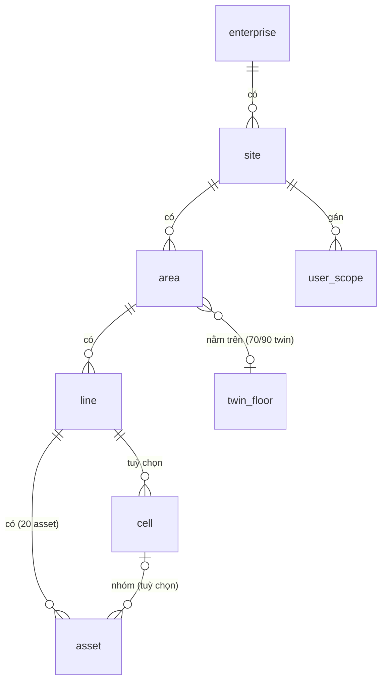

# 10 · Phân cấp ISA-95 và phạm vi (hierarchy)

| | |
|---|---|
| Mục tiêu phục vụ | M1 quản lý toàn diện (trực tiếp); M2/M4/M5 (gián tiếp: mọi dữ liệu và quyền đều neo vào cây) |
| Phụ thuộc | không (module gốc) |
| Module phụ thuộc vào đây | 20 asset (asset.line_id), 30 telemetry (UNS path), 40 alarm (phạm vi), 60 inspection (mã chép cứng), 90 platform (phạm vi người dùng, RLS) |
| Mốc đo | `main 8685b60ef` + `_ai8_wt d97f81c99` (2026-11-03), DB `aoi_management@5434` read-only |
| Trạng thái | **v1.1 — ĐÃ DUYỆT 2026-11-03** (chủ dự án trả lời 6 câu hỏi §7; §2.1 QĐ1–7 và dải migration 0460–0469 có hiệu lực) |

## 0. Phạm vi của module

Module này sở hữu **cây tổ chức** của nhà máy và **phạm vi nhìn thấy** của một danh tính (người dùng, khoá API, máy). Nó trả lời ba câu hỏi: "nút này nằm ở đâu trong nhà máy", "ai được thấy nút nào", "đường dẫn ISA-95/UNS của nút này là gì".

Module này **không** sở hữu: thiết bị và tag (20 asset), hình học 3D và mặt bằng (70/90 twin), vùng robot/an toàn (50 control), KPI theo cấp (90 platform read-model).

---

## 1. Hiện trạng đo được

### 1.1 Dữ liệu

Cây hiện tại có 6 cấp, khai ở `drizzle/schema/hierarchy.ts` `[đo]`:

```
corporates(2) ─code─▶ factories(6) ─id─▶ workshops(29) ─id─▶ production_lines(120) ─id─▶ stations(1 694) ─id─▶ machines(1 700)
```

| Bảng | Hàng | FK thật | Khoá nghiệp vụ | Xoá mềm | Thời gian | Ghi chú đo được |
|---|---|---|---|---|---|---|
| `corporates` | 2 | — | `code` unique toàn cục | `isActive` | naive | Không có router CRUD; chỉ `bootstrapRouter` tạo và `userRouters` đọc gán |
| `factories` | 6 | `corporateCode → corporates.code` (FK theo **code varchar**, nullable) | `code` unique toàn cục | `isActive` | naive | Có `timezone` (IANA), toạ độ bản đồ, ảnh mặt bằng + kích thước sàn (W6-25) |
| `workshops` | 29 | `factoryId → factories.id RESTRICT`; `tangId → twin_tang.id` (FK trong DB, **không khai Drizzle** vì vòng import) | `(factoryId, code)` unique partial `isActive` | `isActive` | naive | 28/29 đã gắn tầng twin |
| `production_lines` | 120 | `workshopId RESTRICT` | `(workshopId, code)` partial | `isActive` | naive | `capacityPerHour`, `maxConcurrentOrders` (dùng ở production/aps) |
| `stations` | 1 694 | `lineId RESTRICT` | `(lineId, code)` partial | `isActive` | naive | `orderIndex` |
| `machines` | 1 700 | `stationId NOT NULL RESTRICT` | `code` partial, `urn` partial | `isActive` | naive | Thuộc module 20; nêu ở đây vì cây kết thúc ở máy |
| `workstations` | 0 | không FK (`lineId/workshopId/factoryId` rời) | `code` | `isActive` | naive | Khái niệm trùng `stations`; 10 tệp server còn tham chiếu `[đo]` |
| `sites` (federation) | 0 | — | | | | Trùng `factories`; cờ FEDERATION tắt |
| `factory_zones` | 0 | | | | | Router `factoryZone` 0 chỗ gọi client |
| `zones` (fleet) | 4 | `factoryId` rời | `code` | | naive | Vùng robot (production/transit/charging/human_shared), seed 2026-07-16 |
| `safety_zones` | 0 | | | | | Thuộc 50 control |
| `user_corporate_assignments` | 1 | `corporateCode` **theo code** | | | naive | |
| `user_factory_assignments` | 8 (8 người) | `factoryCode` **theo code**; index "unique" khai bằng `index()` thường, **không unique** `[đo]` | | | naive | |
| `engineering_assignments` | 0 | | | | | |

Số đo hình dạng cây `[đo]`:

- Xưởng/nhà máy: 1, 1, 3, 8, 8, 8. Line/xưởng: 1–6 (trung bình 4). Trạm/line: 1–39 (trung bình 14,1).
- **Máy/trạm: 1 693 trạm có đúng 1 máy, 1 trạm có 7 máy; 0 trạm không có máy.** Cấp "trạm" trong thực tế là bí danh của máy.
- Xoá mềm: 0 nhà máy, 0 xưởng, 0 line, 0 trạm, 1 máy.
- 6 nhà máy trong DB dev: `SIM-FAC` (nhà máy ảo), `T12-SHOT-FA-…` (ảnh chụp test), `FUYU-F`, `QATD-A/B/C` (QA twin). Chưa có nhà máy thật; không có cột phân biệt thật/mô phỏng/QA.
- URN/isa95_path: 591/1 700 máy có; 1 109 máy chưa backfill.
- Mã chép cứng trên `product_inspections`: 6 588/13 236 thiếu `corporateCode`, **13 236/13 236 thiếu `lineCode`** ⇒ cột chép cứng không dùng được để lọc theo line.
- Cột tenant toàn hệ: `corporateCode` 53 cột, `factoryId` 81 cột, `factoryCode` 12, `siteId` 2, `tenantId` 1 `[đo]`.
- Bảng tham chiếu `stationId`: 18 tệp schema, ~30 cột, 8 cột `NOT NULL` `[đo]`.

### 1.2 Backend

| Thành phần | Tệp | Kích thước | Ghi chú |
|---|---|---|---|
| Router cấp | `server/routers/hierarchyRouters.ts` | 2 034 dòng | `factory`, `factoryZone`, `workshop`, `line`, `station`, `machine` (máy chiếm 1 100 dòng, thuộc module 20) |
| Router cây | `server/routers/hierarchyTreeRouter.ts` | 419 dòng | `getTree`, `getFactoryTree`, `getMqttTopics`, `getMqttMessageTypes`, `getSummary` |
| Router site | `server/routers/sitesRouter.ts` | 317 dòng | admin-only, federation; 4 tệp client gọi |
| Thống kê | `systemRouters.ts::corporateFactoryStatsRouter` | | 8 tệp client gọi; là read-model KPI, không phải phân cấp |
| DB | `server/db/hierarchy.ts` | 2 181 dòng | CRUD từng cấp + **bộ phân giải phạm vi** `idsTrongPhamVi(cap, scope, {strict})`, `machineIdsTrongPhamVi`, `trongPhamVi`, cascade info/delete, IoT virtual station |
| Phạm vi | `server/routers/_phamViNguoiXem.ts::phamViCua(ctx)` | | Trả `{userId, userRole}`; `null` = toàn quyền, `[]` = rỗng |
| Tenant RLS | `server/db/tenantContext.ts` | | `app_tenant_allows(NULL, corporateCode)`; trơ khi chưa set biến phiên; không phủ `machines/product_inspections/ot_telemetry` |

Thủ tục hiện có cho 4 cấp (mỗi cấp giống nhau): `list`, `listByX`, `create`, `update`, `delete` (mềm), `cascadeInfo`, `listDeleted`, `restore`; `factory` thêm `getById`, `updateMapPosition`, `uploadFloorPlan`, `updateFloorDims`. Quyền dùng **một khoá `settings_factory`** cho cả 4 cấp (`canView/Create/Edit/Delete`) `[đo]`. `factory.list` dùng `requireBatKyQuyenNao()` (ai có bất kỳ quyền nào cũng thấy danh sách nhà máy trong phạm vi).

Số chỗ gọi từ client `[đo]`: `factory.list` 41, `line.list` 19, `station.list` 18, `workshop.list` 15; `hierarchyTree.getMqttTopics` 7 (toàn trong MQTT), `getTree` 2, `getSummary` 1; `corporateFactoryStats` 22; `sites` 10; `factoryZone` 0; `corporate` không có router.

Điểm tốt cần giữ: `idsTrongPhamVi` là một chỗ duy nhất phân giải phạm vi, có chú thích vì sao (đã từng có bản chép tay ở `oeeService`), không lọc `isActive` để thùng rác đúng, phân biệt `null`/`[]`. `ensureIotVirtualStation` tạo line + trạm ảo `IOT-<xưởng>` cho thiết bị IoT, với quy ước tiền tố `IOT-` để OEE/yield bỏ qua.

Điểm yếu: 4 bộ CRUD chép nhau; phạm vi theo `corporateCode`/`factoryCode` chuỗi trong khi cây dùng id; `getMqttTopics` là việc của UNS; `getSummary` tải cả cây để đếm; `corporates` không có CRUD; `workstations` chết nhưng còn 10 chỗ tham chiếu.

### 1.3 Frontend

| Bề mặt | Tệp | Dòng | Dùng cây để làm gì |
|---|---|---|---|
| Trục phạm vi ở vỏ | `contexts/AssetScopeContext.tsx` + `components/AssetScopeBar.tsx` | 141 + 225 | Xưởng → Chuyền → Máy; localStorage `asset-scope-axis.v1`; cascade-clear; `wiredCount` để chip nói "trang chưa lọc" |
| Site context | `contexts/SiteContext.tsx` | 127 | federation; đóng băng |
| CRUD cây | `pages/DataSettings.tsx` | 2 028 | 12 tab: overview, factories, workshops, lines, stations, machines, enrollment-tokens, shifts, stages, import-export, config-audit, seed-data |
| CRUD tập đoàn/nhà máy | `pages/CorporateManagement.tsx` | 1 306 | admin-only; factory + workshop |
| Workstation | `pages/WorkstationManagement.tsx` | | bảng 0 hàng |
| Sites | `pages/SitesRegistry.tsx` | | federation |
| Mặt bằng | `pages/CorporateLayout.tsx` (1 293, 38 mã hex), `pages/Layout.tsx` (`/layout/:id`) | | thuộc twin; `/layout` đã redirect `/twin-studio` |
| Drill-down | `pages/DrillDownDashboard.tsx` | | KPI theo cấp; thuộc Phòng vận hành |
| Chọn phạm vi trong trang | `ScopeFilterBar`, `EntityPicker`, `useScope()` | | ~21 bề mặt đã wire theo doc 64 |
| Tree selector MQTT | trong `MqttProfileManagement`, `MqttDashboard` | | dùng `getMqttTopics` |

Tổng: 6 trang (≈ 7 000 dòng) cho một việc là "quản lý cây và phạm vi".

---

## 2. Mục tiêu: mô hình dữ liệu

### 2.1 Năm cấp canonical `[chờ duyệt — Q5]`



| Cấp | Bảng mới | Bảng hiện tại | Thuật ngữ vi (UI) | ISA-95 | UNS segment |
|---|---|---|---|---|---|
| 1 | `enterprise` | `corporates` | Tập đoàn | Enterprise | `{enterprise}` |
| 2 | `site` | `factories` | Nhà máy | Site | `{site}` |
| 3 | `area` | `workshops` | Xưởng | Area | `{area}` |
| 4 | `line` | `production_lines` | Dây chuyền | Work Center / Line | `{line}` |
| 4b | `cell` (tuỳ chọn) | `stations` | Cụm / trạm | Work Cell | `{cell}` hoặc `_` |
| 5 | `asset` (module 20) | `machines` + `robots` | Thiết bị | Work Unit / Equipment | `{equipment}` |

Quyết định thiết kế:

1. **`cell` không còn là cấp bắt buộc.** `asset.line_id NOT NULL`, `asset.cell_id NULL`. Dữ liệu đo: 1 693/1 694 trạm có đúng 1 máy ⇒ với các trạm đó `cell` chỉ là tên khác của máy; giữ `cell_id` để không mất 1 trường hợp 7 máy và để module 60 (trạm kiểm tra theo quy trình) còn chỗ neo. UI mặc định ẩn cấp cell; chỉ hiện khi line có cell chứa ≥ 2 asset hoặc người dùng bật "hiện cụm".
2. **`site_id` là khoá tenant duy nhất** (`[QĐ-Q5]`). `enterprise_id` chỉ có ở `site`. Mọi bảng nghiệp vụ ở module khác có `site_id NOT NULL`; không còn `corporateCode`/`factoryCode` làm khoá.
3. **FK theo id, không theo code.** `site.enterprise_id int FK` thay `factories.corporateCode varchar FK`.
4. **`origin` trên `site`**: `real | sim | qa`. Mọi nhãn "MÔ PHỎNG" ở UI (ràng buộc #8, #10) và loại trừ KPI đọc từ đây, thay cho quy ước tiền tố `IOT-`/`SIM-` trên code. `[QĐ 2026-11-03: duyệt]` KPI/OEE/báo cáo mặc định lọc `origin = real`.
5. **Không cấp nào tên "zone".** `zones` (robot) đóng băng cùng module robot; `factory_zones` gỡ; `safety_zones` thuộc 50 control và tham chiếu `area`/`line` bằng FK.
6. **Mặt bằng và tầng** (`floorPlanImage*`, `floorWidthM`, `mapPosition*`, `workshops.tangId`) chuyển quyền sở hữu sang module twin (70/90). Cột `area.floor_id → twin_floor.id` vẫn ở bảng `area` nhưng khai FK trong `drizzle/relations.ts` để tránh vòng import.
7. Giữ `timezone` ở `site` (nguồn duy nhất cho tính ca và hiển thị giờ).

### 2.2 Đặc tả bảng

#### `enterprise`
Mục đích: cấp cao nhất, chỉ để gộp báo cáo nhiều nhà máy. Không có dữ liệu vận hành.

| Cột | Kiểu | Null | Mặc định | Ràng buộc | Ghi chú |
|---|---|---|---|---|---|
| id | bigint identity | no | | PK | |
| code | varchar(50) | no | | unique partial `WHERE deleted_at IS NULL` | `[A-Z0-9-_]` |
| name | varchar(255) | no | | | |
| description | text | yes | | | |
| country | varchar(100) | yes | | | |
| contact_email | varchar(320) | yes | | | |
| logo_url | text | yes | | | |
| deleted_at | timestamptz | yes | | | xoá mềm |
| created_at / updated_at | timestamptz | no | now() | | |

Index: `uq_enterprise_code_live`. RLS: không (bảng cấp enterprise; đọc được bởi mọi người có ≥ 1 site thuộc enterprise). Nguồn ghi: `hierarchy.enterprise.*` (admin).

#### `site`
Mục đích: nhà máy; **đơn vị tenant**.

| Cột | Kiểu | Null | Mặc định | Ràng buộc | Ghi chú |
|---|---|---|---|---|---|
| id | bigint identity | no | | PK | = `factories.id` khi di trú |
| enterprise_id | bigint | yes | | FK enterprise RESTRICT | NULL = chưa gộp tập đoàn |
| code | varchar(50) | no | | unique partial live | |
| name | varchar(255) | no | | | |
| description, address, region, country | | yes | | | |
| timezone | varchar(64) | no | 'Asia/Ho_Chi_Minh' | IANA, kiểm ở app | nguồn duy nhất cho ca/giờ |
| origin | varchar(8) | no | 'real' | `real \| sim \| qa` | nhãn mô phỏng/QA; loại trừ KPI |
| deleted_at | timestamptz | yes | | | |
| created_at / updated_at | timestamptz | no | now() | | |

Cột chuyển sang twin (không còn ở đây): `mapPositionX/Y`, `floorPlanImageUrl/Key`, `floorWidthM/DepthM`.
Index: `uq_site_code_live`, `idx_site_enterprise`. RLS: có, policy `id = ANY(current_setting('app.site_ids')::bigint[])`, FORCE. Nguồn ghi: `hierarchy.site.*`.

#### `area`

| Cột | Kiểu | Null | Mặc định | Ràng buộc | Ghi chú |
|---|---|---|---|---|---|
| id | bigint identity | no | | PK | = `workshops.id` |
| site_id | bigint | no | | FK site RESTRICT | |
| code | varchar(50) | no | | unique partial `(site_id, code) WHERE deleted_at IS NULL` | |
| name | varchar(255) | no | | | |
| description | text | yes | | | |
| floor_area_m2 | numeric(10,2) | yes | | | giữ từ `floorArea` |
| floor_id | bigint | yes | | FK twin_floor SET NULL (khai ở relations.ts) | = `workshops.tangId` |
| sort_order | int | no | 0 | | thứ tự hiển thị |
| deleted_at, created_at, updated_at | | | | | như trên |

RLS: có theo `site_id`. Nguồn ghi: `hierarchy.area.*`.

#### `line`

| Cột | Kiểu | Null | Mặc định | Ràng buộc | Ghi chú |
|---|---|---|---|---|---|
| id | bigint identity | no | | PK | = `production_lines.id` |
| site_id | bigint | no | | FK site | **chép từ area để RLS và lọc không cần JOIN**; trigger/app giữ đồng bộ |
| area_id | bigint | no | | FK area RESTRICT | |
| code | varchar(50) | no | | unique partial `(area_id, code)` live | |
| name | varchar(255) | no | | | |
| description | text | yes | | | |
| kind | varchar(16) | no | 'production' | `production \| iot \| test` | thay quy ước `IOT-`; `iot`/`test` bị loại khỏi OEE/yield |
| capacity_per_hour | int | yes | | | giữ (production/aps dùng) |
| max_concurrent_orders | int | no | 1 | | giữ |
| sort_order | int | no | 0 | | |
| deleted_at, created_at, updated_at | | | | | |

RLS: có. Nguồn ghi: `hierarchy.line.*`; `kind='iot'` được tạo tự động bởi onboarding IoT (module 20) qua `hierarchy.line.ensureVirtual`.

#### `cell` (tuỳ chọn)

| Cột | Kiểu | Null | Mặc định | Ràng buộc | Ghi chú |
|---|---|---|---|---|---|
| id | bigint identity | no | | PK | = `stations.id` |
| site_id | bigint | no | | FK site | chép |
| line_id | bigint | no | | FK line RESTRICT | |
| code | varchar(50) | no | | unique partial `(line_id, code)` live | |
| name | varchar(255) | no | | | |
| description | text | yes | | | |
| process_step | int | no | 0 | | = `orderIndex`; thứ tự quy trình trên line |
| deleted_at, created_at, updated_at | | | | | |

RLS: có. Nguồn ghi: `hierarchy.cell.*`. Ghi chú: sau di trú, cell 1:1 với asset vẫn tồn tại (không xoá dữ liệu); UI ẩn.

#### `user_scope` (thay `user_corporate_assignments` + `user_factory_assignments` + `engineering_assignments`)

| Cột | Kiểu | Null | Ràng buộc | Ghi chú |
|---|---|---|---|---|
| id | bigint identity | no | PK | |
| user_id | bigint | no | FK users CASCADE | |
| level | varchar(10) | no | `enterprise \| site \| area \| line` | cấp được gán |
| node_id | bigint | no | | id của nút ở cấp đó (kiểm tồn tại ở app; không FK đa hình) |
| assigned_by | bigint | yes | FK users | |
| created_at | timestamptz | no | | |

Unique `(user_id, level, node_id)` **thật** (hiện tại index thường `[đo]`). Nguồn ghi: `hierarchy.scope.assign/revoke` (admin, audit). Ý nghĩa: tập site nhìn thấy = ∪ site của mọi dòng (enterprise ⇒ mọi site con). Gán cấp `area`/`line` thu hẹp *trong* site (phục vụ kỹ sư phụ trách line; thay `engineering_assignments`).

#### Bảng gỡ

`workstations` (0 hàng; 10 tệp server tham chiếu `[cần kiểm]` từng chỗ trước khi gỡ), `factory_zones`, `sites`, `site_kpi_rollup`, `site_sync_log` (federation, đóng băng: giữ bảng, gỡ router/UI).

### 2.3 Đường dẫn ISA-95 và UNS

- `isa95_path` của asset: `{site.code}/{area.code}/{line.code}/{cell.code | '_'}/{asset.code}`, chữ thường, bỏ dấu, `[a-z0-9-]`. Quy tắc slug giữ của `urnService` hiện có.
- Topic UNS: `{enterprise}/{site}/{area}/{line}/{cell|_}/{asset}/v1/...` (module 30 sở hữu phần sau `v1`).
- Đổi tên/di chuyển nút ⇒ job backfill `isa95_path` cho mọi asset con và phát `hierarchy.changed`; **không** đổi `id`.
- Mã chép cứng trên hypertable (`product_inspections.*Code`, `ot_telemetry`): giữ vì hiệu năng, **dẫn xuất lúc ghi từ asset** (module 30/60), không nhận từ máy gửi lên. Lỗ hiện tại (13 236/13 236 thiếu `lineCode`) đóng bằng backfill một lần + ràng buộc ở ingest.

### 2.4 Phạm vi và RLS

- Hàm phân giải duy nhất giữ tên `idsTrongPhamVi(level, scope, {strict})` nhưng đổi đầu vào: `scope = { userId, userRole } | { apiKeyId } | { assetId }`; đầu ra `null | bigint[]`.
- Thứ tự: admin ⇒ `null`; có dòng `user_scope` ⇒ tính tập site rồi chiếu xuống cấp hỏi; không có dòng ⇒ `[]`.
- Biến phiên RLS: `app.site_ids` (mảng), set bởi `withTenantScope` ở đầu mỗi request tRPC/REST/socket; `app.tenant_allows` cũ bỏ sau khi mọi bảng đổi sang `site_id`.
- Cache: tập site/area/line của một user cache 60 s trong tiến trình, xoá khi `hierarchy.changed` hoặc `user_scope` đổi.

---

## 3. Mục tiêu: backend

### 3.1 Namespace `hierarchy.*`

| Procedure | Loại | Input | Output | Phạm vi | Audit | Thay cho |
|---|---|---|---|---|---|---|
| `hierarchy.tree` | protected | `{ root?: {level,id}, depth?: 1..5, includeCounts?: bool, includeDeleted?: bool }` | cây lồng `{enterprise[]→site[]→area[]→line[]→cell[]}` (asset do 20 cung cấp qua `asset.listByLine`), mỗi nút `{id, code, name, level, kind?, origin?, counts?: {area,line,cell,asset}}`, `version` | theo `idsTrongPhamVi` | — | `hierarchyTree.getTree/getFactoryTree/getSummary`, `factory/workshop/line/station.list*` |
| `hierarchy.node.get` | protected | `{level, id}` | nút + breadcrumb `[{level,id,code,name}]` + `isa95Path` | có | — | `factory.getById`, `*.listByX` |
| `hierarchy.node.cascadeInfo` | permission(hierarchy_manage, view) | `{level, id}` | `{area, line, cell, asset, openOrders, activeAlarms}` số con sẽ bị ảnh hưởng | có | — | `*.cascadeInfo` ×4 |
| `hierarchy.enterprise.create/update/archive/restore` | admin | Zod theo bảng | nút | — | có | (mới; `corporates` chưa có CRUD) |
| `hierarchy.site.create/update/archive/restore` | permission(hierarchy_manage, create/edit/delete/edit) | theo bảng; `origin` chỉ admin đổi | nút | create: enterprise trong phạm vi | có | `factory.create/update/delete/restore` |
| `hierarchy.area.*`, `hierarchy.line.*`, `hierarchy.cell.*` | permission(hierarchy_manage, …) | theo bảng | nút | cha phải trong phạm vi | có | `workshop/line/station.*` |
| `hierarchy.node.move` | permission(hierarchy_manage, edit) | `{level, id, newParentId}` | nút + số asset được backfill | cả hai cha trong phạm vi | có, `before/after` parent | (mới; hiện phải xoá + tạo) |
| `hierarchy.line.ensureVirtual` | **internal** (chỉ server gọi từ module 20) | `{areaId, kind: 'iot'\|'test'}` | line id | — | có | `ensureIotVirtualStation` |
| `hierarchy.scope.mine` | protected | — | `{ admin: bool, sites: [{id,code,name,origin}], areas?: [], lines?: [] }` | — | — | `userRouters.getMyAssignments` (phần cây) |
| `hierarchy.scope.list` | admin | `{userId}` | `user_scope[]` | — | — | `userRouters.listAssignments` |
| `hierarchy.scope.assign/revoke` | admin | `{userId, level, nodeId}` | | — | có | `userRouters.assignFactory/Corporate` |
| `hierarchy.search` | protected | `{q, levels?, limit?}` | nút khớp code/name, kèm breadcrumb | có | — | (mới; phục vụ ⌘K và picker) |

Quy tắc chung:

- `archive` là xoá mềm; từ chối (`CONFLICT`) khi `cascadeInfo.asset > 0` hoặc `openOrders > 0`, trừ khi `{force: true}` và quyền `delete` (khi đó asset con chuyển `lifecycle = decommissioned`, module 20 xử lý).
- `restore` từ chối khi code đã bị nút sống khác dùng.
- Mọi mutation phát sự kiện bus `hierarchy.changed { level, id, action, siteId, version }`; socket phòng `site:{id}` nhận `hierarchy:changed` để vỏ làm mới trục phạm vi (dùng `socket.emit` theo phòng đã có, không thêm `join` mới — ràng buộc #22).
- Lỗi: `NOT_FOUND` (nút không tồn tại **hoặc ngoài phạm vi**, trả giống nhau cho đọc); `FORBIDDEN` (mutation ngoài phạm vi, trả rõ vì đã biết nút tồn tại); `CONFLICT` (code trùng, cascade, restore); `BAD_REQUEST` (timezone/origin/kind không hợp lệ).

### 3.2 Khoá quyền

| Khoá | Hành động | Ai mặc định |
|---|---|---|
| `hierarchy_view` | xem cây trong phạm vi | mọi vai đã đăng nhập (ngầm qua `protected`) |
| `hierarchy_manage` | view/create/edit/delete nút cấp site→cell | admin, engineer (create/edit), supervisor (view) |
| `scope_assign` | gán phạm vi người dùng | admin |

Thay cho `settings_factory` (giữ alias trong bảng quyền một chu kỳ) và `admin_system` cho sites.

### 3.3 Gỡ / chuyển

| Thành phần | Hành động | Đích |
|---|---|---|
| `hierarchyTree.getMqttTopics`, `getMqttMessageTypes` | chuyển | module 30 `telemetry.uns.topics` (đọc `hierarchy.tree`) |
| `corporateFactoryStats` | chuyển | module 90 read-model tổng quan `overview.byNode` |
| `factoryZone` router + bảng | gỡ | — |
| `sites` router, `SiteContext` | đóng băng | bật lại cùng federation |
| `workstation` router/db | gỡ sau khi kiểm 10 chỗ tham chiếu | — |
| `factory.uploadFloorPlan/updateFloorDims/updateMapPosition` | chuyển | module 70/90 `twin.site.floorPlan.*` |
| `ensureIotVirtualStation` | thay | `hierarchy.line.ensureVirtual` (không tạo cell) |

### 3.4 Job

`hierarchy.backfillPaths` (worker, chạy khi `hierarchy.changed` có `action ∈ {update, move}` hoặc thủ công): cập nhật `asset.isa95_path`/`urn` cho cây con; idempotent; ghi số hàng đổi vào audit.

---

## 4. Mục tiêu: frontend

### 4.1 Trục phạm vi ở vỏ ứng dụng (dùng chung mọi màn)

- `AssetScopeContext` giữ, đổi hình dạng: `{ siteId?, areaId?, lineId?, assetId? }` + labels; nguồn cây = `hierarchy.tree({includeCounts:true})` cache 5 phút + làm mới khi `hierarchy:changed`.
- `AssetScopeBar` (thanh đầu vỏ): breadcrumb chọn được `Nhà máy ▸ Xưởng ▸ Dây chuyền ▸ Thiết bị`; cấp cell ẩn; nếu `scope.mine.sites.length === 1` thì cấp nhà máy hiện tên cố định, không dropdown.
- Bất biến giữ nguyên (doc 63/64): trang chưa `useScope()` ⇒ chip "chưa lọc theo phạm vi"; phạm vi rỗng ⇒ thông điệp `chung.phamViRong` và 0 hàng, không ngầm toàn cục.
- Nhãn `origin`: nếu site đang chọn có `origin ≠ real` ⇒ thanh đầu đổi nền và hiện `MÔ PHỎNG` / `QA` (ràng buộc #8, #10).

### 4.2 Màn hình

#### Tài sản — `/tai-san` (phần cây; phần chi tiết thiết bị ở module 20)

- Vùng: Dữ liệu chủ · Quyền: `hierarchy_view` (xem), `hierarchy_manage` (sửa)
- Mục đích: một chỗ duy nhất để xem và sửa cây nhà máy và gắn thiết bị vào cây.
- Bố cục: vỏ chung + `PageHeader("Tài sản", phụ đề = phạm vi hiện tại, hành động: [Thêm nút ▾] [Thùng rác] [Nhập/Xuất])` + thân master-detail:
  - Trái (280–360 px, resizable): `HierarchyTree` ảo hoá, tải theo cấp (`hierarchy.tree depth=2` rồi mở dần), tìm kiếm (`hierarchy.search`), badge số thiết bị và số cảnh báo đang mở (từ 40), icon theo `kind`/`origin`.
  - Phải: `NodeDetail` theo cấp đang chọn: thẻ thông tin (code, name, mô tả, timezone/origin cho site, kind/capacity cho line), tab `Con` (bảng con trực tiếp với sort_order kéo thả), tab `Thiết bị` (module 20 cung cấp `AssetListByNode`), tab `Lịch sử` (audit của nút).
  - Chọn asset ⇒ `NodeDetail` nhường chỗ cho `AssetDetail` (module 20).
- Hành động → procedure → quyền:
  - Thêm nút con → `hierarchy.<cấp>.create` → `hierarchy_manage.create`; form trong ngăn phủ (ContextDrawer), code gợi ý từ name.
  - Sửa → `.update` → `.edit`; đổi `origin` của site chỉ admin, có hộp xác nhận nêu hệ quả (loại khỏi KPI).
  - Di chuyển → `hierarchy.node.move` → `.edit`; kéo thả trong cây, xác nhận với số asset sẽ backfill.
  - Lưu trữ → `cascadeInfo` ⇒ `CascadeDialog` liệt kê số con/đơn hàng/cảnh báo ⇒ `.archive` → `.delete`.
  - Thùng rác → `hierarchy.tree({includeDeleted:true})` lọc `deleted_at` ⇒ `.restore`.
- Trạng thái: đang tải (skeleton cây), rỗng (chưa có nhà máy ⇒ CTA "Tạo nhà máy đầu tiên" chỉ admin), phạm vi rỗng (thông điệp chuẩn), lỗi.
- Thay cho: `DataSettings` tab overview/factories/workshops/lines/stations (→ redirect `/datasettings?tab=…` → `/tai-san?node=…`), `CorporateManagement` (→ `/tai-san`), `WorkstationManagement` (gỡ), `DrillDownDashboard` (→ `/van-hanh`), `CorporateLayout` (gỡ), `Layout/:id` (→ `/twin-studio`), `SitesRegistry` (ẩn, đóng băng).
- i18n: `duLieuChu.taiSan.*`, `chung.phanCap.*` (tên cấp dùng chung).
- Nghiệm thu: xem §6.

#### Người dùng & quyền — tab "Phạm vi" (`/quan-tri/nguoi-dung`, module 90)

Chỉ tham chiếu: tab dùng `hierarchy.scope.list/assign/revoke`; picker là `HierarchyTree` ở chế độ chọn nhiều, cấp enterprise→line.

### 4.3 Component dùng chung (đặt ở `components/hierarchy/`)

| Component | Nhiệm vụ | Dùng ở |
|---|---|---|
| `HierarchyTree` | cây ảo hoá, lazy theo cấp, tìm kiếm, chọn đơn/nhiều, badge, kéo thả (tuỳ chọn) | Tài sản, Phạm vi người dùng, picker trong Twin Studio và Studio lập trình |
| `NodePicker` | popover chọn một nút ở cấp cho trước, có breadcrumb | ScopeFilterBar, form recipe/interlock/đơn hàng |
| `NodeBreadcrumb` | `Nhà máy ▸ Xưởng ▸ Dây chuyền` có link | PageHeader của màn Máy, Line |
| `OriginBadge` | nhãn `THẬT / MÔ PHỎNG / QA` theo `site.origin` | thanh đầu, thẻ nút |
| `ScopeEmptyNotice` | thông điệp phạm vi rỗng chuẩn | mọi trang có bảng |
| `CascadeDialog` | hộp xác nhận lưu trữ với số con | Tài sản |

Gỡ sau di trú: `EntityPicker` (thay bằng `NodePicker`), phần tree trong `MqttProfileManagement`.

---

## 5. Di trú từ hiện trạng

Mỗi bước là một đợt riêng, có số đo vào/ra, chạy ở worktree riêng, migration gửi SQL duyệt và áp `--test-only` trước (ràng buộc #21). Dải migration của module này: **0460–0469** `[QĐ 2026-11-03: duyệt]`.

Quyết định dữ liệu seed `[QĐ 2026-11-03]`: `FUYU-F` (id 47), `T12-SHOT-FA-…` (id 18) là seed bỏ đi, **xoá** trong H2 (kèm cây con) sau khi báo các phiên liên quan (ràng buộc #19); `SIM-FAC` → `origin = sim`; `QATD-A/B/C` → `origin = qa`. Múi giờ gốc để đổi `timestamp → timestamptz`: **Asia/Ho_Chi_Minh (+07:00)**.

| Bước | Nội dung | Tương thích ngược | Nghiệm thu |
|---|---|---|---|
| **H1** Khai FK và unique còn thiếu | `workshops.tangId` FK khai ở `relations.ts`; `user_factory_assignments` unique thật (sau khi kiểm trùng); `factories.timezone` NOT NULL | không đổi API | 0 FK chỉ-SQL trong 5 bảng cây; `uq_user_factory` là UNIQUE `[đo]` |
| **H2** Thêm cột mới song song | `factories.enterprise_id` (backfill từ `corporateCode`), `factories.origin` (backfill: `SIM-%`→sim, `QATD-%`/`T12-%`→qa, còn lại real — chủ dự án xác nhận danh sách), `production_lines.kind` (backfill `IOT-%`→iot), `production_lines.site_id`, `stations.site_id`, `*.deleted_at` (backfill từ `isActive=false` → `updatedAt`), `machines.line_id` (backfill từ station), timestamptz cho `created_at/updated_at` của 5 bảng (đổi kiểu tại chỗ `AT TIME ZONE 'Asia/Ho_Chi_Minh'` — xác nhận múi giờ gốc với chủ dự án) | cột cũ giữ; app ghi cả hai | 100 % hàng có `enterprise_id` khớp code cũ; 100 % máy có `line_id`; 0 cột thời gian naive trong 5 bảng |
| **H3** Router `hierarchy.*` mới + alias cũ | Thêm namespace mới đọc/ghi cột mới; router cũ (`factory/workshop/line/station/hierarchyTree`) thành wrapper gọi hàm mới, giữ hình dạng output; `settings_factory` alias `hierarchy_manage` | hoàn toàn | census xanh; 0 thay đổi snapshot output router cũ |
| **H4** Vỏ và màn Tài sản | `AssetScopeBar` đọc `hierarchy.tree`; màn `/tai-san` (phần cây) + redirect 6 trang cũ; `HierarchyTree`/`NodePicker` | route cũ redirect | §6 |
| **H5** `user_scope` | tạo bảng, backfill 1 + 8 dòng, `hierarchy.scope.*`, `idsTrongPhamVi` đọc bảng mới; tab Phạm vi (90) | giữ bảng cũ chỉ đọc một chu kỳ | mọi test phạm vi (`tenantFactoryScope`, `stationTraceScope`, `factoryListCongQuyen`…) xanh trên bảng mới |
| **H6** RLS theo `site_id` | biến phiên `app.site_ids`; policy FORCE trên 5 bảng cây + `user_scope`; `withTenantScope` set biến ở tRPC/REST/socket | cờ `TENANT_RLS_SITE_IDS` | test `tenantRlsCuongChe` chứng minh user hẹp không đọc được site khác **khi kết nối bằng `avi_app`** |
| **H7** Dọn | gỡ `factoryZone`, `workstations` (sau kiểm 10 chỗ), `corporates.code` FK→id, cột `corporateCode` trên `factories`, `isActive` trên 5 bảng, router cũ hết chu kỳ, 6 trang cũ, `getMqttTopics` (đã chuyển sang 30), đổi tên bảng `corporates→enterprise`, `factories→site`, `workshops→area`, `production_lines→line`, `stations→cell` bằng `ALTER TABLE RENAME` + view tên cũ một chu kỳ | view tên cũ | 0 tham chiếu tên bảng cũ trong `server/` ngoài view |

Thứ tự bắt buộc: H1 → H2 → H3 → (H4 ∥ H5) → H6 → H7. H2 và H6 đụng DB thật: dieu-phoi duyệt SQL.

Rủi ro riêng: đổi kiểu timestamptz tại chỗ trên `machines` (1 700 hàng) rẻ; trên hypertable không làm ở module này. Đổi tên bảng ở H7 chạm ~50 tệp schema khác `[đo]` ⇒ làm cuối, sau khi module 20–60 đã trỏ FK theo tên mới.

---

## 6. Tiêu chí nghiệm thu module

| # | Tiêu chí | Cách đo |
|---|---|---|
| N1 | Một bộ phân giải phạm vi: 0 chuỗi JOIN `machines→stations→production_lines→workshops` ngoài `server/db/hierarchy.ts` | grep census |
| N2 | Cây 5 cấp, cell tuỳ chọn: `asset.line_id` NOT NULL 100 %; UI ẩn cell khi 1:1 | SQL + Playwright |
| N3 | Một khoá tenant: 0 cột `corporateCode`/`factoryCode` mới; mọi bảng mới có `site_id` | lint schema |
| N4 | RLS thật: user chỉ gán site A không đọc được hàng site B qua `avi_app`, kể cả `machines`, `product_inspections` (sau khi 20/60 di trú) | test db |
| N5 | 6 trang cũ → 1 màn `/tai-san`; `DataSettings` còn ≤ 5 tab (enrollment-tokens, shifts, stages, import-export, config-audit chuyển dần sang 20/90) | đếm route + dòng |
| N6 | `hierarchy.tree` cho 6 site/1 700 asset trả < 150 ms p95 có counts (cache ấm) | bench |
| N7 | Đổi tên/di chuyển nút ⇒ `isa95_path` của mọi asset con đúng trong ≤ 5 s; 1 700/1 700 máy có `urn` | job + SQL |
| N8 | Nhãn `origin ≠ real` hiện ở thanh đầu trên mọi màn khi chọn site mô phỏng | Playwright |
| N9 | Mọi mutation `hierarchy.*` có dòng `audit_trail` với `before/after` | test |
| N10 | Lớp màu thô trong `components/hierarchy/` và `pages/du-lieu-chu/TaiSan*.tsx` = 0; chỉ token | grep |

---

## 7. Câu hỏi mở — đã trả lời `[QĐ 2026-11-03]`

| # | Câu hỏi | Quyết định của chủ dự án | Hệ quả trong tài liệu |
|---|---|---|---|
| 1 | Cell tuỳ chọn hay bỏ hẳn `stations`? | **Tuỳ chọn** — một số dây chuyền sản xuất vẫn giữ cấp cụm | §2.1 QĐ1 giữ nguyên; UI ẩn cell khi 1:1 |
| 2 | `origin = real \| sim \| qa` trên site, DB dev chứa cả ba? | **Đồng ý** | KPI/OEE/báo cáo mặc định lọc `origin = real` (module 90, 60) |
| 3 | `FUYU-F`, `T12-SHOT-FA-…` là gì? | **Seed bỏ đi, không cần dùng** | Xoá ở H2 (báo trước các phiên); không gán `origin` |
| 4 | Múi giờ gốc khi đổi sang `timestamptz` | **Asia/Ho_Chi_Minh (+07:00)** | H2 dùng `AT TIME ZONE 'Asia/Ho_Chi_Minh'` |
| 5 | Dải migration 0460–0469 | **Đồng ý** | §5 |
| 6 | `engineering_assignments` giữ riêng hay gộp? | **Gộp** vào `user_scope` cấp `line` | §2.2 `user_scope`; H5 bỏ bảng cũ (0 hàng) |

---

## 8. Nhật ký

| Ngày | Phiên | Việc | Số đo |
|---|---|---|---|
| 2026-11-03 | chu-du-an-HST | Viết v1 từ số đo main 8685b60ef / _ai8_wt d97f81c99 và DB live | 6 bảng cây + 3 bảng trùng; 1 693/1 694 trạm 1:1; 6 trang ≈ 7 000 dòng; 2 034 + 419 + 2 181 dòng server |
| 2026-11-03 | chủ dự án + chu-du-an-HST | **Duyệt v1.1**: 6 câu hỏi §7 trả lời; seed FUYU-F/T12 xoá; múi giờ +07; mig 0460–0469; engineering_assignments gộp | — |
