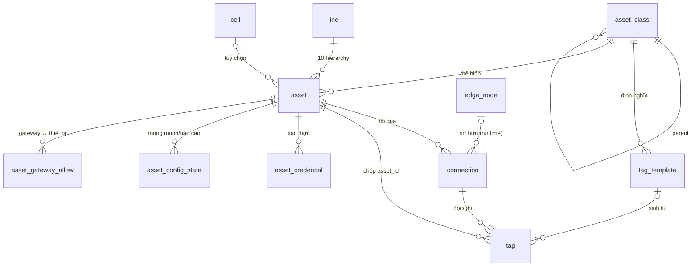

# 20 · Tài sản, lớp mẫu, kết nối, tag (asset)

| | |
|---|---|
| Mục tiêu phục vụ | M1 quản lý toàn diện, M2 giám sát realtime (trực tiếp); M3/M4/M5 (mọi dữ liệu, lệnh và AI đều neo vào asset + tag) |
| Phụ thuộc | 10 hierarchy (`asset.line_id`, `asset.site_id`) |
| Module phụ thuộc vào đây | 30 telemetry (tag → signal), 40 alarm (tag fault, asset), 50 control (tag writable, actuation_level, energy_direction), 60 inspection (asset AOI/AVI, api key), 70 engineering (recipe theo class), 80 ai (L‑7 đọc energy_direction), 90 twin (model 3D theo asset/class) |
| Mốc đo | `_ai8_wt d97f81c99` (2026-11-03), DB `aoi_management@5434` read-only |
| Trạng thái | **v1.1 — ĐÃ DUYỆT 2026-11-03** (8 câu hỏi §7 đã trả lời; từ vựng role tag §2.4 duyệt tại đây; mig 0470–0489) |

## 0. Phạm vi của module

Module này sở hữu **danh tính và cấu hình tĩnh** của mọi thiết bị trong nhà máy: thiết bị là gì (`asset`), thuộc lớp nào và lớp đó biết gì (`asset_class`, `tag_template`), nối tới nó bằng gì (`connection`), đọc/ghi điểm nào (`tag`), nó được xác thực ra sao (`asset_credential`), và cấu hình mong muốn/báo cáo (`asset_config_state`). Module này cũng sở hữu **wizard đưa thiết bị vào hệ thống** và **vòng đời tài sản**.

Module này **không** sở hữu: giá trị sống và tuổi dữ liệu (30), cảnh báo (40), ghi lệnh xuống thiết bị (50), hình học 3D (90 twin), bảng ánh xạ alarm vendor→chuẩn (40), recipe (70).

---

## 1. Hiện trạng đo được

### 1.1 Một thiết bị có tám đại diện

| Đại diện | Danh tính | Kết nối | Hàng `[đo]` | Nối với `machines` |
|---|---|---|---|---|
| `machines` (hierarchy.ts:269) | code, serialNumber, apiKey **plaintext unique**, urn | `ipAddress/port/connectionProtocol` (0/1 700 điền) | 1 700 | — |
| `device_adapters` (ot.ts:18) | code | protocol + endpoint + options + pollIntervalMs + status | 15 | `machineId` **không FK**, 15/15 có |
| `robots` (robot.ts:21) | code, vendor, kind | endpoint + options + pollIntervalMs (cùng khuôn adapter) | 3 | **không có machineId**; 210 máy `ROBOT*` không nối |
| `edge_nodes` (edge.ts:27) | code, factoryCode chuỗi | heartbeat | 3 (đều offline từ 16/07) | không; 67 máy `IOT_GATEWAY` song song |
| `equipment_3d_models` (twin.ts:45) | modelKey (**không unique** dù comment nói có) | — | 5 | `machineId` không FK |
| `workstations` | code | — | 0 | không |
| `mqtt_clients` (mqtt.ts:5) | clientId, deviceId Android | MQTT | 3 | `machineId` 0/3 |
| `field_device_health` | deviceKey `robot:\|machine:\|device:` | endpoint | 0 | không FK |

### 1.2 Tag có bốn bảng, lớp có bốn nguồn

| Khái niệm | Nguồn | Hàng | Vấn đề đo được |
|---|---|---|---|
| Tag | `device_tags` (ot.ts:74): address, dataType, scale/offset/deadband, writable, stop_value, + cột SCADA R1a (channel_kind, display_*, write_*, actuation_level) | 42 | `adapterId` không FK; `writable=false` 42/42; `channel_kind` NULL 42/42 |
| Tag | `uns_tag_mappings` (ot.ts:512): unsTopic, sparkplugMetric, `transform{rename,scale,offset,unit,cast,deadband}` | 15 | `tag` không FK; **lặp** scale/offset/deadband/unit của device_tags |
| Tag | `machine_sensor_readings.sensorType` | 3 loại | không có bảng định nghĩa |
| Tag | `scada_kenh_che_do (machine_id, adapter_id, tag_key)` | 0 | con trỏ bằng chuỗi `tag_key` |
| Lớp | `device_types` (equipmentStandards.ts:73): cây 5 cấp, attributesSchema, supportedCommands, supportedStates PackML, mappedMachineTypes | 31 (seed) | `machines.device_type_key` **NULL 1 112/1 700**, không FK |
| Lớp | `machinetypeenum` pg enum 24 giá trị (enums.ts:15) | — | cứng; thêm loại = ALTER TYPE |
| Lớp | `twin_kich_thuoc_loai` PK = machinetypeenum | 24 (đều `laGiaDinh`) | kích thước lớp nằm ở twin |
| Lớp | `capabilityModel.ts` 17 `EquipmentClass` + `DEFAULT_PROFILES` RAM | — | DB là bản chụp của hằng số mã; schema import type từ service (`equipmentStandards.ts:44`, ngược chiều phụ thuộc) |

`machine_template_versions` **không** phải lớp thiết bị (là phiên bản cây dạy đo theo máy × model sản phẩm) → thuộc module 60.

### 1.3 Kết nối và trạng thái sống

- Gateway OT: `otManager.startOt()` → `loadEnabledAdapters()` (deviceAdapter.ts:142) đọc `device_adapters.isEnabled`, loại adapter do edge sở hữu (`adapterOwnership.edgeNodeId`, **bảng bóng** `edgeControlSchema.ts:121`), nạp `device_tags`, tạo driver theo `protocol` (7 driver: stub, opcua, modbus, s7, mitsubishi-mc, ethernet-ip, slmp; 7 983 LOC) `[đo]`.
- **C3 xác nhận bằng số**: 15/15 adapter `status='disabled'`, `lastConnectedAt` NULL dù `isEnabled=true`. Nguyên nhân: `trangThaiAdapter.ts:75` chỉ ghi DB khi `OT_GHI_TRANG_THAI_ADAPTER_ENABLED === "true"`, cờ này và `OT_GATEWAY_ENABLED` không có trong `.env`. Trạng thái thật chỉ có ở RAM (`listOtAdapterStatuses`, qua `scadaDiag.danhSach`).
- Trạng thái kết nối có **6 nguồn**: `device_adapters.status`, RAM `trangThaiAdapter`, `connection_supervisor`, `machines.operationStatus/lastHeartbeat`, `mqtt_clients.connectionStatus`, `robots.status`, `edge_nodes.status`.
- UNS: `ingest.ts:80` ghép topic cứng `avi/0/workshop/ot/station/{adapter.code}/{tagKey}`; chỉ khi `UNS_MAPPING_ENABLED` mới tra `uns_tag_mappings`. `machines.urn/isa95_path` (591/1 700 có) **không được ingest dùng**. `contracts/mappings/` 0 tệp yaml.
- 576 triệu hàng `ot_telemetry` với 1 699 `deviceId` trong 7 ngày trong khi mọi adapter disabled ⇒ dữ liệu vào từ đường AOI/heartbeat/simulator với `deviceId = machine.code`, không từ gateway OT `[suy luận]`.

### 1.4 Lệch schema ↔ DB

- Cột có trong DB, không có trong Drizzle: `device_adapters.edgeNodeId, ownerEpoch`; `robots.edgeNodeId, motionLockGenerationFloor, ownerEpoch` (mig 0374, khai ở bảng bóng); `edge_nodes.protocolVersion, retiredAt, retiredBy, retireReason`.
- Bảng chỉ có SQL: `machine_claim_tokens` (554 hàng), `machine_enrollment_tokens` (1).
- `machine_operating_config` không tồn tại trong mã (chỉ trong DB, memory "CHƯA PUSH").
- Mọi bảng naive timestamp trừ `device_tags.stop_pinned_at`, `scada_*`, `twin_kich_thuoc_loai`.

### 1.5 Backend

| Khoá | Tệp | LOC | Thủ tục | Quyền | Client gọi |
|---|---|---|---|---|---|
| `machine` | hierarchyRouters.ts:917 | 1 118 | 33 (register/config/claimKey/enroll **public**; approve/reject; list*/getById; create/update/delete/restore; lifecycle; capabilities; uploadImage; layout) + `gatewayAllowlist` | settings_factory ×29, machine_control ×8, machine_registration ×1 | 92 |
| `deviceAdapter` | deviceAdapterRouter.ts | 1 002 | 11 (CRUD + testConnection + `tags.*` + setStopPin) | machine_control | 20 |
| `aoiOnboarding` | aoiOnboardingRouter.ts | 598 | 9 (draft, dryRun, signOff, decommission) | machine_monitoring | 6 |
| `equipment` | equipmentRouter.ts | 182 | 6 (registry RAM) | machine_monitoring | 5 |
| `equipmentStandards` | equipmentStandardsRouter.ts | 664 | 19 (device types, CR, **alarm taxonomy, master alarms** → 40) | machine_monitoring/control | 18 |
| `equipmentIntegration` | equipmentIntegrationRouter.ts | 551 | 13 (euromap, recipe versions → 70) | | 18 |
| `field` | fieldRouter.ts | 168 | 6 | | 6 |
| `robot` | robotRouter.ts | 921 | 15 | machine_control | 16 |
| `edgeRuntime` | edgeRuntimeRouter.ts | 195 | 9 | machine_control | 9 |
| `unsMapping` / `mappingAsCode` | 172 / 166 | | 6 / 5 | | 6 / **0** |
| `commissioning` | commissioningRouter.ts | 144 | 4 | admin_system | 5 |
| `machineContract` | 95 | | 3 | | 1 |
| `scadaKenh` / `scadaDiag` | 641 / 729 | | cheDo, tag, chẩn đoán | kySu (2FA + MOD_OT_CONTROL) | 12 / 10 |
| `mqttClientManagement` | 2 192 | | 50 | admin | 49 (đóng băng cùng FactoryAlert) |
| `machineApi` | machineApiRouters.ts | **6 747** | API máy gọi vào (thuộc 60) | | |

Service: `ot/` 17 610 + `ot/drivers/` 7 983 + `edge/` 16 001 + `robot/` 6 970 + `equipment/` 2 674 + `standards/` 2 290 + `field/` 841 + `assetRegistry/` 657 LOC `[đo]`.

### 1.6 Frontend

| Trang | LOC | Route | Việc | Commit cuối |
|---|---|---|---|---|
| DeviceHub + MachineWorkspace + MachineRail | 66 + 85 | `/device-monitor` | vỏ TabbedHub (field/fleet/health/oee) bọc cockpit | 07-19 |
| MachineCockpit | 1 425 | `/machine/:id` → redirect | 12 tab; **không xoá** (nhúng) | 09-18 |
| RobotCockpit / RobotControl | 1 012 / 626 | `/robot/:id`, `/robot-control` | 11 tab; **không xoá** / đóng băng | 09-18 / 10-14 |
| DeviceOnboardingHubV2 + MachineOnboardingWizard + Aoi/Automation/Iot branch | 157 + 108 + … | `/device-onboarding` | 3 lớp × wizard 5 bước (info, test, assign, deploy, verify) | 07-18 |
| MachineRegistration | 1 673 | `/machine-registration` | duyệt máy đăng ký, api key, claim token, lifecycle | 07-31 |
| EquipmentStandards | 2 093 | `/equipment-standards` | hierarchy lớp, alarms, CR, compliance | 10-05 |
| EquipmentIntegration | 1 164 | `/equipment-integration` | euromap/recipe | 10-09 |
| FieldDevices | 650 | `/field-devices` | health, discovery | 10-05 |
| UnifiedDeviceMonitor | 793 | `/device-adapters` | adapter + edge + secs + mtconnect | 11-01 |
| UnsMappingDesigner | 474 | `/uns-mapping` | | 07-31 |
| ScadaKenh / ScadaDiag / ScadaNhatKy | 155 / 263 / — | `/scada/*` | kênh, chế độ, chẩn đoán (luồng A2 đang làm) | 11-01 |
| ConnectivityHub + 8 trang MQTT | 192 + ~7 000 | `/connectivity` | MQTT client/profile (FactoryAlert) | 07-12 / 10-11 |
| DataSettings tab machines/enrollment-tokens | (2 028) | `/datasettings` | | |

Tổng bề mặt cấu hình thiết bị: ~12 trang ≈ 9 000 dòng (không kể MQTT ≈ 7 000 và cockpit).

---

## 2. Mục tiêu: mô hình dữ liệu

### 2.1 Năm thực thể canonical `[QĐ Q5 báo cáo + QĐ 2026-11-03]`



Quyết định thiết kế:

1. **`asset` là bảng duy nhất cho thiết bị vật lý** (`machines` + `robots` + máy `IOT_GATEWAY`; `kind = machine | robot | gateway | virtual`). `workstations`, `field_device_health` gỡ; `mqtt_clients` **không phải asset** (là thiết bị người dùng của app FactoryAlert, đóng băng cùng app).
2. **`edge_node` giữ bảng riêng**: nó là *runtime* của chính SYNAPSE chạy ở biên (sở hữu connection, có epoch), không phải thiết bị sản xuất. Thiết bị gateway vật lý (67 máy `IOT_GATEWAY`) là `asset.kind = gateway` và có thể trỏ `asset.edge_node_id` khi chính nó chạy edge runtime.
3. **`asset_class` thay cả bốn nguồn lớp.** `machinetypeenum` trở thành `asset_class.key` cấp lá (24 giá trị seed, giữ cột enum cũ trong chu kỳ chuyển); `twin_kich_thuoc_loai` nhập vào `asset_class.dims`; `capabilityModel.ts` DEFAULT_PROFILES trở thành **seed** của bảng, không phải registry RAM; `equipmentStandards.ts` không import type từ service nữa (kiểu đặt ở `shared/asset/`).
4. **`tag` là bảng duy nhất cho điểm dữ liệu**, gộp `uns_tag_mappings` (uns_topic/sparkplug_metric là cột override), `scada_kenh_che_do` tham chiếu `tag.id`, `machine_sensor_readings.sensorType` thành tag `source='mqtt'`. Mọi tag có `role` lấy từ `tag_template` để faceplate, alarm, AI hiểu nghĩa mà không tra tên.
5. **`connection` là bảng duy nhất cho kênh nối** (`device_adapters` + phần kết nối của `robots` + `machines.ipAddress/port/protocol`). Trạng thái sống ghi vào `connection_status` **mặc định bật**, điều tiết 5 s (đóng C3).
6. **Chứng thực tách bảng** `asset_credential` (api key **băm**, claim token, enrollment token); `machines.apiKey` plaintext bỏ sau chu kỳ chuyển 14 ngày `[QĐ 2026-11-03]`.
7. **Hướng năng lượng trên tag** (`energy_direction = up | down | neutral`) khai lúc cấu hình, là đầu vào của hàng rào L‑7 (50/80) thay cho suy từ tên lệnh.
8. UNS topic **dẫn xuất**: `{isa95_path}/{tag.key}`; `uns_topic` chỉ điền khi cần ghi đè. Ingest (30) đọc từ tag, không ghép chuỗi cứng.
9. Mọi cột thời gian `timestamptz`; mọi FK khai thật trong Drizzle (xoá bảng bóng `edgeControlSchema.ts`).

### 2.2 Đặc tả bảng

#### `asset_class`
Mục đích: mẫu thiết bị (UDT). Cây cha–con; phiên bản semver; trạng thái draft/published/archived.

| Cột | Kiểu | Null | Mặc định | Ràng buộc | Ghi chú |
|---|---|---|---|---|---|
| id | bigint identity | no | | PK | |
| key | varchar(64) | no | | unique `(key, version)` | = `device_types.typeKey`; lá seed = 24 giá trị machinetypeenum |
| parent_id | bigint | yes | | FK asset_class | cây Equipment → Robot/Inspection/TestCell/ProcessAutomation/IoTDevice → lá |
| version | varchar(16) | no | '1.0.0' | semver | |
| status | varchar(10) | no | 'draft' | `draft \| published \| archived` | chỉ `published` được gán cho asset mới |
| label | varchar(255) | no | | | tên hiển thị |
| description | text | yes | | | |
| attributes_schema | jsonb | no | '[]' | Zod `AssetClassAttribute[]` | = `device_types.attributesSchema` |
| commands | jsonb | no | '[]' | Zod `CommandDescriptor[]` | lệnh lớp hỗ trợ; mỗi lệnh có `energy_direction`, `actuation_level` mặc định |
| states | jsonb | no | '[]' | | PackML/E10 áp dụng |
| adapter_kind | varchar(32) | yes | | | protocol gợi ý |
| dims_mm | jsonb | yes | | `{w,h,d,is_default}` | từ `twin_kich_thuoc_loai` |
| default_model_3d_key | varchar(128) | yes | | | tham chiếu 90 twin |
| default_faceplate | varchar(64) | yes | | | mẫu faceplate (50) |
| origin | varchar(8) | no | 'manual' | `seed \| manual` | |
| site_id | bigint | yes | | FK site | NULL = lớp toàn hệ (seed); có = lớp riêng của site |
| deleted_at, created_at, updated_at | timestamptz | | | | |

Index: `uq_asset_class_key_version`, `idx_asset_class_parent`, `idx_asset_class_site`. RLS: policy `site_id IS NULL OR site_id = ANY(app.site_ids)`. Nguồn ghi: `asset.class.*`; seed `scripts/seed-asset-classes.mjs` (từ DEFAULT_PROFILES).

#### `tag_template`
Mục đích: tag mà một lớp "nên có"; sinh tag thật khi tạo connection.

| Cột | Kiểu | Null | Mặc định | Ràng buộc | Ghi chú |
|---|---|---|---|---|---|
| id | bigint identity | no | | PK | |
| class_id | bigint | no | | FK asset_class CASCADE | |
| role | varchar(32) | no | | unique `(class_id, role)` | từ vựng chuẩn: `run, fault, mode, count_ok, count_ng, speed, temperature, power, estop, cycle_time, …` (danh sách ở `shared/asset/tagRoles.ts`) |
| key_default | varchar(64) | no | | | tên tag mặc định |
| data_type | varchar(8) | no | | `bool \| int \| float \| string \| json` | |
| unit | varchar(16) | yes | | | |
| required | boolean | no | false | | thiếu ⇒ faceplate hiện "không có tín hiệu" (ràng buộc #7) |
| writable | boolean | no | false | | |
| energy_direction | varchar(8) | no | 'neutral' | `up \| down \| neutral` | |
| actuation_level | smallint | yes | | 1/3/4/5 | mặc định cho tag ghi |
| deadband, sampling_ms, display_format, write_min/max/step | | yes | | | mặc định |
| alarm_default | jsonb | yes | | | ngưỡng/ưu tiên mặc định (40 đọc) |

#### `asset`
Mục đích: thiết bị vật lý hoặc ảo; danh tính và vị trí trong cây.

| Cột | Kiểu | Null | Mặc định | Ràng buộc | Ghi chú |
|---|---|---|---|---|---|
| id | bigint identity | no | | PK | = `machines.id` khi di trú; robots.id ánh xạ sang id mới |
| site_id | bigint | no | | FK site | chép từ line |
| line_id | bigint | no | | FK line RESTRICT | **thay `stationId NOT NULL`** |
| cell_id | bigint | yes | | FK cell SET NULL | = `stationId` cũ |
| class_id | bigint | no | | FK asset_class RESTRICT | **thay `machineType` enum + `device_type_key`** |
| kind | varchar(10) | no | 'machine' | `machine \| robot \| gateway \| virtual` | |
| code | varchar(50) | no | | unique partial `(site_id, code) WHERE deleted_at IS NULL` | |
| name | varchar(255) | no | | | |
| serial_number | varchar(100) | yes | | index | |
| manufacturer, model, firmware_version | varchar | yes | | | |
| description | text | yes | | | |
| urn | text | yes | | unique partial live | `urn:syn:asset:{site}:{line}:{cell\|_}:{code}`; **sinh tự động**, NOT NULL sau backfill |
| isa95_path | text | yes | | index | sinh từ 10 hierarchy; NOT NULL sau backfill |
| lifecycle | varchar(16) | no | 'registered' | `registered \| commissioning \| active \| faulted \| maintenance \| decommissioned \| retired` | giữ máy chuyển tiếp của `MACHINE_LIFECYCLE_TRANSITIONS` |
| registration | varchar(10) | no | 'pending' | `pending \| approved \| rejected` | máy tự đăng ký |
| capabilities | jsonb | yes | | kiểm theo `class.attributes_schema` | = `machines.capabilities` (hiện NULL 100 %) |
| attributes | jsonb | no | '{}' | | thuộc tính theo lớp (vendor/kind của robot, IP quản trị của gateway…) |
| edge_node_id | bigint | yes | | FK edge_node SET NULL | gateway chạy edge runtime |
| owner_epoch | bigint | yes | | | từ mig 0374 (khai vào Drizzle) |
| sync_mode | varchar(8) | no | 'online' | | giữ |
| last_seen_at | timestamptz | yes | | | thay `lastHeartbeat` (giá trị sống chi tiết ở 30) |
| image_2d_key, image_3d_key | varchar | yes | | | ảnh đại diện (storage key; URL dẫn xuất) |
| deleted_at, created_at, updated_at | timestamptz | | | | |

Gỡ khỏi bảng: `apiKey` (→ credential), `ipAddress/port/connectionProtocol` (→ connection), `layoutPositionX/Y`, `layout` (→ 90 twin `twin_dat_cho`), `operationStatus` (→ 30 live), `pendingConfig` (→ config_state), `capabilitiesValidation` (→ cột `capabilities_valid_at` + bảng audit), `machineType`/`device_type_key` (→ class_id).
Index: `uq_asset_site_code_live`, `uq_asset_urn_live`, `idx_asset_line`, `idx_asset_class`, `idx_asset_lifecycle`, `idx_asset_serial`. RLS: có, FORCE. Nguồn ghi: `asset.*`, `asset.register` (public, máy), onboarding.

#### `edge_node`

| Cột | Kiểu | Null | Ghi chú |
|---|---|---|---|
| id, site_id FK, code unique live, name | | | thay `factoryCode` chuỗi |
| status | varchar(10) | no | `online \| offline \| degraded`; ghi bởi heartbeat |
| last_heartbeat_at, version, protocol_version | | yes | |
| health | jsonb | yes | |
| retired_at, retired_by, retire_reason | | yes | khai vào Drizzle (đang chỉ ở DB) |
| created_at, updated_at | timestamptz | | |

`assignedLineCodes jsonb` bỏ: quyền sở hữu đi qua `connection.edge_node_id`.

#### `connection`

| Cột | Kiểu | Null | Mặc định | Ràng buộc | Ghi chú |
|---|---|---|---|---|---|
| id | bigint identity | no | | PK | = `device_adapters.id` |
| site_id | bigint | no | | FK site | |
| asset_id | bigint | no | | FK asset RESTRICT | **thay `machineId` soft nullable** |
| code | varchar(50) | no | | unique partial `(site_id, code)` live | |
| name | varchar(255) | no | | | |
| protocol | varchar(24) | no | | `opcua \| modbus \| s7 \| mitsubishi-mc \| slmp \| ethernet-ip \| mqtt \| http \| vendor-robot \| stub` | thay pg enum; `vendor-robot` cho driver robot (đóng băng) |
| endpoint | text | no | | | |
| options | jsonb | no | '{}' | Zod theo protocol (`shared/asset/connectionOptions.ts`); HA secondary trong `.ha` | |
| poll_ms | int | no | 5000 | ≥ 100 | ràng buộc #11: mặc định 5 s không đổi |
| enabled | boolean | no | false | | |
| edge_node_id | bigint | yes | | FK edge_node SET NULL | NULL = trung tâm chạy |
| owner_epoch | bigint | yes | | | mig 0374 |
| commissioning | varchar(10) | no | 'none' | `none \| active \| revoked \| expired` | gộp `commissioning_records` (FAT); chi tiết ở bảng `connection_commissioning` giữ nguyên hàng cũ |
| created_by | bigint | yes | | FK users | |
| deleted_at, created_at, updated_at | timestamptz | | | | |

#### `connection_status` (runtime ghi, 1:1 với connection)

| Cột | Kiểu | Ghi chú |
|---|---|---|
| connection_id | bigint PK FK CASCADE | |
| state | varchar(12) | `disabled \| connecting \| connected \| lost \| error` |
| since | timestamptz | lúc vào trạng thái |
| last_ok_at, last_error_at | timestamptz | |
| last_error | text | |
| rtt_ms | int | |
| writer | varchar(32) | `central \| edge:{code}` |
| updated_at | timestamptz | |

Ghi **mặc định bật**, điều tiết 5 s; cờ `OT_GHI_TRANG_THAI_ADAPTER_ENABLED` bỏ. Mất kết nối ⇒ `lost` **và** module 30 sinh mẫu `quality=bad` cho mọi tag (C1, luồng A2 đang làm).

#### `tag`

| Cột | Kiểu | Null | Mặc định | Ràng buộc | Ghi chú |
|---|---|---|---|---|---|
| id | bigint identity | no | | PK | = `device_tags.id` |
| site_id | bigint | no | | FK site | |
| connection_id | bigint | no | | FK connection CASCADE | **FK thật** |
| asset_id | bigint | no | | FK asset | chép từ connection; index |
| template_id | bigint | yes | | FK tag_template SET NULL | sinh từ mẫu |
| role | varchar(32) | yes | | index | từ template; NULL = tag tự do |
| key | varchar(64) | no | | unique `(connection_id, key)` | |
| display_name | varchar(255) | yes | | | |
| address | text | no | | | theo driver |
| data_type | varchar(8) | no | | | |
| unit | varchar(16) | yes | | | |
| scale, offset | numeric(18,6) | yes | | | **một chỗ** (bỏ bản trong uns transform) |
| deadband | double | yes | | | |
| sampling_ms | int | yes | | | |
| enabled | boolean | no | true | | |
| source | varchar(8) | no | 'poll' | `poll \| push \| mqtt \| calc` | `mqtt` cho sensorType cũ |
| writable | boolean | no | false | | |
| channel_kind | varchar(20) | yes | | SCADA R1a | |
| write_min, write_max, write_step | numeric | yes | | | |
| actuation_level | smallint | yes | | 1/3/4/5 | |
| energy_direction | varchar(8) | no | 'neutral' | | L‑7 |
| display_format | varchar(32) | yes | | | |
| stop_value | jsonb | yes | | | giữ R1a |
| stop_pinned_by, stop_pinned_at | | yes | | | |
| uns_topic | text | yes | | | override; mặc định dẫn xuất |
| sparkplug_metric | varchar(128) | yes | | | |
| created_at, updated_at | timestamptz | | | | |

Gỡ: `uns_tag_mappings` (cột gộp), `machine_sensor_readings` (giá trị → 30 `signal_samples`, định nghĩa → tag), `scada_kenh_che_do.tag_key` → `tag_id`.

#### `asset_credential`

| Cột | Kiểu | Ghi chú |
|---|---|---|
| id, asset_id FK CASCADE, site_id | | |
| kind | varchar(10) | `api_key \| claim \| enroll` |
| token_hash | bytea/char(64) unique | sha-256; **không lưu plaintext** |
| token_prefix | varchar(12) | hiển thị |
| scopes | jsonb | enroll: scopes; api_key: quyền máy |
| serial_pattern | varchar(100) | enroll |
| max_uses, use_count | int | enroll |
| expires_at, used_at, used_from_ip, revoked_at | | |
| issued_by | bigint FK users | |
| created_at | timestamptz | |

Gộp `machines.apiKey`, `machine_claim_tokens` (554), `machine_enrollment_tokens` (1). Index partial "đang mở".

#### `asset_config_state` (= `machine_config_state`, đổi tên, thêm `site_id`, timestamptz)

#### `asset_gateway_allow` (= `gateway_device_allowlist`, đổi tên; giữ fail-closed)

#### `asset_onboarding` (= `aoi_commissioning_records` mở rộng cho mọi lớp)

| Cột | Ghi chú |
|---|---|
| id, site_id, asset_id FK | |
| status | `draft \| dry_run_ok \| commissioned \| decommissioned` |
| step | `class \| place \| connect \| tags \| credential \| verify` (bước wizard đang ở) |
| draft | jsonb (trạng thái wizard) |
| dry_run_result | jsonb (đọc thử từng tag: ok/giá trị/lỗi) |
| signed_by, signed_at | |
| created_by, created_at, updated_at | |

### 2.4 Từ vựng `role` của tag (`shared/asset/tagRoles.ts`) `[QĐ 2026-11-03: duyệt tại module này]`

Role là **nghĩa** của tag, độc lập với tên tag ở thiết bị. Faceplate (50), alarm (40), OEE (90), L‑7 (80) và mô phỏng (70) chỉ tra `role`. Nguồn đối chiếu: 14 key trong `scripts/sim-factory/topology.mjs`, cột SCADA R1a, PackML, census C-tag của scada-master (bổ sung khi có).

| Nhóm | role | Kiểu | Đơn vị | Ghi/đọc | energy_direction | Ghi chú |
|---|---|---|---|---|---|---|
| Trạng thái | `run` | bool | — | đọc | — | máy đang chạy; nguồn của PackML EXECUTE |
| | `state` | int/string | — | đọc | — | mã trạng thái PackML/E10 theo bảng ánh xạ của lớp |
| | `mode` | int/string | — | đọc | — | LOCAL/REMOTE/AUTO/MANUAL; thiếu ⇒ LOCAL (D3) |
| | `fault` | bool | — | đọc | — | **required** cho mọi lớp máy; thiếu ⇒ "không có tín hiệu" (D10) |
| | `fault_code` | int/string | — | đọc | — | mã lỗi vendor → `alarm_taxonomy` (40) |
| | `warning` | bool | — | đọc | — | |
| | `estop` | bool | — | đọc | — | trạng thái E-stop (chỉ hiển thị; không phải hệ an toàn) |
| | `heartbeat` | int/bool | — | đọc | — | đếm/đảo định kỳ; nguồn tuổi dữ liệu |
| | `ready` | bool | — | đọc | — | sẵn sàng nhận lệnh |
| Đếm | `count_total` | int | pcs | đọc | — | tổng chu kỳ (`cycle_count`) |
| | `count_ok` | int | pcs | đọc | — | (`good_count`, `cycle_ok`) |
| | `count_ng` | int | pcs | đọc | — | (`reject_count`) |
| | `ng_rate` | float | % | đọc/calc | — | có thể là tag `source=calc` |
| | `cycle_time` | float | s | đọc | — | |
| Quá trình | `speed` | float | theo lớp | đọc | — | (`speed`, `line_speed`) |
| | `temperature` | float | °C | đọc | — | |
| | `pressure` | float | kPa | đọc | — | |
| | `torque` | float | N·m | đọc | — | |
| | `position` | float | mm/° | đọc | — | trục; mô hình động học (70/90) dùng `position` + `attributes.axis` |
| | `vibration` | float | mm/s | đọc | — | |
| Năng lượng | `power_active` | float | kW | đọc | — | (`active_power`) |
| | `energy` | int/float | kWh | đọc | — | (`energy_kwh`), counter |
| | `power_factor` | float | — | đọc | — | |
| Lệnh (ghi) | `cmd_start` | bool | — | ghi | **up** | mức 4; chặn cứng cho AI (L‑7) |
| | `cmd_stop` | bool | — | ghi | **down** | mức 1–3; đường STOP riêng (50) |
| | `cmd_reset` | bool | — | ghi | **up** | mức 4 |
| | `cmd_hold` / `cmd_unhold` | bool | — | ghi | down / up | |
| | `setpoint` | float | theo lớp | ghi | **neutral** | mức 3; có `write_min/max/step`; nhiều setpoint ⇒ `attributes.name` |
| | `recipe_id` | int/string | — | ghi | neutral | mức 3; đổi recipe qua 70 |
| Nhận diện | `serial` | string | — | đọc | — | đối chiếu wizard bước 6 |
| | `product_code` | string | — | đọc | — | sản phẩm đang chạy |

Quy tắc: (1) role tuỳ chọn cho tag tự do, **bắt buộc** cho tag sinh từ mẫu; (2) một connection không có hai tag cùng role trừ khi khác `attributes.axis/name`; (3) thêm role mới = sửa `tagRoles.ts` + ghi Nhật ký module này, không thêm tự do trong DB; (4) `energy_direction` của tag ghi mặc định theo role, kỹ sư có thể siết lên mức cao hơn nhưng không nới.

### 2.3 Bảng gỡ / chuyển

| Bảng | Hành động |
|---|---|
| `robots` | gộp vào `asset(kind=robot)` + `connection(protocol=vendor-robot)`; cột `motionLockGenerationFloor` → `attributes`; **robot/AGV là thiết bị tự động hoá của nhà máy, giữ và phát triển sau** `[QĐ 2026-11-03]`: router robot tạm dừng (cờ tắt, không gỡ mã), dữ liệu di trú ngay để không còn bảng song song |
| `workstations`, `field_device_health`, `uns_tag_mappings`, `machine_sensor_readings` (định nghĩa), `config_snapshots` (0, drift → `asset_config_state`) | gỡ |
| `device_types`, `device_type_change_requests` | → `asset_class`, `asset_class_change` (giữ quy trình CR rút gọn: đề xuất → duyệt → publish bump semver) |
| `alarm_taxonomy`, `master_alarms` | → module 40 (không đổi tên ở đây) |
| `equipment_3d_models` | → 90 twin; thêm `asset_id FK`, unique `model_key` |
| `mqtt_clients`, `mqtt_subscriptions` | đóng băng cùng FactoryAlert; không phải asset |
| `machine_template_versions` | → 60 |
| `twin_kich_thuoc_loai` | → `asset_class.dims_mm`; bảng gỡ sau khi 90 twin đọc từ class |

---

## 3. Mục tiêu: backend

### 3.1 Namespace `asset.*`

| Procedure | Loại | Input | Output | Phạm vi | Audit | Thay cho |
|---|---|---|---|---|---|---|
| `asset.list` | protected | `{ nodeFilter?: {level,id}, classId?, kind?, lifecycle?, q?, page }` | hàng `{id, code, name, class{key,label}, kind, line{…}, lifecycle, registration, connectionCount, liveState? (30)}` | theo 10 | — | `machine.list/listPaged/listByStation`, `robot.list`, `equipment.listEquipment` |
| `asset.get` | protected | `{id}` | asset + class + connections[] (kèm status) + tags đếm + credentials (prefix) + configState + breadcrumb | có | — | `machine.getById`, `assetCockpit.machineDetail` (phần tĩnh) |
| `asset.search` | protected | `{q, limit}` | cho ⌘K/picker | có | — | — |
| `asset.create` | permission(asset_manage, create) | theo bảng; `classId` phải `published`; `lineId` trong phạm vi | asset | có | có | `machine.create` (roleProcedure) |
| `asset.update` | permission(asset_manage, edit) | | | | có | `machine.update` |
| `asset.move` | permission(asset_manage, edit) | `{id, lineId, cellId?}` | asset (urn/isa95_path mới) | | có | — |
| `asset.setLifecycle` | permission(asset_manage, edit) | `{id, to, reason}` | | | có | `machine.setLifecycleStatus`; chuyển sang `active` yêu cầu `onboarding.status=commissioned` **hoặc** `force` + admin |
| `asset.archive/restore` | permission(asset_manage, delete/edit) | | | | có | `machine.delete/restore` |
| `asset.approve/reject` | permission(asset_registration, edit) | `{id, lineId, classId}` | | | có | `machine.approve/reject` |
| `asset.register` | **public** (máy gọi, rate-limit) | như hiện tại | `{id, status}` | — | có | `machine.register` |
| `asset.config` | **public** (máy, xác thực bằng api key) | | cấu hình cho máy | — | — | `machine.config` |
| `asset.credential.issueApiKey/rotate/revoke` | admin | `{assetId}` | **plaintext một lần** | | có | `machine.regenerateApiKey` |
| `asset.credential.issueClaim/claimKey/issueEnroll/enroll/listTokens/revokeToken` | admin / public | giữ ngữ nghĩa hiện tại | | | có | `machine.issueClaimToken/claimKey/issueEnrollmentToken/enroll/...` |
| `asset.class.list/get/tree` | protected | | cây lớp + số asset mỗi lớp | | — | `equipmentStandards.hierarchyTree/resolveType`, `equipment.listDefaultProfiles`, `machine.listTypes` |
| `asset.class.create/update/publish/archive` | permission(asset_class_manage, …) | semver bump khi publish | | | có | `equipmentStandards.registerDeviceType` + CR |
| `asset.class.changeRequest.*` | permission(asset_class_manage) | rút gọn: `submit/review/publish` | | | có | `equipmentStandards.*ChangeRequest` |
| `asset.class.template.list/upsert/delete` | permission(asset_class_manage, edit) | tag_template | | | có | (mới) |
| `asset.class.validate` | protected | `{assetId}` | kết quả kiểm capabilities theo schema | | — | `machine.checkCapabilities`, drift scan |
| `asset.connection.list/get/create/update/archive` | permission(connection_manage, …) | theo bảng; create tuỳ chọn `fromTemplates: true` sinh tag | | | có | `deviceAdapter.*` |
| `asset.connection.test` | permission(connection_manage, view) | `{id}` hoặc `{draft}` | `{ok, rttMs, error?, readSample?}` | | — (ghi `control_audit` nếu chạm thiết bị thật) | `deviceAdapter.testConnection`, `robot.testConnection` |
| `asset.connection.status` | protected | `{ids[]}` | từ `connection_status` (DB) + RAM nếu là tiến trình gateway | | — | `scadaDiag.danhSach`, `edgeRuntime.status`, `field.health` |
| `asset.connection.reconnect/disable` | permission(connection_manage, edit) + 2FA | | | | có | `scadaDiag.ketNoiLai/tamTat` |
| `asset.tag.list/get/create/update/delete` | permission(connection_manage, …) | theo bảng | | | có | `deviceAdapter.tags.*`, `unsMapping.*`, `scadaKenh.danhSach/capNhat/khaiHangLoat` |
| `asset.tag.bulkFromTemplate` | permission(connection_manage, create) | `{connectionId, roles[]}` | tag[] | | có | — |
| `asset.tag.readOnce` | permission(connection_manage, view) | `{tagId}` | giá trị + chất lượng | | — | `scadaDiag.thuDocDiaChi` |
| `asset.tag.setStopPin` | actuation(5) | | | | có | `deviceAdapter.tags.setStopPin` |
| `asset.tag.previewUns` | protected | `{tagId}` | topic dẫn xuất + override | | — | `unsMapping.preview` |
| `asset.onboarding.start/saveStep/dryRun/signOff/decommission/get` | permission(asset_manage, create) ; signOff cần 2FA | wizard 6 bước | | | có | `aoiOnboarding.*`, `commissioning.*` |
| `asset.configState.list/setDesired/reportObserved` | permission / public (máy) | | | | có | `machineApi.config-sync` phần drift (60 giữ phần kết quả) |
| `asset.gateway.allowlist.get/set` | admin | giữ | | | có | `machine.gatewayAllowlist.*` |
| `asset.edgeNode.list/get/register/retire/heartbeat` | admin / public (edge) | | | | có | `edgeRuntime.*` |
| `asset.export/import` | admin | mapping-as-code yaml theo `contracts/mappings/README` | | | có | `mappingAsCode.*` (0 UI → thêm nút ở màn Tài sản) |

Quy tắc:
- Asset `kind=robot` và connection `vendor-robot`: procedure tồn tại nhưng `asset.connection.test/reconnect` trả `MODULE_PAUSED` khi `ROBOT_CONTROL_ENABLED=false`; robot/AGV phát triển sau, mô hình dữ liệu đã sẵn chỗ (`kind`, `attributes.vendor/kind`, `protocol=vendor-robot`).
- `asset.create` không nhận `apiKey`; chứng thực chỉ qua `credential.*`, plaintext trả **một lần**.
- `asset.setLifecycle(active)` kiểm `onboarding.commissioned`; `faulted` chỉ do runtime (30) đặt; `retired` là đích của archive.
- Sự kiện bus: `asset.changed {assetId, action}`, `asset.connection.changed`, `asset.tag.changed` ⇒ gateway OT (trung tâm hoặc edge sở hữu) **nạp lại connection đó** (hot reload, không restart toàn bộ); socket phòng `machine:{id}` phát `asset:changed`.
- Lỗi chuẩn như module 10; thêm `CLASS_NOT_PUBLISHED`, `TAG_ROLE_REQUIRED_MISSING` (khi `signOff` thiếu tag `required`), `CONNECTION_OWNED_BY_EDGE` (sửa connection do edge sở hữu phải qua edge sync).

### 3.2 Khoá quyền

| Khoá | Nghĩa | Mặc định |
|---|---|---|
| `asset_view` | xem asset/class/connection/tag trong phạm vi | mọi vai |
| `asset_manage` | tạo/sửa/lưu trữ asset, onboarding | engineer, admin |
| `asset_registration` | duyệt máy tự đăng ký | supervisor, engineer, admin |
| `asset_class_manage` | lớp và mẫu tag | engineer (đề xuất), admin (publish) |
| `connection_manage` | connection/tag; `reconnect/disable` thêm 2FA | engineer, admin |
| actuation(5) | `setStopPin` | theo 50 |

Thay `settings_factory` (phần máy), `machine_control` (phần cấu hình), `machine_monitoring` (phần đọc), `machine_registration`, `admin_system` (commissioning).

### 3.3 Runtime kết nối (trong module này chỉ phần *nạp cấu hình*; vòng đọc thuộc 30)

```mermaid
flowchart LR
  DB[(connection + tag)] -->|loadEnabled(owner=me)| GW[otManager / edge runtime]
  GW -->|createDriver(protocol)| DRV[driver 7 loại]
  DRV -->|state| CS[(connection_status)]
  DRV -->|samples + quality| T30[30 telemetry]
  BUS((bus asset.*.changed)) -->|hot reload 1 connection| GW
```

- `loadEnabled` lọc theo `connection.edge_node_id` (= tôi hoặc NULL cho trung tâm); bỏ bảng bóng.
- `createDriver` giữ `driverRegistry` 7 driver; `vendor-robot` đăng ký driver `notImplemented` khi robot đóng băng.
- Ghi `connection_status` mặc định bật; `OT_GATEWAY_ENABLED` vẫn là cờ hạ tầng (chủ dự án bật).
- Mapping-as-code: `contracts/mappings/{connection.code}.mapping.yaml` là dạng xuất/nhập của `connection + tag`, có CI `contract-gate` kiểm Zod.

### 3.4 Gỡ / đóng băng

| Thành phần | Hành động |
|---|---|
| `equipment` router + `services/equipment` registry RAM (2 674 LOC) | gỡ; profile thành seed `asset_class` |
| `equipmentStandards` phần alarm (`listAlarmMappings…alarmKpis`) | → 40 |
| `equipmentIntegration` (euromap, recipe) | recipe → 70; euromap/secs/mtconnect đóng băng (Q1) |
| `field` router + `services/field` | gỡ (health → `connection_status`; discovery bỏ ở v1 — QĐ 2026-11-03) |
| `robot` router, `services/robot` | **tạm dừng, không gỡ** (robot/AGV phát triển sau — QĐ 2026-11-03); khi mở lại phải đi qua `asset.connection` + dispatcher một cửa (50) |
| `edgeRuntime` | giữ, đổi namespace `asset.edgeNode.*`; `assignRun/syncRunResult` → 70 |
| `mappingAsCode` | → `asset.export/import` |
| `unsMapping` | gỡ (cột trên tag) |
| `machineContract` | giữ ở 60 (hợp đồng API máy) |
| `scadaKenh/scadaDiag` | **giữ nguyên tới khi A2 xong**, sau đó phần cấu hình kênh → `asset.tag.*`, phần chẩn đoán sống → 30; không chen trước hàng an toàn (ràng buộc #12) |
| `mqttClientManagement` + 8 trang MQTT | đóng băng cùng FactoryAlert |

---

## 4. Mục tiêu: frontend

### 4.1 Màn "Tài sản" — `/tai-san` (phần chi tiết thiết bị; phần cây ở module 10)

- Vùng: Dữ liệu chủ · Quyền: `asset_view` (xem), `asset_manage`/`connection_manage` (sửa)
- Khi chọn một asset trong `HierarchyTree`, khung phải hiện `AssetDetail`:
  - `PageHeader`: tên + code, `OriginBadge`, chip lifecycle, chip trạng thái kết nối tổng hợp (từ `connection.status`: n/m connected; dữ liệu cũ tím gạch theo ràng buộc #7), hành động `[Mở faceplate ↗ /giam-sat/may/:id] [Đổi vòng đời ▾] [Lưu trữ]`.
  - Tab **Tổng quan**: lớp (link), vị trí (breadcrumb), serial/hãng/model/firmware, ảnh đại diện, thuộc tính theo `class.attributes_schema` (form sinh từ schema, kiểm Zod), kết quả `class.validate`.
  - Tab **Kết nối & tag**: bảng connection (protocol, endpoint, poll, owner edge, trạng thái sống, `[Thử] [Kết nối lại] [Tạm tắt]`); chọn connection ⇒ bảng tag: role (icon + tên chuẩn), key, address, kiểu, đơn vị, writable/actuation/energy, UNS topic (dẫn xuất, nút ghi đè), `[Đọc thử]`; `[Sinh từ mẫu]` mở hộp chọn role còn thiếu; tag `required` thiếu hiện cảnh báo "lớp yêu cầu tag `fault`".
  - Tab **Chứng thực**: api key (prefix, ngày, `[Xoay]` hiện plaintext một lần có nút copy), claim/enroll token đang mở, `[Thu hồi]`.
  - Tab **Cấu hình**: `asset_config_state` theo loại (recipe/points/model/device_settings): mong muốn vs báo cáo, drift, `[Đẩy lại]`.
  - Tab **Mô hình 3D**: do 90 twin cung cấp (`Model3dPanel` nhúng).
  - Tab **Lịch sử**: audit asset + connection + tag.
- Trạng thái: asset `kind=robot` khi `ROBOT_CONTROL_ENABLED=false` hiện dải "Mô-đun robot/AGV sẽ phát triển sau; hiện chỉ xem".
- Thay cho: `MachineRegistration` (tab Chứng thực + hàng đợi duyệt dưới đây), `UnifiedDeviceMonitor` (phần cấu hình; phần sống → `/ket-noi` module 30), `UnsMappingDesigner`, `FieldDevices`, `EquipmentIntegration` (phần recipe → 70), `DataSettings` tab machines/enrollment-tokens, `RobotControl` (đóng băng, ẩn).
- i18n: `duLieuChu.taiSan.thietBi.*`.

### 4.2 Hàng đợi duyệt máy tự đăng ký — ngăn phủ trong `/tai-san`

Nút `[Chờ duyệt (n)]` ở PageHeader mở `ContextDrawer`: danh sách `registration=pending` (code, serial, IP nguồn, thời điểm), chọn ⇒ gán lớp + line ⇒ `asset.approve`. Thay `MachineRegistration` phần duyệt.

### 4.3 Wizard "Thêm thiết bị" — `/tai-san/them` (toàn màn, 6 bước)

| Bước | Nội dung | Procedure |
|---|---|---|
| 1 Lớp | chọn lớp từ cây `asset.class.tree` (chỉ published); mô tả lớp, tag mẫu, lệnh | — |
| 2 Vị trí | `NodePicker` line (+ cell tuỳ chọn), code (gợi ý), tên, serial | `asset.onboarding.start` ⇒ tạo asset `lifecycle=registered` |
| 3 Kết nối | protocol (gợi ý từ class.adapter_kind), endpoint, options theo protocol (form Zod), poll (mặc định 5 000), owner (trung tâm/edge); `[Thử kết nối]`. Không có quét mạng ở v1 `[QĐ 2026-11-03]` | `asset.connection.test` (draft), `asset.connection.create` |
| 4 Tag | bảng tag sinh từ `tag_template` (tích chọn, sửa address), thêm tag tự do; `[Đọc thử tất cả]` ⇒ cột giá trị/chất lượng | `asset.tag.bulkFromTemplate`, `asset.tag.readOnce` |
| 5 Chứng thực | nếu lớp là máy tự gửi (AOI/AVI/ICT…): phát claim/enroll token hoặc api key; nếu không: bỏ qua | `asset.credential.*` |
| 6 Nghiệm thu | `dryRun`: đọc tất cả tag ≥ 30 s, kiểm tag `required` có dữ liệu `good`, kiểm serial khớp (nếu máy báo), kết quả bảng ✓/✗; `[Ký nghiệm thu]` (2FA) ⇒ `commissioned`, lifecycle → `active` | `asset.onboarding.dryRun/signOff` |

Lưu nháp từng bước; thoát giữa chừng ⇒ asset ở `registered` với `onboarding.step`. Thay `DeviceOnboardingHubV2` + 3 nhánh + `MachineOnboardingWizard` + `aoiOnboarding` + `commissioning`.

### 4.4 Màn "Lớp thiết bị" — `/tai-san/lop`

- Quyền: `asset_view` / `asset_class_manage`.
- Bố cục: trái cây lớp (Equipment → nhóm → lá; badge số asset), phải chi tiết lớp: tab **Thuộc tính** (attributes_schema editor dạng bảng), **Tag mẫu** (role, kiểu, đơn vị, required, writable, energy, actuation), **Lệnh & trạng thái**, **Kích thước & mô hình 3D mặc định**, **Phiên bản & thay đổi** (CR: đề xuất → duyệt → publish bump).
- Thay `EquipmentStandards` tab hierarchy/crs/compliance (tab alarms → 40).

### 4.5 Component dùng chung (`components/asset/`)

| Component | Nhiệm vụ |
|---|---|
| `AssetPicker` | chọn asset theo phạm vi (dùng ở recipe, interlock, báo cáo, Thợ Cả) |
| `ClassBadge`, `LifecycleChip`, `ConnectionStateChip` | hiển thị chuẩn (token ISA; dữ liệu cũ tím gạch) |
| `TagRoleIcon` + `TagTable` | bảng tag chuẩn (dùng lại ở faceplate 50, chẩn đoán 30) |
| `SchemaForm` | form sinh từ `attributes_schema`/`connection options` (Zod → UI) |
| `DryRunPanel` | bảng đọc thử tag (wizard, chẩn đoán) |

Giữ `MachineCockpit`, `RobotCockpit` (ràng buộc #15): sau di trú chúng đọc `asset.get` thay `assetCockpit.machineDetail` phần tĩnh; faceplate chính thức thuộc 50.

---

## 5. Di trú từ hiện trạng

Dải migration: **0470–0489** `[QĐ 2026-11-03: duyệt]`. Thứ tự: A1 → A2 → A3 → A4 → (A5 ∥ A6) → A7 → A8. A2–A4 chạm DB thật ⇒ dieu-phoi duyệt SQL; không chen trước A2 SCADA với bảng `device_tags`/`scada_*` (A4 chờ A2(o)+1a lên main).

| Bước | Nội dung | Tương thích | Nghiệm thu |
|---|---|---|---|
| **A1** Đưa DB về Drizzle | khai 7 cột 0374 + 4 cột edge_nodes vào schema; `machine_claim_tokens`, `machine_enrollment_tokens` thành pgTable; unique `equipment_3d_models.modelKey`; xoá bảng bóng `edgeControlSchema.ts` | không đổi API | 0 cột/bảng ngoài Drizzle trong miền này `[đo]` |
| **A2** `asset_class` + `tag_template` | tạo bảng; seed từ `device_types` (31) + `DEFAULT_PROFILES` + `twin_kich_thuoc_loai` (24); `machines.class_id` backfill từ `device_type_key` rồi từ `machineType` (1 112 NULL); `tag_template` seed từ `attributesSchema` + từ vựng role | `machineType` giữ, trigger đồng bộ | 1 700/1 700 có `class_id`; 24 lá; 0 asset lớp `draft` |
| **A3** `asset` cột mới + `connection`/`tag` FK | `machines.line_id` (từ 10 H2), `kind`, `attributes`, `edge_node_id/owner_epoch`, timestamptz; `device_adapters.machineId NOT NULL` + FK; `device_tags.adapterId` FK + `role/template_id/energy_direction/source/uns_topic/sparkplug_metric`; backfill `uns_tag_mappings` → cột tag; `connection_status` tạo và **bật ghi mặc định** | API cũ giữ | 15/15 connection có FK; 42/42 tag FK; `connection_status` có hàng cho mọi connection enabled trong ≤ 10 s sau boot `[đo]` |
| **A4** Robots → asset | 3 robots thành asset `kind=robot` + connection `vendor-robot`; 210 máy `ROBOT*` giữ nguyên (đã là machines); bảng `robots` thành view; router robot đọc view | router robot đóng băng | `robots` view trả đúng 3 hàng; test robot* xanh |
| **A5** Namespace `asset.*` + alias | router mới; `machine/deviceAdapter/aoiOnboarding/equipmentStandards(phần lớp)/edgeRuntime/unsMapping/mappingAsCode/commissioning/field` thành wrapper; khoá quyền mới alias cũ | hoàn toàn | census xanh; snapshot output cũ không đổi |
| **A6** Chứng thực băm | `asset_credential`; backfill claim/enroll token; api key: **xoay bắt buộc** (plaintext cũ không băm được ⇒ giữ cột `apiKey` đọc-only một chu kỳ, máy nào gọi bằng key cũ được ghi log để kỹ sư xoay) | chu kỳ chuyển 1 phát hành | 0 máy dùng key cũ trong 14 ngày ⇒ drop cột |
| **A7** Frontend | `AssetDetail` + wizard + màn Lớp + `components/asset/`; redirect 8 route cũ; `MachineCockpit/RobotCockpit` đọc `asset.get` | route cũ redirect | §6 |
| **A8** Dọn | gỡ `equipment`, `field`, `unsMapping`, `uns_tag_mappings`, `workstations`, `field_device_health`, `config_snapshots`, `machine_sensor_readings` (sau 30 chuyển giá trị), `device_types` (view), enum `machinetypeenum` (sau 60/90 đổi); đổi tên `machines→asset`, `device_adapters→connection`, `device_tags→tag`, `edge_nodes→edge_node` + view tên cũ | view một chu kỳ | 0 tham chiếu tên cũ ngoài view |

Phụ thuộc chéo: A3 cần 10-H2 (`line_id`); 30 cần A3 (`tag.role`, `connection_status`); 50 cần A3 (`energy_direction`, `actuation_level`); 90 twin cần A2 (`dims_mm`).

---

## 6. Tiêu chí nghiệm thu module

| # | Tiêu chí | Cách đo |
|---|---|---|
| N1 | Một bảng thiết bị: `robots`, `workstations`, `field_device_health` không còn là bảng (view hoặc gỡ); 0 cột `machineId` soft trong miền | schema lint |
| N2 | 100 % asset có `class_id` published, `line_id`, `urn`, `isa95_path` | SQL |
| N3 | 100 % connection có FK asset; 100 % tag có FK connection + `asset_id` đúng; 0 bản sao scale/offset/deadband | SQL + test |
| N4 | **C3 đóng**: ngắt mạng tới simulator ⇒ `connection_status.state='lost'` trong ≤ 10 s, DB (không chỉ RAM); khôi phục ⇒ `connected` | test tích hợp với simulator :5020/:4840 |
| N5 | Ingest (30) dùng `tag.uns_topic` dẫn xuất từ `isa95_path`; 0 chuỗi topic cứng `avi/0/workshop` trong `server/` | grep |
| N6 | Wizard 6 bước thêm được một máy mô phỏng OPC UA từ đầu tới `commissioned` không rời màn; dry-run bắt được tag `required` thiếu | Playwright + simulator |
| N7 | API key plaintext = 0 cột sau A6; `asset.credential.issueApiKey` trả plaintext đúng một lần | test |
| N8 | 12 trang cấu hình thiết bị → 3 màn (`/tai-san` chi tiết, `/tai-san/them`, `/tai-san/lop`); route cũ redirect | đếm route |
| N9 | Hot reload: sửa tag ⇒ gateway nạp lại đúng 1 connection, không restart; thời gian ≤ 5 s | log + test |
| N10 | `energy_direction`/`actuation_level` điền cho 100 % tag `writable` (hiện 0 tag writable; khi A2 SCADA thêm) | SQL |
| N11 | Lớp màu thô trong `components/asset/`, `pages/du-lieu-chu/*` = 0 | grep |
| N12 | Mapping-as-code: export → import lại cho 15 connection cho kết quả byte-identical | script |

---

## 7. Câu hỏi mở — đã trả lời `[QĐ 2026-11-03]`

| # | Câu hỏi | Quyết định | Hệ quả |
|---|---|---|---|
| 1 | `edge_node` bảng riêng? | **Giữ riêng** | §2.1 QĐ2 |
| 2 | Di trú `robots` vào `asset` ngay dù module robot tạm dừng? | **Robot/AGV vẫn là thiết bị tự động hoá của nhà máy; không bỏ, phát triển sau** | A4 di trú dữ liệu ngay; router/service robot tạm dừng bằng cờ, không gỡ; khi mở lại đi qua `asset.connection` + dispatcher một cửa |
| 3 | API key băm, xoay key 550 máy trong 14 ngày? | **Chấp nhận chu kỳ 14 ngày** | A6 |
| 4 | `connection_status` ghi mặc định bật, bỏ cờ? | **Đồng ý** | §2.2, A3; đóng C3 |
| 5 | `machinetypeenum` → `asset_class.key`, enum cũ song song tới khi 60/90 đổi? | **Đồng ý** | A2, A8 |
| 6 | Từ vựng role tag duyệt ở đâu? | **Duyệt tại đây** | §2.4 (31 role, 6 nhóm) có hiệu lực; census C-tag bổ sung qua Nhật ký |
| 7 | Dải migration 0470–0489 | **Đồng ý** | §5 |
| 8 | Quét mạng trong wizard? | **Bỏ ở v1** theo khuyến nghị | §4.3 bước 3; `field.discover` gỡ |

---

## 8. Nhật ký

| Ngày | Phiên | Việc | Số đo |
|---|---|---|---|
| 2026-11-03 | chu-du-an-HST | Viết v1 từ kiểm kê read-only `_ai8_wt d97f81c99` + DB live | 8 đại diện thiết bị; 4 bảng tag; 4 nguồn lớp; 15/15 adapter "disabled" do cờ; 12 trang ≈ 9 000 dòng; ~55k LOC service |
| 2026-11-03 | chủ dự án + chu-du-an-HST | **Duyệt v1.1**: 8 câu hỏi §7; robot/AGV giữ, phát triển sau; api key băm 14 ngày; connection_status mặc định bật; từ vựng role tag §2.4; mig 0470–0489; bỏ quét mạng | — |
